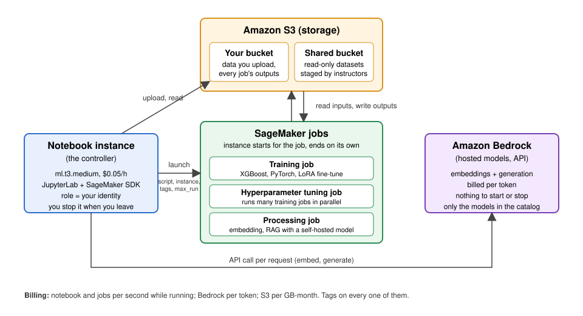
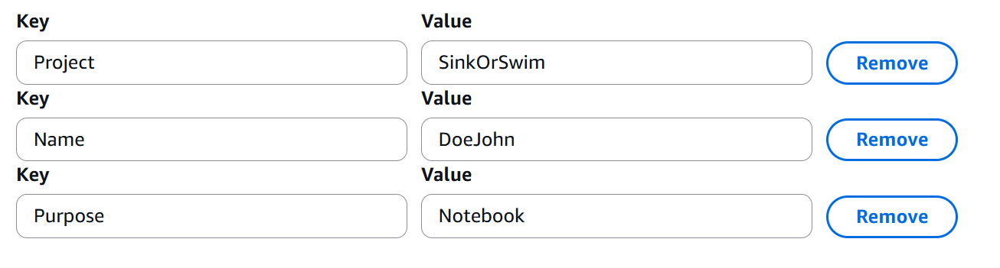

:::::::::::::::::::::::::::::::::::::: questions 

- How do you set up and use SageMaker notebooks for machine learning tasks?
- How can you manage compute resources efficiently using SageMaker's controller notebook approach?

::::::::::::::::::::::::::::::::::::::::::::::::

::::::::::::::::::::::::::::::::::::: objectives

- Explain why the lesson works from a SageMaker notebook instance, and what the controller pattern is.
- Create a tagged notebook instance on a small instance type, open the lesson notebooks in it, and stop it when done.

::::::::::::::::::::::::::::::::::::::::::::::::

## Setting up our notebook environment
In this episode we set up the **SageMaker notebook instance** that every later episode runs from.

### What a SageMaker notebook instance is
A **SageMaker notebook instance** is a virtual machine that AWS runs for you with JupyterLab already installed, a set of Python kernels that come with the AWS SDKs (`boto3` and the SageMaker Python SDK), and an IAM role attached that decides what the code running on it may do in your account. You create it from the console and open JupyterLab in a browser tab. Compute is billed per second while it is running and not while it is stopped. The instance's disk is separate: the files you keep under `/home/ec2-user/SageMaker/` survive a stop, and that storage volume keeps billing at about `$0.14` per GB-month (about `$0.70` a month for the default 5 GB) until the instance is deleted.

### Using the notebook as a controller
The notebook instance is a *controller*: a small, cheap machine where you write code and use the **SageMaker Python SDK** to launch larger instances for model training, batch processing, and hyperparameter tuning. Those instances start, run your script, write their results to S3, and shut themselves down, so you pay for powerful hardware only for the minutes a job needs it.

{alt="Diagram from the overview episode: S3 buckets at the top, the notebook instance on the left launching SageMaker training, tuning and processing jobs, and Bedrock on the right"}

The notebook is the box on the left of the diagram from the overview episode. Everything else in the picture is launched or called from it, and every later episode uses this same instance.

### Why we work from a notebook instance in this lesson
The SageMaker SDK runs anywhere Python does, so the lesson could be run from a laptop. We use a notebook instance for four reasons:

- **No credential setup.** The IAM role attached to the instance authorizes every call made from it, so there is nothing to install or log in to. Working from a laptop is not hard, `aws configure sso` and `aws sso login` take a few minutes, but in a room of a hundred people that is a hundred setups, plus SSO sessions expiring mid-episode and the occasional person pasting an access key instead. The role sidesteps all of it.
- **Everyone has the same environment.** The kernels, the SDK version and the paths are identical for every learner, so a cell that works for the instructor works for you.
- **Instructors can see what happened.** Every notebook instance in the shared account shows up in the console, and an instructor can open yours and see the notebook that launched a job, with its outputs. Jobs launched from a laptop are just as visible in the job list, but the code that launched them is on your machine, so when something breaks or a charge looks wrong there is less to go on.
- **No egress charges.** AWS bills data transfer when it leaves AWS, not when it moves within a region. The notebook instance sits in the same region as your bucket, so reading or downloading files from S3 to the instance is free. Pulling the same files to a laptop costs `$0.09` per GB wherever the laptop is: "region" means the AWS data center your resources live in, and a machine outside AWS is never in one.

We'll follow these steps to create our first "SageMaker notebook instance".

#### 1. Navigate to SageMaker
- In the AWS Console, search for **SageMaker**.
- Recommended: Select the star icon next to **Amazon SageMaker AI** to save SageMaker as a bookmark in your AWS toolbar 
- Select  **Amazon SageMaker AI**

#### 2. Create a new notebook instance
- In the SageMaker left-side menu, click on **Notebook instances**, then click **Create notebook instance**.
- **Notebook name**: the same words as your bucket, capitalised: `Challenge-LastnameFirstname`, e.g. `SinkOrSwim-DoeJohn`. One instance serves the whole workshop; the individual `.ipynb` notebooks inside it are where the per-episode work lives. SageMaker allows letters, digits and hyphens (no spaces or underscores, up to 63 characters); capitals are fine here and in tags, only bucket names must be lowercase. This name is also reused as the prefix of every training job you launch from the notebook, which is how you will find your jobs in a shared account.
- **Instance type**: sets the CPU, memory and price of the virtual machine. Our notebook is a controller, so pick a small one: `ml.t3.medium` (2 vCPU, 4 GB RAM, `$0.05`/hour). The jobs we launch from it will run on more powerful instances; the supplemental [Instances for ML](https://carpentries-incubator.github.io/ML_with_AWS_SageMaker/instances-for-ML.html) page compares them.
- **Platform identifier**: This is an internal AWS setting related to the environment version and underlying platform. You can leave this as the default.
- **Additional configuration (leave collapsed)**: holds the **Volume size in GB** of the instance's persistent disk, default 5 GB. The default is enough for this lesson; the disk is the one thing a stopped instance keeps billing for, so do not make it larger than you need.
- **Permissions and encryption**:
   - **IAM role**: For this workshop, we have pre-configured the "ml-sagemaker-use" role to enable access to AWS services like SageMaker, with some restrictions to prevent overuse/misuse of resources. Select the "ml-sagemaker-use" role. Outside of the workshop, you create/select a role that includes the `AmazonSageMakerFullAccess` policy.
   - **Root access**: Determines whether the user can run administrative commands within the notebook instance.  You should **Enable root access** to allow installing additional packages if/when needed.  
   - **Encryption key (skip)**: While we won't use this feature for the workshop, it is possible to specify a KMS key for encrypting data at rest if needed. 
- **Network (skip)**: Networking settings are optional. Configure them if you're working within a specific VPC or need network customization.
- **Git repositories configuration (skip)**: You don't need to complete this configuration. Instead, we'll run a clone command from our notebook later to get our repo setup. This approach is a common strategy (allowing some flexiblity in which repo you use for the notebook).
- **Tags (NOT OPTIONAL)**: the same three keys you put on your bucket, with the same values except `Purpose`. Tags never propagate from one resource to another, so the instance needs its own copy; the previous episode's callout on why these keys and no others applies here too.

  | Key | Value |
  |---|---|
  | `Project` | your challenge name (`SinkOrSwim`, `WattBot2026`, `BadgerScribe`, `BadgerCode`, ...), e.g. `SinkOrSwim` |
  | `Name` | your name, e.g. `DoeJohn` |
  | `Purpose` | what this resource is for, `Notebook` |

  {alt="Screenshot showing the three required tags on a SageMaker notebook instance"}

- Click **Create notebook instance**.

### Load pre-filled Jupyter notebooks
The new instance appears in the list with status `Pending`; after a few minutes it changes to `InService`. Once it does, click **Open JupyterLab** next to it. In JupyterLab, create a new notebook with the `conda_python3` kernel (we aren't training anything yet, so the plain Python environment is enough).

In the new notebook, run:

```sh
!pwd
!ls ..
```

The first line prints `/home/ec2-user/SageMaker`: new notebooks start in that folder. The second lists its parent, the instance's home directory, which holds AWS's own setup: the `anaconda3` folder with the conda environments behind the kernel list, AWS's `sample-notebooks`, and a pile of license files. `SageMaker/` is the one folder that is different. It is a separate disk, the volume whose size sits under **Additional configuration** on the create form (5 GB by default). Everything else in the home directory lives on the system disk and is reset when the instance stops; `SageMaker/` is the only place that survives a stop. JupyterLab's file browser opens there for that reason, and it is where everything in this lesson goes.

Now clone the lesson repository into it:

```sh
!git clone https://github.com/carpentries-incubator/ML_with_AWS_SageMaker.git
```

Then open `ML_with_AWS_SageMaker/notebooks/04_Accessing-S3-via-SageMaker-notebooks.ipynb` from the file browser to begin the first notebook.

### At the end of class: stop the instance

A notebook instance bills for every second it is **InService**. At the end of class, go to **Notebook instances**, select yours and choose **Stop**. Your files under `/home/ec2-user/SageMaker` (including the repos you clone) survive a Stop and are there when you start it again; packages you `pip install` are not, so expect to reinstall them. When the workshop is over, **Delete** the instance: a stopped instance still bills for its storage volume (`$0.14` per GB-month), and the cleanup episode walks through this.

::::::::::::::::::::::::::::::::::::: keypoints 

- Use a minimal SageMaker notebook instance as a controller to manage larger, resource-intensive tasks.
- The notebook does not do the heavy computation; later episodes use it to launch training, tuning and processing jobs on separate instances.
- Every resource gets the same three tags; they never propagate, so each new resource needs its own.
- Stop the notebook instance at the end of class, and delete it when the workshop is over.

::::::::::::::::::::::::::::::::::::::::::::::::
