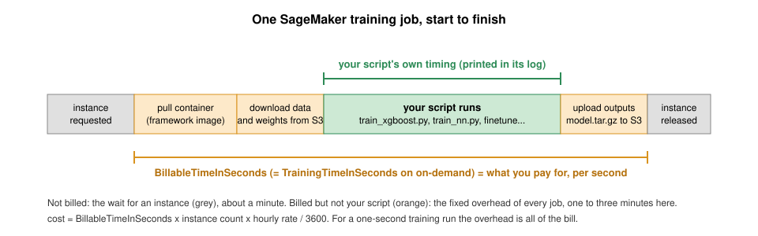

:::::::::::::::::::::::::::::::::::::: questions 

- What are the differences between local training and SageMaker-managed training?
- What is a SageMaker training job, and what does it cost?
- How do you estimate what a training job will cost before launching it, and check what it cost afterwards?

::::::::::::::::::::::::::::::::::::::::::::::::

::::::::::::::::::::::::::::::::::::: objectives

- Understand the difference between training locally in a SageMaker notebook and using SageMaker's managed infrastructure.
- Launch a training job with the `XGBoost` estimator: your script, AWS's container, a rented instance.
- Tell apart the two ways to run XGBoost on SageMaker, your script in AWS's container versus AWS's built-in algorithm in the same container, and know when each fits.
- Conduct training with data stored in S3 and monitor training job status using the SageMaker console.
- Estimate the cost of a job before launching it, tag it so it shows up on the bill, and read back its billable time afterwards.

::::::::::::::::::::::::::::::::::::::::::::::::

Open the notebook from: `/ML_with_AWS_SageMaker/notebooks/06_Training-models-in-SageMaker-notebooks.ipynb`. When asked for a kernel, pick **`conda_pytorch`**; every notebook from here to the end of the lesson uses it. The `conda_python3` kernel has no PyTorch, and on current instances no scikit-learn either.

## Test on a small sample first, then scale up

The Titanic data trains in a second on the notebook, and nothing about it needs the cloud. We use it because the pattern matters more than the example. Test the code on a small sample first, where a bug costs nothing, and once it works, scale up to a more powerful instance when the data or the model calls for one. A SageMaker training job is that scale-up step. The notebook describes the job and launches it, and SageMaker rents the instance, runs the script on it and releases it when the script ends. The fine-tuning episode follows the same two steps with a 3B model on a GPU, where the cloud earns its keep.

This episode walks through both steps once with XGBoost. First the script runs on the notebook, to check that it handles the data and the arguments. Then the same script runs as a training job, with the data supplied from S3, and we look at how the job receives its inputs, where it writes its model, how to estimate its cost before launching and how to read the billable time afterwards.

## Initial setup


### Set up the project folder
Work from the Titanic project folder the S3 episode created, and make the lesson repository's `scripts/` importable. The training scripts for this episode (`train_xgboost.py`) and the next (`train_nn.py`) are in that folder.

```python
# The Titanic project folder from the S3 episode, beside the lesson clone: downloads and outputs land here, not in the repository
!mkdir -p /home/ec2-user/SageMaker/titanic
%cd /home/ec2-user/SageMaker/titanic
import sys
# Put the lesson's scripts/ folder on Python's import path
sys.path.insert(0, "/home/ec2-user/SageMaker/ML_with_AWS_SageMaker/scripts")
import helpers  # lesson helper functions; train_xgboost.py lives in the same folder
```

### Connect to SageMaker and S3
The notebook needs two interfaces to AWS. `boto3` reads and writes S3 and inspects resources directly, and the SageMaker SDK provides the higher-level objects that launch training jobs. We also look up the notebook's IAM role, which the jobs use to read their inputs and write their outputs.

#### Boto3 API
> Boto3 is the AWS SDK for Python: every AWS service, called from Python, with the notebook's role as the identity.

```python
import boto3                          # AWS SDK for Python: low-level access to every AWS service (S3, EC2, ...)
import pandas as pd
import os
os.environ["SAGEMAKER_SUPPRESS_V2_WARNING"] = "1"   # the SDK otherwise prints a deprecation notice on import and on every estimator
import sagemaker                      # SageMaker Python SDK: higher-level API for training jobs, tuning, deployment
import logging
logging.getLogger("sagemaker.telemetry.telemetry_logging").setLevel(logging.WARNING)   # silence the telemetry notice; the "Creating training-job" line still prints
logging.getLogger("sagemaker.image_uris").setLevel(logging.WARNING)
logging.getLogger("sagemaker.config").addFilter(lambda record: record.levelno >= logging.WARNING)   # drop the two "Not applying SDK defaults" lines; a filter holds even where the SDK resets the logger's level
from sagemaker import get_execution_role

# Initialize the SageMaker role (will reflect notebook instance's policy)
role = sagemaker.get_execution_role()  # the IAM role attached to this notebook instance; every call below acts as this role
print(f'role = {role}')

# Initialize an S3 client to interact with Amazon S3, allowing operations like uploading, downloading, and managing objects and buckets.
s3 = boto3.client('s3')

# Define the S3 bucket that we will load from
bucket_name = 'sinkorswim-doejohn'  # replace with your S3 bucket name

# Define train/test filenames
train_filename = 'titanic_train.csv'  # object keys inside the bucket (no prefix: they sit at the bucket root)
test_filename = 'titanic_test.csv'
```

Create a SageMaker session to manage interactions with Amazon SageMaker, such as training jobs, model deployments, and data input/output. The region comes from the notebook instance itself, so the same notebook works in any account.

```python
region = boto3.Session().region_name  # inherited from the notebook instance; do not hard-code a region
session = sagemaker.Session()         # tracks the region, default bucket and SageMaker client for this notebook
sagemaker_client = session.sagemaker_client  # the boto3 SageMaker client inside the session; we'll use it to describe jobs
print(f"region = {region}")
```

## Check the training script before launching a job
A training job runs your script on a machine SageMaker rents for it, so the script has to work before it is worth renting anything. Run it here first, on the notebook instance, on the small Titanic data. If it crashes here, it costs nothing. If it crashes as a job, you still pay for the minutes the instance spent starting up. Every later episode does the same, a few epochs on a subset on the cheapest machine, then the real run.

::::::::::::::::::::::::::::::::::::::: challenge

### Understanding the XGBoost Training Script

Take a moment to review the `ML_with_AWS_SageMaker/scripts/train_xgboost.py` script cloned in the controllers episode. This script handles preprocessing, training, and saving an XGBoost model, while also adapting to both local and SageMaker-managed environments.

Try answering the following questions:

1. **Data Preprocessing**: What transformations are applied to the dataset before training?

2. **Training Function**: What does the `train_model()` function do? Why do we print the training time?

3. **Command-Line Arguments**: What is the purpose of `argparse` in this script? How would you modify the script if you wanted to change the number of training rounds?

4. **Handling Local vs. SageMaker Runs**: How does the script determine whether it is running in a SageMaker training job or locally (within this notebook's instance)?

5. **Training and Saving the Model**: What format is the dataset converted to before training, and why? How is the trained model saved, and where will it be stored?

After reviewing, discuss any questions or observations with your group.

::::::::::::::::::::::::::::::::::::::: solution

### Solution

1. **Data Preprocessing**: The script fills missing values (`Age` with median, `Embarked` with mode), converts categorical variables (`Sex` and `Embarked`) to numerical values, and removes columns that don't contribute to prediction (`Name`, `Ticket`, `Cabin`).

2. **Training Function**: The `train_model()` function takes the training dataset (`dtrain`), applies XGBoost training with the specified hyperparameters, and prints the training time. Printing training time is what the SageMaker runs are compared against.

3. **Command-Line Arguments**: `argparse` allows passing parameters like `max_depth`, `eta`, `num_round`, etc., at runtime without modifying the script. To change the number of training rounds, you would update the `--num_round` argument when running the script:  `python train_xgboost.py --num_round 200`

4. **Handling Local vs. SageMaker Runs**: The script uses `os.environ.get("SM_CHANNEL_TRAIN", ".")` and `os.environ.get("SM_MODEL_DIR", ".")` to detect whether it's running in SageMaker. `SM_CHANNEL_TRAIN` is the directory where SageMaker stores input training data, and `SM_MODEL_DIR` is the directory where trained models should be saved. If these environment variables are *not set* (e.g., running locally), the script defaults to `"."` (current directory).

5. **Training and Saving the Model**: The dataset is converted into **XGBoost's `DMatrix` format**, which is optimized for memory and computation efficiency. The trained model is saved with XGBoost's own `save_model()` as `xgboost-model.json`, stored either in the SageMaker `SM_MODEL_DIR` (if running in SageMaker) or in the local directory. The JSON format can be loaded by any later XGBoost version, which matters here because the SageMaker container and the notebook kernel do not run the same version.

:::::::::::::::::::::::::::::::::::::::::::::::::::::

:::::::::::::::::::::::::::::::::::::::::::::::::::::

### Download data into notebook environment
For this test we download copies of the Titanic files from S3 onto the notebook instance. The managed job later reads its own input from S3 and never uses these local copies.

:::: callout
We download the data into the notebook to test the code, as a local pipeline would. In a pipeline that scales, the data lives in S3 and the jobs read it from there. 
:::::

Run the following cells to download the training and test CSVs. If the files do not appear in the Jupyter file browser, refresh it. A permissions error usually means the notebook role or the bucket policy does not allow the requested S3 operation.

```python
# Define the S3 bucket and file location
file_key = f"{train_filename}"  # Path to your file in the S3 bucket
local_file_path = f"./{train_filename}"  # Local path to save the file

# Download the file using the s3 client variable we initialized earlier
# This writes a copy to the instance's disk, unlike get_object, which reads the object into memory
s3.download_file(bucket_name, file_key, local_file_path)
print("File downloaded:", local_file_path)
```

We can do the same for the test set.

```python
# Define the S3 bucket and file location
file_key = f"{test_filename}"  # Path to your file in the S3 bucket
local_file_path = f"./{test_filename}"  # Local path to save the file

# Download the file
s3.download_file(bucket_name, file_key, local_file_path)
print("File downloaded:", local_file_path)
```

#### Logging runtime & instance info
To compare our local runtime with future experiments, we'll need to know what instance was used, as this will greatly impact runtime in many cases. We can extract the instance name for this notebook using...

```python
# Replace with your notebook instance name.
# This does NOT refer to specific ipynb files, but to the SageMaker notebook instance.
notebook_instance_name = 'SinkOrSwim-DoeJohn'

# Describe the notebook instance (sagemaker_client was created from our session above)
response = sagemaker_client.describe_notebook_instance(NotebookInstanceName=notebook_instance_name)

# Display the status and instance type
print(f"Notebook Instance '{notebook_instance_name}' status: {response['NotebookInstanceStatus']}")
local_instance = response['InstanceType']  # e.g. ml.t3.medium; recorded so runtimes can be compared across instances
print(f"Instance Type: {local_instance}")
```

#### Helper:  `get_notebook_instance_info()` 
You can also use the `get_notebook_instance_info()` function found in the lesson's `scripts/helpers.py` to retrieve this info for your own project.

```python
helpers.get_notebook_instance_info(notebook_instance_name, region)
```

Test `train_xgboost.py` on this notebook's instance (or, when possible, on your own machine) before doing anything more complicated (e.g., hyperparameter tuning on multiple instances)

```python
!pip install xgboost scikit-learn   # neither notebook kernel ships scikit-learn; the script imports both
```

### Local test

Run the training script here in the notebook first, on the small data, with the hyperparameters passed in as variables. A local run finds bugs for free, and the same script then runs unchanged as a SageMaker job.

```python
import time as t # we'll use the time package to measure runtime

start_time = t.time()

# Define your parameters. These python vars wil be passed as input args to our train_xgboost.py script using %run

max_depth = 3 # Sets the maximum depth of each tree in the model to 3. Limiting tree depth helps control model complexity and can reduce overfitting, especially on small datasets.
eta = 0.1 #  Sets the learning rate to 0.1, which scales the contribution of each tree to the final model. A smaller learning rate often requires more rounds to converge but can lead to better performance.
subsample = 0.8 # Specifies that 80% of the training data will be randomly sampled to build each tree. Subsampling adds randomness between trees, which reduces overfitting.
colsample_bytree = 0.8 # Specifies that 80% of the features will be randomly sampled for each tree, enhancing the model's ability to generalize by reducing feature reliance.
num_round = 100 # Sets the number of boosting rounds (trees) to 100. More rounds typically allow for a more refined model, but too many rounds can lead to overfitting.
train_file = 'titanic_train.csv' #  Points to the location of the training data

# %run executes the script in this kernel; IPython substitutes the Python variables in {braces} into the arguments
%run /home/ec2-user/SageMaker/ML_with_AWS_SageMaker/scripts/train_xgboost.py --max_depth {max_depth} --eta {eta} --subsample {subsample} --colsample_bytree {colsample_bytree} --num_round {num_round} --train {train_file}

# Measure and print the time taken
print(f"Total local runtime: {t.time() - start_time:.2f} seconds, instance_type = {local_instance}")
```

The run takes seconds. The script prints its own training time, and the cell prints the total including data loading; both numbers are the baseline the SageMaker runs below are compared with.

### Sanity check: Quick evaluation on test set
Nothing here is SageMaker specific: apply the model to the test set on the notebook instance to check that it trained properly.

Score the model you just trained locally on the test set, reusing the script's own `preprocess_data` so the test rows are transformed exactly as the training rows were.

```python
import xgboost as xgb
import pandas as pd
import numpy as np
from sklearn.metrics import accuracy_score
from train_xgboost import preprocess_data  # importable because scripts/ is on sys.path

# Load the test data
test_data = pd.read_csv('./titanic_test.csv')

# Preprocess the test data using the imported preprocess_data function
X_test, y_test = preprocess_data(test_data)

# Convert the test features to DMatrix for XGBoost
dtest = xgb.DMatrix(X_test)

# Load the trained model from the saved file
model = xgb.Booster()
model.load_model('./xgboost-model.json')  # the file the local %run wrote to the current directory

# Make predictions on the test set
preds = model.predict(dtest)
predictions = np.round(preds)  # Round predictions to 0 or 1 for binary classification

# Calculate and print the accuracy of the model on the test data
accuracy = accuracy_score(y_test, predictions)
print(f"Test Set Accuracy: {accuracy:.4f}")
```

A reasonably high test set accuracy suggests our code/model is working correctly.

## Run the script as a SageMaker training job

Now that the script is checked, we submit it to SageMaker. The notebook sends the job configuration, the training code, the instance type, the S3 location of the data and where the output goes. SageMaker starts a separate instance, runs the script in AWS's XGBoost container, saves the model to S3 and releases the instance when the job ends. The notebook stays free for launching and inspecting jobs. It is not the machine doing the training.

### Which instance to start with?
The Titanic data and the XGBoost model are small, so we start with one `ml.m5.large` CPU instance. The point is to learn how job configuration and billing work, not to make this tiny model train faster. For larger datasets, instance memory and CPU count matter, and the [Instances for ML page](https://carpentries-incubator.github.io/ML_with_AWS_SageMaker/instances-for-ML.html) is the place to start choosing.

::::::::::::::::::::::::::::::::::::: challenge

### Challenge: pick an instance for a bigger job

Open the supplemental [Instances for ML](https://carpentries-incubator.github.io/ML_with_AWS_SageMaker/instances-for-ML.html) page. A colleague has a **20 GB tabular dataset** (a CSV of sensor readings) and wants to train gradient-boosted trees on it, like we are about to do with the Titanic data. Which instance would you pick for the training job, and why?

:::::::::::::::::::::::::::::::::::: solution

The table's rule of thumb is RAM of at least 1.5× the dataset, so 20 GB of data wants about 32 GB of memory: `ml.m5.2xlarge` (8 vCPU, 32 GiB, about `$0.46`/h) is the natural fit for a tree-ensemble training job, or `ml.m5.4xlarge` (64 GiB) if feature engineering will add many columns. No GPU: gradient-boosted trees on tabular data are CPU work, so a `g4dn` or `g5` would cost more and run no faster.

::::::::::::::::::::::::::::::::::::::::::::::::

::::::::::::::::::::::::::::::::::::::::::::::::

### Estimators
Every training job runs inside a container image. The `XGBoost` class we use below is a *framework estimator*: it looks up AWS's prebuilt XGBoost image for the region and runs your script inside it. `PyTorch`, `SKLearn`, `TensorFlow` and `HuggingFace` are the same idea for other frameworks, each with a `framework_version` that picks the image, and a `requirements.txt` in `source_dir` is pip-installed in the container before the script starts, for packages the image lacks. The plain `Estimator` class takes an `image_uri` directly and is for a container of your own, or for one of AWS's built-in algorithms, which train with AWS's code and no script of yours; the optional challenge at the end of this episode runs XGBoost that way for comparison. The [list of prebuilt images](https://docs.aws.amazon.com/sagemaker/latest/dg/pre-built-containers-frameworks-deep-learning.html) says what each one has installed.

### Launching the training job
We configure an `XGBoost` estimator to run the same `train_xgboost.py` we tested above. The estimator describes the training environment. Its `hyperparameters` become command-line arguments, and `TrainingInput` tells SageMaker which data to copy from S3. Before launching we set the cost-tracking tags and estimate how long the instance will be billed. The full code is below, with explanation after it.

#### Cost tracking
When you launch a SageMaker training job from a notebook, SageMaker creates new managed resources (EC2 instances, attached storage, logs) on your behalf. These resources do not automatically inherit the notebook instance's tags. 

So we tag each training job at launch time, with the same three keys as the bucket and the notebook instance.

```python
name = "DoeJohn" # replace with your name
project = "SinkOrSwim"   # your challenge: WattBot2026, BadgerScribe, BadgerCode, BrainDecoding, PoisonedWell or SnapshotWI; SinkOrSwim is the workshop itself
purpose = "Training"        # one of: Storage, Notebook, Training, Tuning, Inference

# Tags: key/value labels attached to the job's resources, so its cost shows up under your name and project on the bill
job_tags = [
    {"Key": "Name", "Value": name},
    {"Key": "Project", "Value": project},
    {"Key": "Purpose", "Value": purpose},
]
helpers.check_launch(job_tags)   # the account's rules, checked here first: AWS's own refusal does not say which rule
print(f"Name: {name}, Project: {project}, Purpose: {purpose}")
```

#### Estimate before you launch
Estimate the cost of every job *before* you run it: instance rate x expected minutes, plus two or three minutes of startup. Two things happen before your script runs, and only one of them is billed. First SageMaker finds an instance for you: that is *provisioning*, it takes a minute or so, and it is free. Then the instance pulls the training container and downloads your data: that is *startup*, and the meter is running. An `ml.m5.large` costs about `$0.115`/hour (us-east-1 on-demand; see the [Instances for ML page](https://carpentries-incubator.github.io/ML_with_AWS_SageMaker/instances-for-ML.html)). Our local test finished in under a minute, so the estimate is a few seconds of training plus two or three minutes of startup: about three billable minutes, under a cent.

One thing to watch in the estimator below is `hyperparameters`. It is how values get from this notebook into the script. SageMaker turns the dictionary into command-line flags, `--train titanic_train.csv --max_depth 3 --eta 0.1 ...`, and appends them to the command that starts `train_xgboost.py` inside the container, exactly as `%run` passed them a moment ago; the script's `argparse` block reads them. So the keys must be the script's argument names, and a key the script has no flag for makes `argparse` exit with "unrecognized arguments", which fails the job. (The job's log prints the full command, under "Invoking script with the following command", which is the place to look when a value does not seem to arrive.)

```python
from sagemaker.inputs import TrainingInput
from sagemaker.xgboost.estimator import XGBoost   # framework estimator: AWS's XGBoost container running your own script

# Define instance type/count we'll use for training
instance_type="ml.m5.large"   # the managed machine SageMaker launches for the job, separate from this notebook's instance
instance_count=1 # always start with 1; the next episode shows what a second instance does
price_per_hour = 0.115 # ml.m5.large, us-east-1 on-demand (2026-10-16), from the Instances for ML page; check it for your region

# The runtime cap, in seconds: SageMaker stops the job and releases the instance when it is reached. Set it a little above the estimate;
# the estimate here is three or four minutes, so 20 minutes leaves room for a slow container pull without letting a hung job bill for hours.
max_run = 20*60 # 20 minutes

# Define S3 paths for input and output
train_s3_path = f's3://{bucket_name}/{train_filename}'  # an S3 URI: bucket plus key; SageMaker takes input in this form

# we'll store all results in a subfolder called xgboost on our bucket. This folder will automatically be created if it doesn't exist already.
output_folder = 'xgboost'
output_path = f's3://{bucket_name}/{output_folder}/'   # S3 prefix (a "folder") where SageMaker uploads the job's outputs

helpers.check_launch(job_tags, instance_type, max_run)   # tags, instance type and cap against the account's rules, before anything is sent

# The XGBoost framework estimator: AWS's XGBoost container, running our script
xgboost_estimator = XGBoost(
    base_job_name=f"{notebook_instance_name}-xgboost",   # prefix of the job name: who + which model; SageMaker appends a timestamp to make it unique
    max_run=max_run, # in seconds; always include (max 48 hours)
    entry_point='train_xgboost.py',      # the script SageMaker runs inside the container on the training instance
    source_dir='/home/ec2-user/SageMaker/ML_with_AWS_SageMaker/scripts',  # Directory where your script is located (uploaded to the job with it)
    role=role,                           # the job assumes this role to read its input and write its output in S3
    tags=job_tags,                       # the cost-tracking tags defined above
    instance_count=instance_count,
    instance_type=instance_type,
    output_path=output_path,
    sagemaker_session=session,
    framework_version="1.7-1",           # XGBoost container version
    hyperparameters={                    # passed to the script as command-line arguments: --train ..., --max_depth ...
        'train': train_file,
        'max_depth': max_depth,
        'eta': eta,
        'subsample': subsample,
        'colsample_bytree': colsample_bytree,
        'num_round': num_round
    }
)

# Define input data
# TrainingInput: where the data is and its format; SageMaker copies it onto the training instance before the script runs
train_input = TrainingInput(train_s3_path, content_type='csv')

# Measure and start training time
start = t.time()
# fit() launches the job and blocks until it finishes (wait=False would return at once); the 'train' channel becomes SM_CHANNEL_TRAIN
xgboost_estimator.fit({'train': train_input})
end = t.time()

print(f"Runtime for training on SageMaker: {end - start:.2f} seconds, instance_type: {instance_type}, instance_count: {instance_count}")
```

While a job runs, its status is on the console under [Training jobs](https://us-east-2.console.aws.amazon.com/sagemaker/home?region=us-east-2#/training). For a job too long to sit through, see "Launching a job without waiting for it" below.

::::::::::::::::::::::::::::::::::::: callout

### If the launch is refused

The account checks every launch against a short list of rules, and refuses one that breaks any of them with an `AccessDeniedException` ending in `with an explicit deny in an identity-based policy`. The rules: the three tags `Name`, `Project` and `Purpose` must be present, `Name` must not be blank, `Project` must be one of SinkOrSwim, WattBot2026, BadgerScribe, BadgerCode, BrainDecoding, PoisonedWell, SnapshotWI, `Purpose` must be Storage, Notebook, Training, Tuning or Inference, the instance type must be one the lesson uses, the runtime cap must be 48 hours or less, and endpoints and EC2 instances cannot be created at all. The instance list is single-GPU types only, and that is deliberate: with the 48-hour cap, the most one hung job can bill on the largest allowed type is about `$125`, where a four-GPU box would be `$340` to `$1,200`.

The error message does not say which rule was broken. AWS does not let an administrator attach an explanation to a refusal. The lesson's helper module does the explaining instead. `helpers.check_launch(job_tags, instance_type, max_run)` checks a launch against the same rules before it is sent and says what to change; the tag cell above and every launch in the later episodes call it. `helpers.rules()` prints the rules. `helpers.explain_refusal()` is for afterwards: it reads the refused requests of the last hour from CloudTrail, the account's log of every API call, and says which rule each one broke. All three read the rules from `scripts/guardrails.json`, the same file the administrator attached to the account, so they cannot disagree with it. A launch that passes `check_launch` and is still refused is almost always a missing `tags=job_tags` line on the estimator. The [If a Launch Is Refused](../learners/refused-launch.md) page has all of this on one page for your own notebooks after the workshop.

::::::::::::::::::::::::::::::::::::::::::::::::

#### Hyperparameters
The `hyperparameters` section in this code defines the input arguments of `train_xgboost.py`. The first is the name of the training input file, and the others are hyperparameters for the XGBoost model, such as `max_depth`, `eta`, `subsample`, `colsample_bytree`, and `num_round`.

#### TrainingInput
Additionally, we define a TrainingInput object containing the training data's S3 path, to pass to `.fit({'train': train_input})`. SageMaker uses `TrainingInput` to download your dataset from S3 to a temporary location on the training instance. This location is mounted and managed by SageMaker and can be accessed by the training job if/when needed.

#### What did that cost?

{alt="Timeline of a SageMaker training job showing the unbilled wait for an instance and the billed phases from container pull to model upload"}
`describe_training_job` returns `BillableTimeInSeconds`: the seconds the instance was yours, from container pull to model upload, per instance. The minute or so before that, while SageMaker finds an instance, is not billed. (The job's console page also shows a "Training time"; on an on-demand instance it is the same number, and neither one is your script's own training time, which only the script's log has. The two lines the SDK prints when `fit()` returns, `Training seconds` and `Billable seconds`, are the same pair: they differ only on spot instances, which this lesson does not use, so read either one.) SageMaker bills per second, with no rounding, so cost is billable seconds x instance count x hourly rate. We'll wrap this in a small helper and call it after every job in this lesson.

```python
def job_cost_report(job_name: str, price_per_hour: float):
    desc = session.sagemaker_client.describe_training_job(TrainingJobName=job_name)  # the job's full record: status, timings, resources, output
    if "BillableTimeInSeconds" not in desc:   # the job has not finished: no bill yet
        print(f"{job_name}: status {desc['TrainingJobStatus']}; billable time and the model path appear once it is Completed")
        return desc
    n = desc["ResourceConfig"]["InstanceCount"]
    billable = desc["BillableTimeInSeconds"] * n   # BillableTimeInSeconds: container pull to model upload, charged per instance
    wall = (desc["TrainingEndTime"] - desc["CreationTime"]).total_seconds()   # from the launch request to the end, including unbilled provisioning
    print(f"{job_name}: status {desc['TrainingJobStatus']}, wall-clock {wall/60:.1f} min, billable {billable/60:.1f} min on {n} instance(s), cost ${billable/3600*price_per_hour:.3f} at ${price_per_hour}/h")
    print(f"    model: {desc['ModelArtifacts']['S3ModelArtifacts']}")   # the model.tar.gz this job uploaded to output_path
    return desc

desc = job_cost_report(xgboost_estimator.latest_training_job.name, price_per_hour)  # latest_training_job: the job fit() just ran
```

The `model:` line is where the trained model went. Everything else the job wrote sits next to it under the same prefix; list it straight from the notebook:

```python
# Everything the job wrote, straight from S3: the model tarball plus the profiler's small files
job_prefix = f"{output_folder}/{xgboost_estimator.latest_training_job.name}/"
for obj in s3.list_objects_v2(Bucket=bucket_name, Prefix=job_prefix).get("Contents", []):
    print(f"{obj['Size'] / 1024:8.1f} KB  s3://{bucket_name}/{obj['Key']}")
```

Compare this with the estimate you made above. The job's log (scroll up in the `fit()` output) shows the script itself trained in a fraction of a second, yet the bill is about two minutes. The rest is container pull, data download and model upload: the fixed overhead of every job, the same whether you train for one minute or one hour. The extra minute between calling `fit()` and the first billed second is SageMaker finding an instance, which is free.

#### What landed in S3
The listing above is what you would see in the [S3 console](https://us-east-2.console.aws.amazon.com/s3/home?region=us-east-2); open it once to see the same thing the console's way.

In **your bucket**, under `xgboost/<job-name>/` (the prefix from `output_path` plus the job name):

1. `output/model.tar.gz`: the model artifacts, a tarball of whatever the script saved to `SM_MODEL_DIR` (here `xgboost-model.json`). This is the file we download below.
2. `profiler-output/` and `debug-output/`: small files from SageMaker's profiler and debugger, written for every training job. Ignore them; `disable_profiler=True` and `debugger_hook_config=False` on the estimator turn them off.

The job's log is not in S3. It is in **CloudWatch**, the AWS service that stores the printed output of every job: everything the script prints goes to a CloudWatch *log stream* named after the job, and it stays there after the instance is gone. To read it: open [Training jobs](https://us-east-2.console.aws.amazon.com/sagemaker/home?region=us-east-2#/training), click the job's name, scroll to **Monitor** and click **View logs**, then click the one stream listed. What you see is the same text `fit()` streamed into the notebook, which is useful the day a job you launched last night failed while the kernel was off.

A **second bucket** also appeared, `sagemaker-<region>-<account-id>`. The SageMaker SDK creates this *default bucket* the first time it needs somewhere to stage files: before the job started, `fit()` zipped `source_dir` and uploaded it there as `<job-name>/source/sourcedir.tar.gz` for the training instance to download. It holds kilobytes per job and nothing you need, but it is shared by everyone in the account and carries no tags, so it is one more thing on the cleanup list. If you want everything in your own bucket, create the session as `sagemaker.Session(default_bucket=bucket_name)`.

### Extracting trained model from S3 for final evaluation
To evaluate the model on a test set after training, we'll go through these steps:

1. **Download the trained model from S3**.
2. **Load and preprocess** the test dataset. 
3. **Evaluate** the model on the test data.

The code below:

- Download the `model.tar.gz` file containing the trained model from S3.
- Load the `titanic_test.csv` data we downloaded earlier and preprocess it as needed.
- Use the XGBoost model to make predictions on the test set and then compute accuracy or other metrics on the results. 

If additional metrics or custom evaluation steps are needed, you can add them in place of or alongside accuracy.

```python
# Model results are saved in auto-generated folders. Use xgboost_estimator.latest_training_job.name to get the folder name
# Key of the model artifact: <output prefix>/<job name>/output/model.tar.gz, a tarball of whatever the script saved to SM_MODEL_DIR
model_s3_path = f'{output_folder}/{xgboost_estimator.latest_training_job.name}/output/model.tar.gz'
print(model_s3_path)
local_model_path = 'model.tar.gz'

# Download the trained model from S3
s3.download_file(bucket_name, model_s3_path, local_model_path)

# Extract the model file
import tarfile
with tarfile.open(local_model_path) as tar:
    tar.extractall()
```

Now the same evaluation on the model the job trained: load it from the unpacked archive and score the test set the same way as before.

```python
import xgboost as xgb
import pandas as pd
import numpy as np
from sklearn.metrics import accuracy_score
from train_xgboost import preprocess_data

# Load the test data
test_data = pd.read_csv('./titanic_test.csv')

# Preprocess the test data using the imported preprocess_data function
X_test, y_test = preprocess_data(test_data)

# Convert the test features to DMatrix for XGBoost
dtest = xgb.DMatrix(X_test)

# Load the trained model from the saved file (the container's XGBoost 1.7 wrote it; the kernel's newer XGBoost reads it)
model = xgb.Booster()
model.load_model('./xgboost-model.json')

# Make predictions on the test set
preds = model.predict(dtest)
predictions = np.round(preds)  # Round predictions to 0 or 1 for binary classification

# Calculate and print the accuracy of the model on the test data
accuracy = accuracy_score(y_test, predictions)
print(f"Test Set Accuracy: {accuracy:.4f}")
```

## Monitoring training

The job's page in the console has everything the notebook printed and more. Open [Training jobs](https://us-east-2.console.aws.amazon.com/sagemaker/home?region=us-east-2#/training); the list is the whole account's, so find yours by name, `SinkOrSwim-DoeJohn-xgboost-<timestamp>`, and click it.

- **Status**: `InProgress`, `Completed`, `Failed` or `Stopped`.
- **View logs**, under **Monitor**: the job's printed output in CloudWatch, kept after the instance is gone. **Job Metrics** next to it shows CPU, GPU and memory use over the run.
- **Output**: the S3 path of the model artifact.
- **Stop**, under **Actions**: ends the job and its billing. Check the name first; the list has other people's jobs in it.

## Launching a job without waiting for it

Everything `fit()` waited for happened on the job's instance, not this one. Once SageMaker has the request, the job pulls its container, trains, uploads the model to S3 and writes its log to CloudWatch, and none of that needs this notebook. `wait=True`, the default, only makes the cell block and stream the log here, which is fine for a four-minute job. For a run of hours it means sitting on a blocked cell, or leaving a notebook instance running all night so that a cell can watch a log you could read in CloudWatch.

`wait=False` returns as soon as the job is accepted. Run the next cell, or stop the notebook instance and go home; the job runs the same either way.

```python
# Launch and return at once: the cell ends in seconds, and the job runs on its own instance
xgboost_estimator.fit({'train': train_input}, wait=False)
job_name = xgboost_estimator.latest_training_job.name
print("launched:", job_name)
```

While it runs, its status and log are on its page under [Training jobs](https://us-east-2.console.aws.amazon.com/sagemaker/home?region=us-east-2#/training), from any browser. When it finishes, the model is in S3 under `output_path`, whether or not anything was watching. To read its status and bill from a notebook, the same call as before:

```python
desc = job_cost_report(job_name, price_per_hour)   # prints the status while the job runs; the bill and the model path once it is Completed
```

If the notebook instance was stopped in between, the kernel's variables are gone, so set `job_name` from the printed output or from the Training jobs list before running that cell. `xgboost_estimator = XGBoost.attach(job_name, sagemaker_session=session)` rebuilds the estimator from the job's record, waiting for the job if it is still running, if you want the evaluate cells above to work as before.

Interrupting the cell, restarting the kernel and stopping the instance all leave the job running. Only **Stop** on the job's page, or the job's own cap, ends it. A job you launched and forgot bills until one of those happens. Two estimator settings limit what that can cost.

### For any run longer than half an hour

**A cap you chose.** `max_run` is the most a job can bill, in seconds, and every estimator in this lesson sets it. Put it a little above your estimate, twice the estimate is a fair margin, and never above the account's 48-hour ceiling, which the account refuses. Leave it out and the SDK sends 24 hours, which on an `ml.g5.xlarge` is `$34` for a job that hung in its first minute.

**Checkpoints.** The cap ends a hung job, but without checkpoints the work it did is gone with it, and so is the bill. Two estimator arguments fix that: `checkpoint_s3_uri=` names an S3 prefix, and `checkpoint_local_path="/opt/ml/checkpoints"` names a folder on the training instance that SageMaker copies to that prefix while the job runs. The script's part is to save its state into that folder at the end of every epoch and, when it starts, to resume from whatever it finds there. A job that is killed, or that crashes, then costs one epoch instead of the run, and a second launch with the same `checkpoint_s3_uri` carries on. It is not worth setting up for this one-minute job; the fine-tuning episode's script does it, and its estimator has the two lines to copy.

::::::::::::::::::::::::::::::::::::: challenge

### Launch, lose the kernel, read the bill anyway

Do this once while the job is short, so that it is familiar when the job is long.

1. The `wait=False` cell above launched a job; note the name it printed.
2. From the Jupyter menu choose **Kernel**, **Restart**. Every variable is gone, which is what a stopped instance would also do to you, without the minutes of waiting for it to start again.
3. Rerun the setup cells at the top of the episode (the session, bucket and role), set `price_per_hour = 0.115` again, and rerun the cell that defines `job_cost_report`. Do not rerun the launch cells.
4. Set `job_name` to the name you noted and run the `job_cost_report` cell.

What was the job's status when you looked, and what did it cost compared with the first job?

:::::::::::::::: solution

The status is `InProgress` if you were quick and `Completed` otherwise. The cost is the same as the first run, since the job did the same work, and it did not care that the kernel it was launched from no longer existed. The only thing that connected the kernel to the job was the name, and if you lose that too, the [Training jobs](https://us-east-2.console.aws.amazon.com/sagemaker/home?region=us-east-2#/training) list, filtered by your notebook instance name, has it.

:::::::::::::::::::::::::

::::::::::::::::::::::::::::::::::::::::::::::::

::::::::::::::::::::::::::::::::::::: challenge

### Optional: the same job with AWS's built-in algorithm

Every job so far ran *your* script in AWS's XGBoost container. The container also carries AWS's own XGBoost training code, the *built-in algorithm*, which you get by using the plain `Estimator` with the image and no `entry_point`. Nothing of yours is uploaded, so there is nothing to write; the price is that it does only standard XGBoost. Preprocessing has to happen before the data reaches it, and the data has to arrive as a CSV with no header, every column numeric and the label first. Run the Titanic job that way and compare the bill and the accuracy with the script version.

:::::::::::::::::::::::::::::::::::: solution

The built-in algorithm will not run our `preprocess_data()` for us, and it expects a CSV with no header row, every column numeric, and the label in the first column. The raw `titanic_train.csv` (header, `Name` and `Sex` strings, label in the second column) fails at data load. So we run the same preprocessing we used in `train_xgboost.py` here in the notebook, write the result in the expected layout, and upload it to its own prefix in our bucket.

```python
%%script false --no-raise-error
# ^ remove this line to run the cell; the guard keeps Run All from launching the extra job
from train_xgboost import preprocess_data

# The same titanic_train.csv the script job trained on. The script ran preprocess_data inside the container;
# the built-in algorithm runs no code of ours, so the same preprocessing is applied here instead
X, y = preprocess_data(pd.read_csv(train_filename))   # fill missing values, encode Sex/Embarked, drop text columns

# Same rows, written the way the built-in algorithm requires: no header, all numeric, label first
builtin_filename = "train_builtin.csv"
pd.concat([y, X], axis=1).to_csv(builtin_filename, header=False, index=False)

# Upload under its own prefix so it is not confused with the raw CSV
builtin_s3_key = f"xgboost/builtin/{builtin_filename}"
s3.upload_file(builtin_filename, bucket_name, builtin_s3_key)
builtin_s3_path = f"s3://{bucket_name}/{builtin_s3_key}"
print("Uploaded:", builtin_s3_path)
```

With our script, the data path was just another flag the script read. The built-in algorithm has no flags: the data arrives as a `TrainingInput` channel it knows to look for. Here there is no script of ours in the container, so the dictionary goes to AWS's own training code, which reads it as XGBoost's parameters: the keys must be XGBoost's parameter names (`max_depth`, `eta`, `num_round`), not flags we invented, and there is no `train` key because the data arrives as a channel. We also add `objective`, because the built-in algorithm's default objective is regression rather than binary classification.

```python
%%script false --no-raise-error
# ^ remove this line to run the cell
from sagemaker.estimator import Estimator # when using images, we use the general Estimator class: a container image, no script of ours

# Define instance type/count we'll use for training
instance_type="ml.m5.large"
instance_count=1 # always start with 1

# Use Estimator directly for built-in container without specifying entry_point
xgboost_estimator_builtin = Estimator(
    base_job_name=f"{notebook_instance_name}-xgboost",   # job name = who + which model; SageMaker appends a timestamp
    max_run=max_run, # in seconds; always include (max 48 hours)
    # image_uris.retrieve looks up AWS's prebuilt XGBoost container for this region; its built-in training code replaces entry_point
    image_uri=sagemaker.image_uris.retrieve("xgboost", region, version="1.7-1"),
    role=role,
    tags=job_tags,
    instance_count=instance_count,
    instance_type=instance_type,
    output_path=output_path,
    sagemaker_session=session,
    hyperparameters={                    # go straight to the XGBoost algorithm, not to a script of ours
        'objective': 'binary:logistic',  # the built-in default is regression; we are classifying
        'max_depth': max_depth,
        'eta': eta,
        'subsample': subsample,
        'colsample_bytree': colsample_bytree,
        'num_round': num_round
    }
)

# Define input data: the headerless, label-first CSV we just uploaded
train_input_builtin = TrainingInput(builtin_s3_path, content_type="text/csv")  # content_type tells the built-in algorithm how to parse the data

# Measure and start training time
start = t.time()
xgboost_estimator_builtin.fit({'train': train_input_builtin})
end = t.time()

print(f"Runtime for training on SageMaker: {end - start:.2f} seconds, instance_type: {instance_type}, instance_count: {instance_count}")
```

Then the cost report:

```python
%%script false --no-raise-error
# ^ remove this line to run the cell
desc = job_cost_report(xgboost_estimator_builtin.latest_training_job.name, price_per_hour)
```

The bill is the same two or three billable minutes, since both jobs spend their time on startup rather than on the fraction of a second of training, and the accuracy matches to within the randomness of subsampling. The built-in route saves writing a script and costs the preprocessing step and every bit of logic of your own. Every later episode uses the script route, because every later job has such logic.

::::::::::::::::::::::::::::::::::::::::::::::::

::::::::::::::::::::::::::::::::::::::::::::::::

The next episode asks what to do when a job takes too long: a bigger instance, a GPU, or more than one machine, measured on a PyTorch network.

::::::::::::::::::::::::::::::::::::: keypoints

- **Setup**: a SageMaker session, the execution role and the bucket name are what every job needs from the notebook.
- **Local vs. managed training**: Always test your code locally (on a smaller scale) before scaling things up. This avoids wasting resources on buggy code that doesn't produce reliable results.
- **Estimators**: `XGBoost(entry_point=...)` is AWS's container running your script, the pattern every later episode uses with `PyTorch` and `HuggingFace`.
- **Training data channels**: `TrainingInput` names the S3 data a job copies onto its instance before the script runs.
- Estimate the cost before launching (rate × minutes, startup included), then read back `BillableTimeInSeconds` with `job_cost_report()` after every job and compare.
- **Long runs**: launch with `wait=False` and carry on, or stop the notebook instance; the job runs and finishes without it, and `job_cost_report(job_name, ...)` reads its bill later. Set `max_run` a little above the estimate, and checkpoint to S3 on anything longer than half an hour.

::::::::::::::::::::::::::::::::::::::::::::::::
