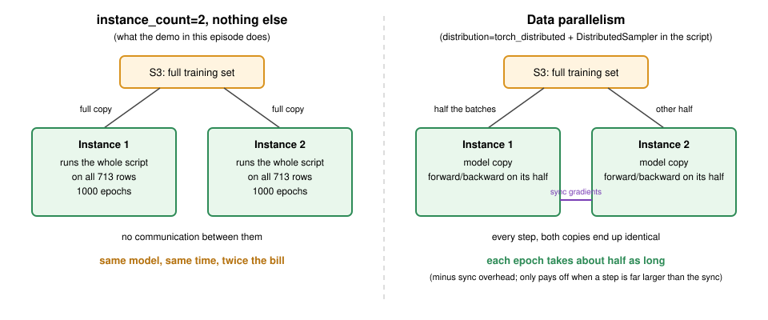

:::::::::::::::::::::::::::::::::::::: questions 

- When should you consider using a GPU instance for training neural networks in SageMaker, and what are the benefits and limitations?
- How does SageMaker handle data parallelism and model parallelism, and which is suitable for typical neural network training?

::::::::::::::::::::::::::::::::::::::::::::::::

::::::::::::::::::::::::::::::::::::: objectives

- Preprocess the Titanic dataset for efficient training using PyTorch.
- Save and upload training and validation data in `.npz` format to S3.
- Understand the trade-offs between CPU and GPU training for smaller datasets.
- Train a PyTorch model as a SageMaker training job and compare CPU and GPU instance types on time and cost.
- Differentiate between data parallelism and model parallelism, and determine when each is appropriate in SageMaker.

::::::::::::::::::::::::::::::::::::::::::::::::

## Initial setup: open prefilled .ipynb notebook
Open the notebook from: `/ML_with_AWS_SageMaker/notebooks/07_Training-models-in-SageMaker-notebooks-part2.ipynb`. Select the **`conda_pytorch`** kernel.

## Setup notebook as controller
Once your notebook is open, we can setup our SageMaker controller as usual:

```python
import boto3
import pandas as pd
import sagemaker
from sagemaker import get_execution_role

# Initialize the SageMaker role (will reflect notebook instance's policy)
role = sagemaker.get_execution_role()
print(f'role = {role}')

# Initialize an S3 client to interact with Amazon S3, allowing operations like uploading, downloading, and managing objects and buckets.
s3 = boto3.client('s3')

# Define the S3 bucket that we will load from
bucket_name = 'sinkorswim-doejohn'  # replace with your S3 bucket name

# Define train/test filenames
train_filename = 'titanic_train.csv'
test_filename = 'titanic_test.csv'
```

Create a SageMaker session to manage interactions with Amazon SageMaker, such as training jobs, model deployments, and data input/output. As before, the region comes from the notebook instance.

```python
region = boto3.Session().region_name  # inherited from the notebook instance; do not hard-code a region
session = sagemaker.Session()
sagemaker_client = session.sagemaker_client  # low-level boto3 client; describe_training_job() below uses it
print(f"region = {region}")
```

We should also record our local instance information to report this information during testing. First, let's make sure we're starting in the same location to access helper functions

```python
# The Titanic project folder from the S3 episode, beside the lesson clone: downloads and outputs land here, not in the repository
!mkdir -p /home/ec2-user/SageMaker/titanic
%cd /home/ec2-user/SageMaker/titanic
import sys
sys.path.insert(0, "/home/ec2-user/SageMaker/ML_with_AWS_SageMaker/scripts")
import helpers
```

```python
notebook_instance_name = 'SinkOrSwim-DoeJohn' # replace with your notebook instance name

local_instance_info = helpers.get_notebook_instance_info(notebook_instance_name, region)
local_instance = local_instance_info['InstanceType']
local_instance
```

If you are starting from a fresh notebook instance, download the Titanic CSVs from S3 again.

```python
s3.download_file(bucket_name, train_filename, train_filename)
s3.download_file(bucket_name, test_filename, test_filename)
```

## Training a neural network with SageMaker
Let's see how to do a similar experiment, but this time using PyTorch neural networks. We will again demonstrate how to test our custom model train script (`train_nn.py`) before deploying to SageMaker, and discuss some strategies (e.g., using a GPU) for improving train time when needed.

### Preparing the data (compressed npz files)
When deploying a PyTorch model on SageMaker, it's helpful to prepare the input data in a format that's directly accessible and compatible with PyTorch's data handling methods. The next code cell will prep our npz files from the existing csv versions. 

:::::::::::::::::::::::::::::::: callout
#### Why are we using this file format? 

1. **Optimized data loading**:  
   The `.npz` format stores arrays in a compressed, binary format, making it efficient for both storage and loading. PyTorch can easily handle `.npz` files, especially in batch processing, without requiring complex data transformations during training.

2. **Batch compatibility**:  
   When training neural networks in PyTorch, it's common to load data in batches. By storing data in an `.npz` file, we can quickly load the entire dataset or specific parts (e.g., `X_train`, `y_train`) into memory and feed it to the PyTorch `DataLoader`, enabling efficient batched data loading.

3. **Reduced I/O overhead in SageMaker**:  
   Storing data in `.npz` files minimizes the I/O operations during training, reducing time spent on data handling. This is especially beneficial in cloud environments like SageMaker, where efficient data handling directly impacts training costs and performance.

4. **Consistency and compatibility**:  
   Using `.npz` files allows us to ensure consistency between training and validation datasets. Each file (`train_data.npz` and `val_data.npz`) stores the arrays in a standardized way that can be easily accessed by keys (`X_train`, `y_train`, `X_val`, `y_val`). This structure is compatible with PyTorch's `Dataset` class, making it straightforward to design custom datasets for training.

5. **Support for multiple data types**:  
   `.npz` files support storage of multiple arrays within a single file. This is helpful for organizing features and labels without additional code. Here, the `train_data.npz` file contains both `X_train` and `y_train`, keeping everything related to training data in one place. Similarly, `val_data.npz` organizes validation features and labels, simplifying file management.

In summary, saving the data in `.npz` files ensures a smooth workflow from data loading to model training in PyTorch, leveraging SageMaker's infrastructure for a more efficient, structured training process.
:::::::::::::::::::::::::::::::::::::::

Open `ML_with_AWS_SageMaker/scripts/train_nn.py` in the file browser and read it before going on; it is short. Three things to find: `TitanicNet`, a three-layer network with 7 inputs and one output; the training loop in `train()`, which prints `validation:accuracy = ...` once per hundred epochs (the hyperparameter-tuning episode's metric regex reads that line); and the last lines, which save the model to `/opt/ml/model` inside a job and next to the script otherwise, the same trick as `train_xgboost.py`. Questions now are cheaper than questions once it is running on a billed instance.

We reuse the `preprocess_data()` function from the lesson's `scripts/train_nn.py` rather than re-typing the preprocessing here: the same function will later be applied to the test set, so train and test are transformed identically. It returns the fitted `StandardScaler`, and we save it with `joblib` so the next episode can load it.

```python
!pip install scikit-learn   # the notebook kernels do not ship it; train_nn.py imports it
```

Load the Titanic CSV, run it through the script's `preprocess_data`, split off a validation set, and save the arrays and the scaler. The training script reads these files; the scaler is kept so test data can later be transformed the same way.

```python
import numpy as np
import joblib
from sklearn.model_selection import train_test_split
from train_nn import preprocess_data

# Load and preprocess the Titanic dataset: encode Sex/Embarked, fill missing Age/Fare, standardize features
df = pd.read_csv(train_filename)
X, y, scaler = preprocess_data(df)   # scaler is fit on the training data only

# Split the data
X_train, X_val, y_train, y_val = train_test_split(X, y, test_size=0.2, random_state=42)

# Save the preprocessed data (and the fitted scaler) to our local jupyter environment
np.savez('train_data.npz', X_train=X_train, y_train=y_train)  # .npz = several numpy arrays in one compressed file, read back by key
np.savez('val_data.npz', X_val=X_val, y_val=y_val)
joblib.dump(scaler, 'scaler.joblib')  # keep the fitted scaler: the test set must be transformed with these same means/stds, never refit
print(X_train.shape, X_val.shape)
```

Next, we will upload our compressed files (and the scaler) to our S3 bucket. Storage is fairly cheap on AWS (around `$0.023` per GB per month), but be mindful of uploading too much data. It may be convenient to store a preprocessed version of the data at times, but try not to store too many versions that aren't being actively used.

```python
train_file = "train_data.npz"  # Local file path in your notebook environment
val_file = "val_data.npz"  # Local file path in your notebook environment
scaler_file = "scaler.joblib"

# Upload the training and validation files (and the scaler) to the bucket root
for f in [train_file, val_file, scaler_file]:
    s3.upload_file(f, bucket_name, f)

print("Files successfully uploaded to S3.")
```

## Testing on notebook instance
You should always test code thoroughly before scaling up and using more resources. Here, we will test our script using a small number of epochs (100) — just to verify our setup is correct.

```python
import torch
import time as t # Measure training time locally

epochs = 100          # small smoke test
learning_rate = 0.001

start_time = t.time()
%run /home/ec2-user/SageMaker/ML_with_AWS_SageMaker/scripts/train_nn.py --train train_data.npz --val val_data.npz --epochs {epochs} --learning_rate {learning_rate}
print(f"Local training time: {t.time() - start_time:.2f} seconds, instance_type = {local_instance}")
```

## Deploying PyTorch neural network via SageMaker
Now that we have tested things locally, we can try to train with a larger number of epochs (1000). We can do this easily by invoking the PyTorch estimator. Our notebook is currently configured to use ml.m5.large. We will use the same instance type with the below code (using our notebook as a controller). 

**Should we use a GPU?**: Since this dataset is fairly small, we don't necessarily need a GPU for training. Considering costs, the m5.large is `$0.115/hour`, while the cheapest GPU instance (ml.g4dn.xlarge) is `$0.74/hour`. However, for larger datasets (> 1 GB) and models, we may want to consider a GPU if training time becomes cumbersome (see [Instances for ML](https://carpentries-incubator.github.io/ML_with_AWS_SageMaker/instances-for-ML.html)). We'll test that in the exercise below.

#### Cost tracking
As in the XGBoost episode, every training job needs its own tags: a job does not inherit the notebook instance's tags, and an untagged job is anonymous on the bill. Define them once here and pass `tags=job_tags` to every estimator below.

```python
name = "DoeJohn" # replace with your name
project = "SinkOrSwim" # replace with your challenge name
purpose = "Training"        # one of: Storage, Notebook, Training, Tuning, Inference

job_tags = [
    {"Key": "Name", "Value": name},
    {"Key": "Project", "Value": project},
    {"Key": "Purpose", "Value": purpose},
]
print(f"Name: {name}, Project: {project}, Purpose: {purpose}")
```

## Estimating a training job before you launch it

Every job in this lesson gets an estimate written down before `fit()`, and the habit matters more than the numbers here, which are cents. There are two ways to make the estimate, and which one applies depends on the size of the model.

**Small models: time a smoke test and scale it.** For a network like `TitanicNet`, the arithmetic is nothing; the time is Python overhead per epoch plus the job's fixed startup. So measure the 100-epoch run you just did, scale to the epochs and data you plan, and add the startup:

```python
local_seconds_per_epoch = (t.time() - start_time) / epochs     # from the smoke test above: wall-clock over its 100 epochs
planned_epochs = 1000
startup_minutes = 3                                            # container pull + data download, billed; the same for every job
rate = 0.115                                                   # $/hour, ml.m5.large

train_minutes = local_seconds_per_epoch * planned_epochs / 60
estimate = (train_minutes + startup_minutes) / 60 * rate
print(f"{local_seconds_per_epoch * 1000:.1f} ms per epoch locally -> {train_minutes:.1f} min of training for {planned_epochs} epochs")
print(f"estimate: {train_minutes + startup_minutes:.0f} min billed, about ${estimate:.3f} on ml.m5.large")
```

Expect a couple of minutes of training plus two or three of startup: about a cent. (The `ml.t3.medium` notebook is slower than the `ml.m5.large` the job runs on, so the training part of the estimate is high. Our run billed 2.8 minutes in total, `$0.005`.) If the planned run has ten times the rows, multiply the training minutes by ten; the startup does not change.

**Large models: count the arithmetic.** Once a model has millions of parameters, compute is the cost, and it can be counted before any instance exists. Training one example through a dense network or a transformer costs about 6 floating-point operations per parameter (2 forward, 4 backward); multiply by parameters, examples and epochs, and divide by what the GPU does per second, about a quarter of its data-sheet peak in practice:

```text
FLOPs       = 6 × parameters × examples × tokens per example × epochs
GPU-seconds = FLOPs ÷ (GPU peak FLOPS × 0.25)
cost        = GPU-hours × instance price per hour + startup
```

On `TitanicNet` this says the training is nothing, which is the point of the two regimes:

```python
n_params = sum(p.numel() for p in TitanicNet().parameters())   # the network's weights and biases: how big the model is
n_examples = len(np.load("train_data.npz")["X_train"])
flops = 6 * n_params * n_examples * planned_epochs
print(f"{n_params:,} parameters x {n_examples} examples x {planned_epochs} epochs = {flops:.1e} FLOPs")
print(f"on an A10G at a quarter of 70 TFLOPS: {flops / (70e12 * 0.25):.4f} seconds of arithmetic; the bill is the startup")
```

The same rule, in `helpers.estimate_training_cost`, picks an instance and prints the time, cost and `max_run` for any model size. It only earns its keep from about 1e15 FLOPs up, a few million parameters over a few million examples, which is where the fine-tuning episode uses it on a 3-billion-parameter model. Here it is on a run that does need it: a 125-million-parameter text model, a million training examples of 256 tokens, three passes:

```python
helpers.estimate_training_cost(params_billions=0.125, examples=1_000_000, tokens_per_example=256, epochs=3)
```

About eight GPU-hours and nine dollars on the cheapest instance that fits, eight hours of wall-clock on one GPU; a job you want capped and tagged before it starts.

::::::::::::::::::::::::::::::::::::: challenge

### Estimate your own first run

Take the model you expect to train for your own project or challenge, or the biggest one you have trained before, and estimate its first SageMaker run before you ever launch one. You need four numbers:

1. **Parameters.** For a model you have in PyTorch, `sum(p.numel() for p in model.parameters())`; for a model card, it is in the name (`-7B`, `-125M`).
2. **Examples and tokens per example.** Rows for tabular data, sequence length for text, pixels ÷ 784 for an image through a vision transformer; for a convolutional network use the FLOPs-per-image figure from its paper instead of the 6 × parameters rule.
3. **Epochs.** Small data usually takes three to five passes, large corpora one to three; the number is a budget, not a given.
4. **Instance.** From the [Instances for ML](https://carpentries-incubator.github.io/ML_with_AWS_SageMaker/instances-for-ML.html) page, or let the helper pick the cheapest that fits.

If the FLOPs come out below 1e15, use the smoke-test method instead and say what you would measure. Write the estimate down with the `max_run` you would set, and keep it: the first real bill goes next to it.

:::::::::::::::::::::::: solution

There is no single answer; the solution is the written estimate. One worked example for scale: a 7B language model fully fine-tuned on 50,000 documents of 2,000 tokens for 3 epochs is 6 × 7e9 × 1e8 = 1.3e19 FLOPs, 45 GPU-hours on A100s, about `$140` a run; the fine-tuning episode works that one through. A 10-million-parameter network on 100,000 rows for 20 epochs is 1.2e14 FLOPs: below the line, so time a smoke test and scale it, and expect the startup minutes to dominate.

:::::::::::::::::::::::::::::::::

::::::::::::::::::::::::::::::::::::::::::::::::

We'll also bring back the `job_cost_report()` helper from the previous episode, plus the hourly rates of the instances we're about to use.

```python
def job_cost_report(job_name: str, price_per_hour: float):
    desc = session.sagemaker_client.describe_training_job(TrainingJobName=job_name)  # the job record the console shows
    n = desc["ResourceConfig"]["InstanceCount"]
    billable = desc["BillableTimeInSeconds"] * n   # container pull to model upload, charged per instance
    wall = (desc["TrainingEndTime"] - desc["CreationTime"]).total_seconds()   # from the launch request to the end, including unbilled provisioning
    print(f"{job_name}: status {desc['TrainingJobStatus']}, wall-clock {wall/60:.1f} min, billable {billable/60:.1f} min on {n} instance(s), cost ${billable/3600*price_per_hour:.3f} at ${price_per_hour}/h")
    print(f"    model: {desc['ModelArtifacts']['S3ModelArtifacts']}")   # the model.tar.gz this job uploaded to output_path
    return desc

# us-east-1 on-demand rates (2026-10-16); check the instances page for your region
prices = {"ml.m5.large": 0.115, "ml.m5.xlarge": 0.23, "ml.g4dn.xlarge": 0.74}
```

Set up the estimator for a longer run: the epochs, the instance, where the output goes, and a two-hour `max_run` cap.

```python
from sagemaker.pytorch import PyTorch
from sagemaker.inputs import TrainingInput

epochs = 1000          # more epochs now that the script is known to work
instance_count = 1
instance_type = "ml.m5.large"
output_path = f's3://{bucket_name}/output_nn/' # this folder will auto-generate if it doesn't exist already

# Define max runtime in seconds to ensure you don't use more compute time than expected. Use a generous threshold (2x expected time but < 2 days) so that work isn't interrupted without any gains.
max_run = 2*60*60 # 2 hours

# Define the PyTorch estimator and pass hyperparameters as arguments
pytorch_estimator = PyTorch(
    base_job_name=f"{notebook_instance_name}-nn",   # who + which model; SageMaker appends a timestamp to make each job name unique
    max_run=max_run, # in seconds; always include (max 48 hours)
    entry_point="/home/ec2-user/SageMaker/ML_with_AWS_SageMaker/scripts/train_nn.py",  # copied into the container and run there
    role=role,
    tags=job_tags,  # per job; nothing is inherited from the notebook instance
    instance_type=instance_type, # with this small dataset, we don't necessarily need a GPU for fast training. 
    instance_count=instance_count,
    # framework_version + py_version pick the prebuilt PyTorch training image the job runs in
    framework_version="2.3",  # if fit() fails with an image error, check available versions with: sagemaker.image_uris.retrieve("pytorch", region, version="2.3", py_version="py311", image_scope="training", instance_type="ml.m5.large")
    py_version="py311",
    output_path=output_path,
    sagemaker_session=session,
    hyperparameters={  # passed to train_nn.py as command-line flags: --train ... --epochs 1000 ...
        "train": "/opt/ml/input/data/train/train_data.npz",  # SageMaker will mount this path
        "val": "/opt/ml/input/data/val/val_data.npz",        # SageMaker will mount this path
        "epochs": epochs,
        "learning_rate": learning_rate
    }
)

# Define input paths: each TrainingInput is a channel; its S3 object is copied to /opt/ml/input/data/<channel>/ in the container
# content_type is a label only; our script reads the file itself
train_input = TrainingInput(f"s3://{bucket_name}/train_data.npz", content_type="application/x-npz")
val_input = TrainingInput(f"s3://{bucket_name}/val_data.npz", content_type="application/x-npz")

# Start the training job and time it
start = t.time()
pytorch_estimator.fit({"train": train_input, "val": val_input})
end = t.time()

print(f"Runtime for training on SageMaker: {end - start:.2f} seconds, instance_type: {instance_type}, instance_count: {instance_count}")
```

```python
desc_cpu = job_cost_report(pytorch_estimator.latest_training_job.name, prices[instance_type])
```

For a job this small, almost all of the billable minutes are startup.

## Deploying PyTorch neural network via SageMaker with a GPU instance

In this section, we'll implement the same procedure as above, but using a GPU-enabled instance for potentially faster training. While GPU instances are more expensive, they can be cost-effective for larger datasets or more complex models that require significant computational power.

#### Selecting a GPU Instance
For a small dataset like ours, we don't strictly need a GPU, but for larger datasets or more complex models, a GPU can reduce training time. Here, we'll select an `ml.g4dn.xlarge` instance, which provides a single GPU and costs approximately `$0.74/hour` (check [Instances for ML page](https://carpentries-incubator.github.io/ML_with_AWS_SageMaker/instances-for-ML.html) for detailed pricing).

#### Code modifications for GPU use
Using a GPU requires minor changes in your training script (`train_nn.py`). Specifically, you'll need to:
1. Check for GPU availability in PyTorch.
2. Move the model and tensors to the GPU device if available.

#### Enabling PyTorch to use GPU in `train_nn.py`  

The following code snippet enables GPU support in `train_nn.py`:

```text
device = torch.device("cuda" if torch.cuda.is_available() else "cpu")
model = TitanicNet().to(device)
X_train, y_train = X_train.to(device), y_train.to(device)
```

::::::::::::::::::::::::::::::::::::::: challenge

### CPU or GPU: predict, then measure

We're about to run the identical job on an `ml.g4dn.xlarge` (one NVIDIA T4 GPU, about `$0.74`/hour) instead of the `ml.m5.large` (`$0.115`/hour). Before you run the cell:

1. Predict which instance finishes first (total wall-clock, as `fit()` reports it).
2. Predict which costs less for this job.

Then run the GPU job, call `job_cost_report()` for it, and compute cost = rate x billable minutes for both runs. Were you right? Explain the result.

```python
instance_type = "ml.g4dn.xlarge"  # one NVIDIA T4 GPU; train_nn.py moves to it on its own via torch.cuda.is_available()
instance_count = 1

pytorch_estimator_gpu = PyTorch(
    base_job_name=f"{notebook_instance_name}-nn",
    max_run=max_run, # in seconds; always include (max 48 hours)
    entry_point="/home/ec2-user/SageMaker/ML_with_AWS_SageMaker/scripts/train_nn.py",
    role=role,
    tags=job_tags,
    instance_type=instance_type,
    instance_count=instance_count,
    framework_version="2.3",
    py_version="py311",
    output_path=output_path,
    sagemaker_session=session,
    hyperparameters={
        "train": "/opt/ml/input/data/train/train_data.npz",
        "val": "/opt/ml/input/data/val/val_data.npz",
        "epochs": epochs,
        "learning_rate": learning_rate
    }
)

start = t.time()
pytorch_estimator_gpu.fit({"train": train_input, "val": val_input})
end = t.time()
print(f"Runtime for training on SageMaker: {end - start:.2f} seconds, instance_type: {instance_type}, instance_count: {instance_count}")

desc_gpu = job_cost_report(pytorch_estimator_gpu.latest_training_job.name, prices[instance_type])

for label, d, rate in [("CPU ml.m5.large", desc_cpu, prices["ml.m5.large"]), ("GPU ml.g4dn.xlarge", desc_gpu, prices["ml.g4dn.xlarge"])]:
    billable_min = d["BillableTimeInSeconds"] / 60
    print(f"{label}: billable {billable_min:.1f} min x ${rate}/h = ${billable_min/60*rate:.3f}")
```

::::::::::::::::::::::::::::::::::::::: solution

### Solution

Typically the CPU run finishes about as fast or faster, and it is several times cheaper. Both jobs spend roughly the same few minutes on startup (pulling the container, downloading data; the unbilled wait for an instance comes before that), and the GPU container is larger, so it often takes a little *longer* to start. The actual training is a few seconds on either instance: the network has about 2,600 parameters and the whole training set is 713 rows, so each full-batch step is tiny and the T4 sits almost idle, and the one-time CUDA initialization adds a few seconds of its own. Startup dominates both bills, and the GPU bill is about 6x higher per minute (0.74 / 0.115), so the GPU costs several times more for no speedup. In our run the CPU job billed 2.8 minutes (`$0.005`) and the GPU job 3.6 minutes (`$0.045`): slower, and nine times the price.

A GPU pays off when the per-step work is large enough to keep it busy: bigger models, bigger batches, or datasets of hundreds of MB and up. If you ever do need more GPU than a `g4dn.xlarge`, the next sensible step is an `ml.g5.xlarge` (~`$1.41`/hour), not a multi-GPU box.

:::::::::::::::::::::::::::::::::::::::::::::::::::::

:::::::::::::::::::::::::::::::::::::::::::::::::::::

::::::::::::::::::::::::::: callout
#### GPUs can be slow for small datasets/models
This performance discrepancy might be due to the following factors:

1. **Small dataset/model size**: When datasets and models are small, the overhead of transferring data between the CPU and GPU, as well as managing the GPU, can slow things down. For very small models and datasets, CPUs are often faster since there's minimal data to process.

2. **GPU initialization overhead**: Every time a training job starts on a GPU, there's a small overhead for initializing CUDA libraries. For short jobs, this setup time can make the GPU appear slower overall.

3. **Batch size**: GPUs perform best with larger batch sizes since they can process many data points in parallel. If the batch size is too small, the GPU is underutilized, leading to suboptimal performance. You may want to try increasing the batch size to see if this reduces training time.

4. **Instance type**: Some GPU instances, like the `ml.g4dn` series, have less computational power than the larger `g5` series. They're better suited for inference or lightweight tasks rather than intense training, so a more powerful instance (e.g., `ml.g5.xlarge`) could help for larger tasks.

If training time continues to be critical, sticking with a CPU instance may be the best approach for smaller datasets. For larger, more complex models and datasets, the GPU's advantages should become more apparent.
::::::::::::::::::::::::::::::::::::::::::::::::::::::

## Distributed Training for Neural Networks in SageMaker

The previous episode gave the rule of thumb: upgrade the single instance first, and consider multiple instances only when the dataset no longer fits in one instance's memory (tens of GB or more) or a single-instance run takes longer than about 10 hours. The GPU exercise was Option 1. Let's now look at Option 2, starting with what `instance_count=2` does.

### What `instance_count=2` does on its own

{alt="Two panels comparing instance_count=2 without distribution, where each instance trains on the full data, with data parallelism, where batches are split and gradients synced"}

Setting `instance_count=2` on an estimator makes SageMaker start two instances and run **the full training script on each of them**. Nothing is split:

- `TrainingInput` defaults to `distribution="FullyReplicated"`, so every instance downloads the complete dataset.
- `train_nn.py` has no distributed code, so each instance trains its own independent copy of the model on all of the data for all 1000 epochs, and each saves a model.
- SageMaker bills `BillableTimeInSeconds x InstanceCount`.

So without a distribution strategy, two instances means the same job twice, in parallel, at double the cost. Estimate first: about the same 3-4 minutes of wall-clock as the single-instance run, but billed for two instances, so about `$0.01` on `ml.m5.large` (our run: 3.5 minutes of wall-clock, 5.5 billable minutes across the two instances, `$0.010`).

```python
instance_count = 2   # demonstration: NOT expected to be faster, and expected to cost double
instance_type = "ml.m5.large"

pytorch_estimator_2x = PyTorch(
    base_job_name=f"{notebook_instance_name}-nn",
    max_run=max_run, # in seconds; always include (max 48 hours)
    entry_point="/home/ec2-user/SageMaker/ML_with_AWS_SageMaker/scripts/train_nn.py",
    role=role,
    tags=job_tags,
    instance_type=instance_type,
    instance_count=instance_count,  # no distribution= argument, so each instance runs the whole script on the whole dataset
    framework_version="2.3",
    py_version="py311",
    output_path=output_path,
    sagemaker_session=session,
    hyperparameters={
        "train": "/opt/ml/input/data/train/train_data.npz",
        "val": "/opt/ml/input/data/val/val_data.npz",
        "epochs": epochs,
        "learning_rate": learning_rate
    }
)

start = t.time()
pytorch_estimator_2x.fit({"train": train_input, "val": val_input})
end = t.time()
print(f"Runtime for training on SageMaker: {end - start:.2f} seconds, instance_type: {instance_type}, instance_count: {instance_count}")

desc_2x = job_cost_report(pytorch_estimator_2x.latest_training_job.name, prices[instance_type])
print(f"Single-instance job billed {desc_cpu['BillableTimeInSeconds']/60:.1f} min; two-instance job billed {desc_2x['BillableTimeInSeconds']*2/60:.1f} min")
```

Look at the job's log: open [Training jobs](https://us-east-2.console.aws.amazon.com/sagemaker/home?region=us-east-2#/training), click the job's name, scroll to **Monitor**, click **View logs**. This time CloudWatch lists two streams, `algo-1` and `algo-2`, and each one prints all 1000 epochs. The wall-clock time is about the same as the single-instance run (slightly longer, if anything, because two instances have to be provisioned), and the billable minutes are double.

### Data parallelism, done properly

To split one training run across two instances instead of running it twice, the script needs three things the demo above did not have, and the estimator needs one. `scripts/train_nn_ddp.py` is `train_nn.py` with those three added; open the two side by side, the differences are marked 1, 2 and 3 in the comments.

1. **Join the process group.** The launcher starts one copy of the script on each instance. The copies are numbered from zero, and a copy's number is its **rank**: with two instances, one copy is rank 0 and the other rank 1, and the count of copies, 2, is the **world size**. Each copy learns its own rank and the world size from environment variables the launcher sets, and `setup_distributed` reads them and calls `init_process_group`, after which the copies can talk to each other. The rank is the only thing that differs between the copies, and everything below that has to differ between instances keys off it. With no launcher the function returns rank 0 of 1 and the script trains like `train_nn.py`.
2. **Shard the data.** Each copy keeps the rows whose index, counting from zero, leaves its rank as the remainder when divided by the world size: rank 0 takes rows 0, 2, 4, ... and rank 1 takes rows 1, 3, 5, ..., which is `X_train[rank::world_size]`. Half the training set each, no row seen twice, and the copies agree on the split without talking, because each one knows only its rank.
3. **Wrap the model in `DistributedDataParallel`.** After every `loss.backward()`, DDP averages the gradients across the processes before `optimizer.step()`, so both copies of the model take the same step and stay identical. That averaged gradient over two half-shards is the gradient over the whole set, which is why the result is one training run and not two. Only the copy with rank 0 prints the metrics and saves the model, since every copy holds the same weights and one file is enough; rank 0 is the conventional choice because every world has one.

On the estimator, `distribution={"mpi": {"enabled": True, "processes_per_host": 1}}` is what starts the processes: SageMaker launches the script on every instance through MPI, which sets the rank and world-size variables the script reads and lets the instances find each other by name. (`torch_distributed`, the `torchrun` launcher, is the same idea for GPU instances; the script handles either.) Everything else is the two-instance estimator from the demo.

```python
pytorch_estimator_ddp = PyTorch(
    base_job_name=f"{notebook_instance_name}-nn-ddp",
    max_run=max_run,
    entry_point="/home/ec2-user/SageMaker/ML_with_AWS_SageMaker/scripts/train_nn_ddp.py",   # the three additions, marked in the script
    role=role,
    tags=job_tags,
    instance_type="ml.m5.large",
    instance_count=2,
    distribution={"mpi": {"enabled": True, "processes_per_host": 1}},   # start one process per instance and connect them; without this, two copies again
    framework_version="2.3",
    py_version="py311",
    output_path=output_path,
    sagemaker_session=session,
    hyperparameters={
        "train": "/opt/ml/input/data/train/train_data.npz",
        "val": "/opt/ml/input/data/val/val_data.npz",
        "epochs": epochs,
        "learning_rate": learning_rate,
    },
)

start = t.time()
pytorch_estimator_ddp.fit({"train": train_input, "val": val_input})
print(f"Data-parallel run: {(t.time() - start) / 60:.1f} min wall-clock on 2 x ml.m5.large")
desc_ddp = job_cost_report(pytorch_estimator_ddp.latest_training_job.name, prices["ml.m5.large"])
```

Read the log before the bill. The two CloudWatch streams now say different things: each prints `training on 446 of 891 rows` (or 445), and only `algo-1` prints the epochs and saves the model. The final validation loss matches the single-instance run to the third decimal, because the averaged gradient is the same gradient; that match is the proof that the work was split rather than copied. The wall-clock is not shorter. Each step now costs a round of gradient exchange between two machines, which takes longer than the 445 rows it saves, and the bill is still two instances' worth. That is the rule of thumb again, measured: data parallelism pays when the step is big enough that the exchange is a small part of it, which on tabular data of 891 rows it never is.

**Model parallelism** is the other kind, for a model too large for one device's memory, where the layers themselves are spread across devices (`smdistributed.modelparallel`, or PyTorch's FSDP). There is no example here because no model in this lesson needs it: the fine-tuning episode's memory arithmetic shows what does, a model whose weights plus their gradients and optimizer state exceed one GPU, and the usual answer at this scale is a LoRA fine-tune, which shrinks the problem instead of spreading it.

For the **built-in XGBoost** image from the previous episode the recipe is simpler, because the algorithm already knows how to train across instances: split the training CSV into several S3 objects under one prefix and pass `TrainingInput(prefix, content_type="text/csv", distribution="ShardedByS3Key")`, so each instance receives a different subset of the files. Even then, a dataset of 891 rows will only show overhead.

Either way, the rule of thumb stands: a bigger single instance first, and multiple instances only once data no longer fits in memory or a run exceeds ~10 hours.

::::::::::::::::::::::::::::::::::::: keypoints

- **Efficient data handling**: The `.npz` format is optimized for efficient loading, reducing I/O overhead and enabling batch compatibility for PyTorch's `DataLoader`.
- **Startup dominates small jobs**: Every SageMaker training job waits a minute or so for an instance (not billed), then spends one to three minutes on container pull and data download (billed) before the script runs; for a job whose script finishes in seconds, that overhead is the whole bill.
- **GPU training**: While beneficial for larger models or datasets, GPUs may introduce overhead for smaller tasks; selecting the right instance type is critical for cost-efficiency.
- **Data parallelism vs. model parallelism**: Data parallelism splits data across instances and synchronizes model weights, suitable for typical neural network tasks. Model parallelism, which divides model layers, is ideal for very large models that exceed memory capacity.
- **`instance_count` alone is not distributed training**: Without `distribution=` on the estimator and distributed code in the script, `instance_count=2` runs the full script on the full data on each instance and bills twice. Data parallelism is three additions to the script (join the process group, shard the rows, wrap the model in `DistributedDataParallel`) and one argument on the estimator; `train_nn_ddp.py` has them, and reaches the single-instance run's loss on half the rows per instance.
- **SageMaker configuration**: By adjusting instance counts and types, SageMaker supports scalable training setups. Starting with CPU training and scaling as needed with GPUs or distributed setups allows for performance optimization.
- **Testing locally first**: Before deploying large-scale training in SageMaker, test locally with a smaller setup to ensure code correctness and efficient resource usage.
- **Estimate before you launch**: for small models, time a smoke test and scale it by epochs and rows, plus about three minutes of startup; for large ones, 6 FLOPs per parameter per example-token, divided by a quarter of the GPU's peak. `helpers.estimate_training_cost` does the second; write the number down and compare it to the bill.

::::::::::::::::::::::::::::::::::::::::::::::::
