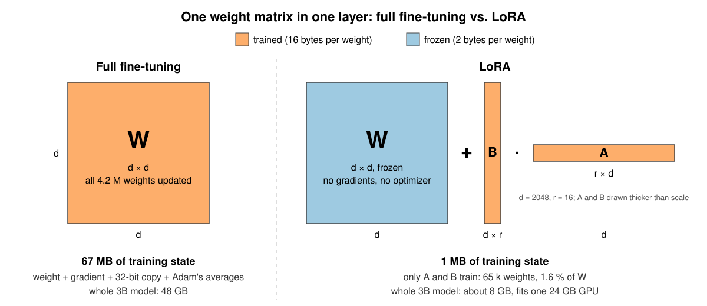
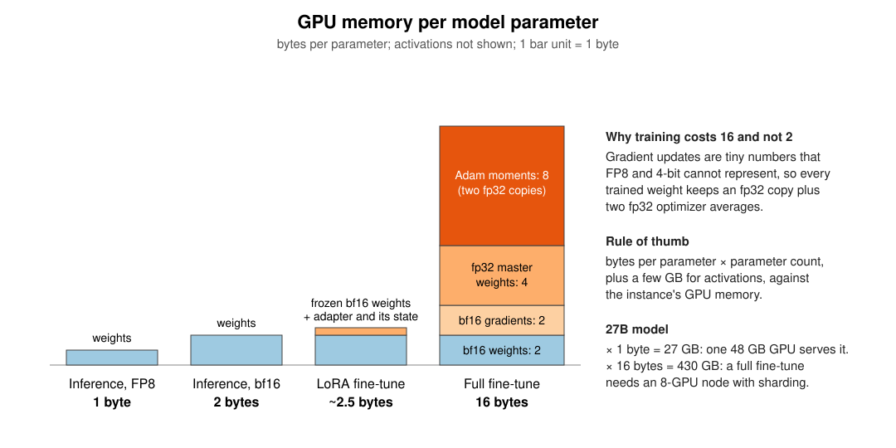
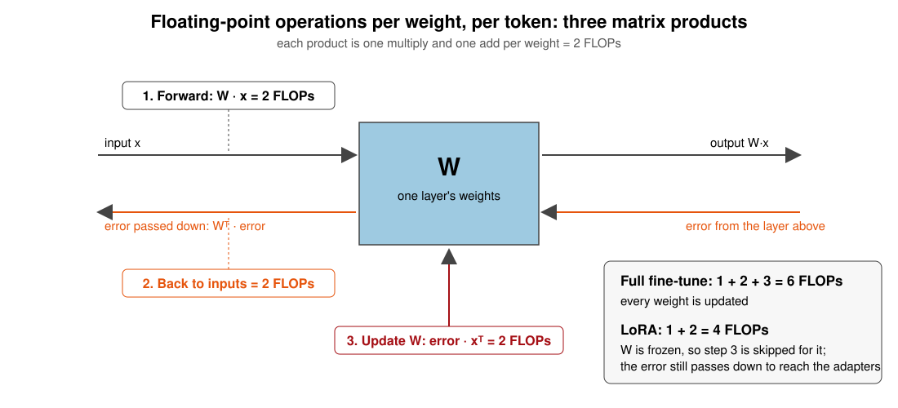
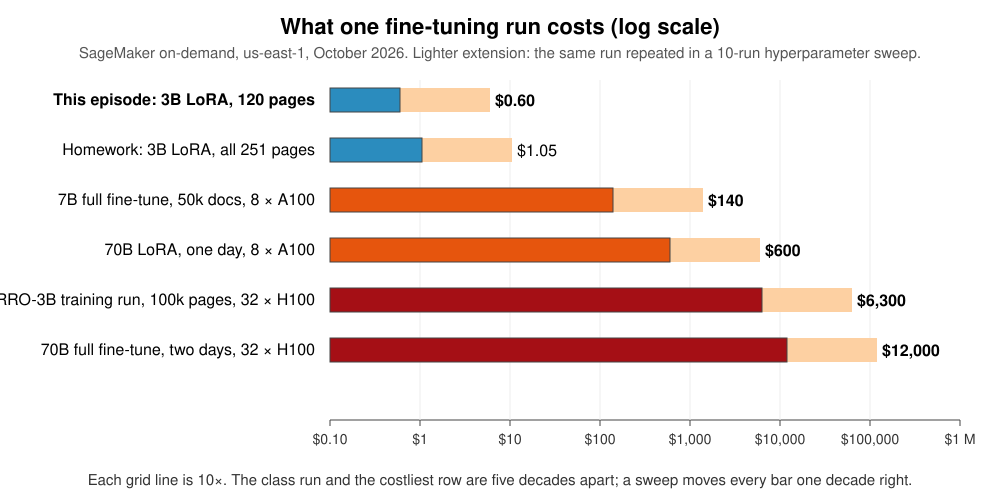

:::::::::::::::::::::::::::::::::::::: questions

- When is fine-tuning worth it?
- What does a fine-tuning run cost, and how do I estimate that before launching it?
- How do I fine-tune a model as a SageMaker training job?
- How do I tell whether the fine-tune helped?

::::::::::::::::::::::::::::::::::::::::::::::::

::::::::::::::::::::::::::::::::::::: objectives

- Explain what drives the cost of a fine-tuning run (model size × tokens × epochs × number of attempts), and what to do before launching one at any size: set a time cap, run a small slice first, write the estimate down, and checkpoint.
- Launch a LoRA fine-tune of a 3B vision-language model (CHURRO-3B) as a `HuggingFace` training job on a single 24 GB GPU, with tags, a unique job name and a `max_run` cap.
- Read a job's billable time and compare it to the estimate.
- Compare the base model and the fine-tuned model on held-out pages using the competition's own character error rate (CER).
- Know how to scale the same job up to the full dataset (homework) and to multi-GPU instances for larger models.

::::::::::::::::::::::::::::::::::::::::::::::::

Open the notebook from: `/ML_with_AWS_SageMaker/notebooks/08_Finetuning-BadgerScribe.ipynb`. Select the **`conda_pytorch`** kernel.

## Why fine-tune a model?

In the earlier training episodes, we built relatively small models from scratch. That works when we have a well-defined problem and enough training data, but it isn't practical for tasks that require the broad capabilities of a modern language or vision model with billions of weights. Training one of those models from scratch can require thousands of GPUs and enormous datasets. The PyTorch episode put numbers on that with `helpers.estimate_training_cost`. One pass of a 7B language model over a million papers came to about `$1,270` on a four-GPU box, and the models behind ChatGPT are far larger and trained on far more.

Fortunately, we don't have to start from scratch. ***Pretrained*** models already know how to interpret images, understand language, and generate text. ***Fine-tuning*** lets us build on those capabilities by training a model further on examples from our own task.

Consider historical handwriting recognition. A general-purpose vision-language model, such as the open-weight Qwen3.8-27B or a commercial one like Gemini, may be able to transcribe ordinary printed text and modern handwriting, yet struggle with nineteenth-century documents, unfamiliar letterforms, or the conventions used by a particular archive. Giving it better instructions can help, but there are limits to what prompting can accomplish when the model has never learned to recognize the writing itself.

Fine-tuning offers another approach. Show the model examples of the documents alongside their correct transcriptions, and train it to produce better results on similar material.

This can be surprisingly effective. [CHURRO](https://github.com/stanford-oval/Churro) is a 3-billion-parameter vision-language model developed for historical text recognition. Its researchers fine-tuned an existing Qwen model on roughly 100,000 historical document pages and reported better transcription accuracy than Gemini 2.5 Pro at substantially lower inference cost ([paper](https://arxiv.org/abs/2509.19768)). Rather than using an increasingly large general-purpose model, they trained a smaller one to become particularly good at the task they cared about. The same pattern shows up in other fields:

{alt="Dot plot of benchmark scores for three task-specific models against a much larger general model on the same benchmark; the specialist is ahead in each row by 6.5, 2.2 and 1.2 points"}

Sources: [CHURRO, EMNLP 2025](https://arxiv.org/abs/2509.19768); [Goedel-Prover-V2, ICLR 2026](https://arxiv.org/abs/2508.03613); [MedGemma technical report, 2025](https://arxiv.org/abs/2507.05201). Scores are as reported by each model's authors.

That's the approach we'll explore in this episode. We'll take CHURRO, which already specializes in historical documents, and adapt it further to a collection of handwritten German letters from UW-Madison's Badger Scribe challenge.

### How fine-tuning works

Fine-tuning uses the same basic training process we've already seen. The model makes predictions on training examples, we measure how far those predictions are from the correct answers, and gradient descent adjusts its parameters to reduce the error.

The difference is where we begin. Rather than initializing the model with random weights, we start with weights learned during an earlier, much larger training process. Our examples don't need to teach the model everything about language or images. They only need to help it adapt what it already knows.

We could update every parameter in the model, which is called ***full fine-tuning***. That's how CHURRO itself was created. But even a relatively small model with 3 billion parameters is expensive to train this way, because training requires much more GPU memory than simply running the model.

### LoRA adds new small weights beside the frozen model

The alternative to full fine-tuning is ***parameter-efficient fine-tuning***, or ***PEFT***, a family of methods that leave the pretrained weights frozen and train a small number of new parameters instead. ***Low-rank adaptation***, or ***LoRA***, is the most widely used form of PEFT. It keeps the pretrained weights frozen and adds small sets of trainable parameters to selected layers. Rather than directly changing a large weight matrix, LoRA learns a much smaller adjustment to its output.

{alt="Left: a d by d weight matrix, all trained, 16 bytes per weight. Right: the same matrix frozen in bf16 plus two thin trained matrices B (d by r) and A (r by d); output is W x plus B A x."}

Nothing in the original model is trained. The trained parameters are the new matrices, and they are a small fraction of the model's size, under one percent in this episode. We still run the whole model during training, but we only calculate and store weight updates for the new matrices. That saves enough memory to fine-tune CHURRO on a single GPU with 24 GB of memory; the next section says how much.

LoRA also produces a relatively small ***adapter*** that we can save separately from the original model. To use the fine-tuned model later, we load the pretrained weights together with the adapter.

This makes LoRA particularly useful for research groups. We can take an existing open-weight model, adapt it to a specialized dataset, evaluate whether the adaptation helped, and keep the resulting model without the expense of full fine-tuning.

### Training, full fine-tuning and LoRA on one scale

The GPU-hours put the three on one scale. Training from scratch is at the top, the full fine-tune that made CHURRO in the middle, and this episode's LoRA run at the bottom.

{alt="Horizontal bar chart on a logarithmic GPU-hours axis from 0.1 to 10 million. Training from scratch, every weight from random: 460,000 GPU-hours. Full fine-tuning, every weight from a pretrained model: 800 GPU-hours. LoRA fine-tuning, an adapter under one percent of the weights: 0.5 GPU-hours. Each bar is labelled with the GPUs, the time and the electricity. Energy is GPU electricity at the rated draw, a lower bound."}

Why do the three differ so much? Training from scratch and full fine-tuning do the same work per step. Every parameter is updated, which means keeping four things in GPU memory for each one, the weight itself, its gradient, a 32-bit copy of the weight for the update to land in, and the optimizer's two running averages. That is 16 bytes per parameter, so a 3B model needs about 48 GB before activations and other overhead, which means several GPUs. What separates those two is how much data they go through, trillions of tokens against a hundred thousand pages. LoRA cuts the work in a different place. It updates only the adapter and leaves the model's own weights frozen, and a frozen weight costs 2 bytes, not 16, with nothing else to store for it. That is why the same model fits one GPU, and for our task it is all we need.

### Our task, transcribing historical German letters

For this exercise, we'll use the [Badger Scribe](https://www.kaggle.com/competitions/badger-scribe) challenge, which asks participants to produce faithful transcriptions of scanned historical documents. The competition includes several kinds of archival material, but we'll concentrate on letters from the Anna Seifert correspondence, held by the Max Kade Institute, 191 letters and postcards written between 1932 and 1942 by one woman to her son, transcribed by the Institute's Kurrent Transcription Group.

These letters were written in ***Kurrent***, a historical form of German handwriting whose letterforms differ substantially from modern cursive. Even a model trained on historical documents can struggle with it, making this a useful test of whether additional fine-tuning helps.

We have 295 labeled pages from this collection. We'll reserve approximately 15% for evaluation and train on the remaining 251, using the corresponding human-produced transcriptions as our targets.

| split | pages | documents | label source |
|---|---|---|---|
| train | 295 | 4 letter bundles | all human-transcribed, ~620 characters per page |
| test | 141 | 5 other letter bundles | labels held by Kaggle |

Our goal is straightforward. Does fine-tuning CHURRO on these examples improve its ability to transcribe previously unseen pages?

We'll measure that using ***character error rate (CER)***, the same metric used by the competition. A lower CER means the transcription contains fewer character-level mistakes.

### What we'll do, and what it will cost

We'll run the training on AWS SageMaker, using a managed training job rather than keeping an interactive GPU notebook running. SageMaker will provision the GPU, run our training script, save the model adapter and evaluation results, and shut down the instance when the job finishes.

The entire run, including evaluation before and after fine-tuning, takes about 33 minutes on an `ml.g5.xlarge` instance and costs approximately `$0.75`, based on our measured October 2026 run.

That small cost is deliberate. Fine-tuning can become expensive when we move to larger models, longer datasets, or repeated experiments, so we'll learn how to estimate memory and runtime requirements before launching the job. We'll also set a time limit to prevent an unexpected training run from continuing indefinitely.

By the end, we'll have fine-tuned a vision-language model, compared its predictions against the original model, and checked how closely the actual bill matched our estimate.

::::::::::::::::::::::::::::::::::::: callout

### What the class account allows

Do not fully fine-tune anything in this workshop, and do not LoRA fine-tune a model larger than 7B on the class account. A 7B LoRA needs about 22 GB, which is the most the 24 GB GPU the class uses will hold; a full fine-tune of a 7B model needs more memory than any instance the account allows. The larger runs appear in this episode only as estimates, so that you can recognise one before you launch it.

::::::::::::::::::::::::::::::::::::::::::::::::

## Step 0: Estimate the cost before you launch anything

Before launching a fine-tune, write down what it should cost. If the bill comes in at three times your number, something is wrong, and you want to find that out on the first run, not the fiftieth. Two questions decide the cost of any training run. Will the model fit on the GPU, and how long will it run? Both can be answered on paper, to within a factor of two, before anything is rented.

### How much GPU memory it needs

Every parameter in the model takes up GPU memory, and how much depends on what you are doing with it. Running the model needs only the weight. A full fine-tune needs the weight, its gradient, a 32-bit copy of the weight, and the two running averages Adam keeps for it, the four numbers per weight from the *How fine-tuning works* section above. A LoRA fine-tune keeps the weights frozen in 16-bit and adds a small adapter that carries its own gradients and optimizer state.

{alt="Stacked bar chart of bytes per parameter for inference versus LoRA versus full fine-tuning"}

| What you are doing with the model | Bytes per parameter | What has to be in memory for each parameter |
|---|---|---|
| Inference, 4-bit weights | 0.5 | the weight, quantized |
| Inference, FP8 | 1 | the weight, quantized |
| Inference, bf16 | 2 | the weight |
| LoRA fine-tune | ~2.5 | the frozen 16-bit weight, plus a share of the adapter with its gradients and optimizer state |
| Full fine-tune, mixed precision | 16 | the 16-bit weight (2), its gradient (2), a 32-bit copy of the weight (4), Adam's two running averages (8) |

Multiply the bytes per parameter by the parameter count, add about 4 GB for activations (more for long sequences or big batches), and you have the GPU memory the job needs. The second table does that for four model sizes and names the smallest SageMaker box that holds each one:

| Model | Inference, bf16 | LoRA fine-tune | Full fine-tune |
|---|---|---|---|
| 3B | 6 GB: `ml.g5.xlarge`, 1 × 24 GB, `$1.41`/h | 12 GB: `ml.g5.xlarge` | 52 GB: `ml.g5.12xlarge`, 4 × 24 GB, `$7.09`/h |
| 7B | 14 GB: `ml.g5.xlarge` | 22 GB: `ml.g5.xlarge`, with nothing to spare | 116 GB: `ml.g6e.12xlarge`, 4 × 48 GB, `$13.12`/h |
| 27B | 54 GB: `ml.g5.12xlarge`, 4 × 24 GB, `$7.09`/h | 72 GB: `ml.g5.12xlarge` | 436 GB: `ml.p5.48xlarge`, 8 × 80 GB, `$63.30`/h |
| 70B | 140 GB: `ml.g6e.12xlarge`, 4 × 48 GB, `$13.12`/h | 179 GB: `ml.g6e.12xlarge` | 1,124 GB: two `ml.p5.48xlarge`, `$127`/h |

A 7B model that runs on one 24 GB GPU needs 116 GB to fully fine-tune, a four-GPU box at `$13` an hour with the model sharded across the GPUs. Training cannot run on quantized weights the way inference can, because each step's update is too small for 8-bit or 4-bit numbers to hold. LoRA avoids that jump by freezing the model and training a few million adapter parameters, which is why this episode fits on one 24 GB card.

### How long will it run?

How long a job runs is how much work it does divided by how fast the GPU does it. The work is counted in floating-point operations, FLOPs, one multiply or one add on one number. The GPU's speed is a rate, floating-point operations per second, written FLOPS with a capital S, and a trillion a second is a TFLOPS, which is how a data sheet quotes a GPU.

The work per token is easy to count, because every parameter does the same small amount of it. Running the model forward is one multiply and one add per parameter, 2 FLOPs. Passing the error back through the model to find what each parameter should have done is another 2. Updating the parameters is another 2. A full fine-tune does all three, 6 FLOPs per parameter per token. LoRA leaves the base weights alone, so it skips the update and does 4.

{alt="A layer W with an input arrow, an output arrow, an error arrow going back and an update arrow into W, each labelled 2 FLOPs; a box totals 6 for full fine-tuning and 4 for LoRA"}

```text
tokens      = examples × tokens per example × passes over the data
FLOPs       = 6 × parameters × tokens      (4 × for LoRA)
GPU-seconds = FLOPs ÷ (GPU speed in FLOPS × 0.25)      a training job reaches about a quarter of the speed on the data sheet
```

The data sheet quotes a GPU's peak speed, about 70 TFLOPS for an A10G, 312 for an A100, 989 for an H100. A training job reaches about a quarter of that, because the GPU spends much of its time waiting for data to arrive from memory. Cost is GPU-hours times the hourly rate, plus the startup minutes every job spends pulling its container and data, which are billed too.

For the class run, 251 pages at about 1,600 tokens each for 2 passes is 803,000 tokens. LoRA on 3.75B parameters is 4 × 3.75 billion × 803,000, about 1.2 × 10¹⁶ FLOPs. A quarter of an A10G's 70 TFLOPS is 17 trillion a second, so about 700 seconds, call it 12 minutes. Measured, the same instance trains at 1.45 seconds per page-pass, so 502 page-passes take about 12 minutes. The rule lands on the number.

### The same arithmetic as a function

`helpers.estimate_finetune_cost` does both calculations for any model and any data, picks the cheapest instance that fits (or uses the one you name), and prints the memory needed, the GPU-hours, the cost per run and per project, and a `max_run` to set. It is the same function the PyTorch episode used as `estimate_training_cost`, which is this one with every weight trained from scratch, so the assumptions are the same there and here. Bytes per parameter from the first table, 6 or 4 FLOPs per parameter per token, times 1.5 for gradient checkpointing, a quarter of the GPU's peak, and 10 minutes of startup per job. Its inputs are the quantities in the two rules, with the class run as the example:

- `params_billions`: every parameter the model holds, including parts you are not training. CHURRO is a 3B language model plus a vision tower, 3.75B in all.
- `examples`: one example is one training item, whatever the model is given one at a time. Here it is one page image with its transcription, and there are 251 of them. For a text model it would be one document; for a speech model, one recording.
- `tokens_per_example`: how many tokens the model sees for one of those items. Tokens, not words, because the model never sees words. English text is about 1.3 tokens per word, more for German and for old spellings. An image on a Qwen-VL style model becomes one token per 28 × 28 pixel block after resizing, about 1,300 for a megapixel. For a page here that is about 1,300 for the image plus about 300 for the transcription, 1,600; the Setup section counts it with the model's own processor rather than guessing.
- `epochs`: passes over the data. The three numbers multiply to the tokens the model sees, 251 × 1,600 × 2, about 800,000. If you know the total tokens and not the breakdown, put the total in `examples` and 1 in `tokens_per_example`; the arithmetic is the same.
- `method`: `"lora"` or `"full"`, which sets the bytes per parameter and the FLOPs per token.
- `instance_type`: one of the boxes in the price list; leave it out and the cheapest one that fits is chosen.
- `runs`: how many times you expect to run it. A first run is never the last; five to ten is realistic for a project before any sweep.

```python
import sys
sys.path.insert(0, "/home/ec2-user/SageMaker/ML_with_AWS_SageMaker/scripts")
import helpers

step0_estimate = helpers.estimate_finetune_cost(
    params_billions=3.75,        # CHURRO-3B: the 3B language model plus its vision tower
    examples=251,                # one example = one page image with its transcription
    tokens_per_example=1600,     # ~1,300 image tokens + ~300 text tokens; counted in Setup below
    epochs=2,                    # passes over the 251 pages
    method="lora",
    instance_type="ml.g5.xlarge",
    runs=1,                      # one run today; the printout's last cost line is this times runs
)
```

The function says about 27 minutes and `$0.64`, 17 minutes of training plus 10 of startup. The hand calculation said 12 minutes of training, and the measured run took 12. The estimator is high because it adds half again for gradient checkpointing, which our script uses to save memory by recomputing the forward pass during the backward one. A third either way is normal for this rule. The job you launch in Step 1 bills about 32 minutes, because it also scores holdout pages before and after training, about 14 minutes the estimator does not count. Keep `step0_estimate`. Step 2 puts it next to the job's own bill.

The same call for a 7B model on 5,000 documents of about 600 words (800 tokens) each, three passes. Two arguments change besides the size. `runs` goes from 1 to 8, because a project reruns a fine-tune as it fixes data and tries settings, and the printout's last line prices all eight. `instance_type` is left out, so the function picks the cheapest instance the model fits on.

```python
helpers.estimate_finetune_cost(
    params_billions=7,           # a 7B model, LoRA on top
    examples=5000,               # 5,000 documents
    tokens_per_example=800,      # about 600 words each
    epochs=3,                    # three passes over the documents
    method="lora",
    runs=8,                      # the eight attempts a project takes; the last cost line is for all of them
);                               # no instance_type: the cheapest that fits is chosen
```

Batch size is not an input, and does not need to be. A bigger batch keeps the GPU busier, which is the `utilization` argument (0.25 by default; a well-fed GPU reaches 0.35 or so), and it needs more memory for activations, which is `activations_gb`.

### Which instance to rent

The memory rule names the smallest box that holds a job. These are the single-GPU and multi-GPU SageMaker training instances from the price list; the full table, with CPU instances and notes on each GPU, is on the supplemental [Instances for ML](https://carpentries-incubator.github.io/ML_with_AWS_SageMaker/instances-for-ML.html) page:

| Instance | GPU | GPU memory | `$`/hour |
|---|---|---|---|
| `ml.g4dn.xlarge` | 1 × T4 | 16 GB | `$0.74` |
| `ml.g6.xlarge` | 1 × L4 | 24 GB | `$1.13` |
| `ml.g5.xlarge` | 1 × A10G | 24 GB | `$1.41` |
| `ml.g6e.xlarge` | 1 × L40S | 48 GB | `$2.61` |
| `ml.g5.12xlarge` | 4 × A10G | 96 GB | `$7.09` |
| `ml.p4d.24xlarge` | 8 × A100 | 320 GB | `$25.25` |
| `ml.p5.48xlarge` | 8 × H100 | 640 GB | `$63.30` |

A 3B LoRA run fits a 24 GB GPU with room to spare, so `ml.g5.xlarge` is the workhorse for this episode. A T4 is too small and too slow for a 3B vision model with page-sized images; `ml.g6.xlarge` is a fine substitute if g5 capacity is short; `ml.g6e.xlarge` is roughly 2 to 3x faster for less than twice the price, so it becomes cheaper per run once training outweighs the fixed startup.

Multi-GPU instances are for jobs that do not fit on one GPU, a full fine-tune of a 7B model or anything at 70B. They do not make a job cheaper. GPU-hours are the cost, and spreading them across eight GPUs shortens the wall-clock time and leaves the bill alone, and only shortens it when the job is big enough to keep all eight busy. For a job that fits one GPU the price goes up 5x to 45x and the job gets no faster. You add GPUs when the memory table says one GPU cannot hold the job, not to save money.

When a job does need several GPUs, the training script's Hugging Face `Trainer` runs data-parallel across every GPU of the instance once the estimator sets `distribution={"torch_distributed": {"enabled": True}}`; the PyTorch episode's table of setups per kind of job has the details, including sharding the model with `fsdp=` when it does not fit one GPU. LoRA splits across GPUs better than a full fine-tune does, because what the GPUs exchange after every step is the gradient, and in a LoRA run that is the adapter alone, under 1% of the model. `helpers.estimate_parallel_speedup` takes `method="lora"` for this; the class run on a four-GPU box, as an estimate only:

```python
# The class run on a 4 × A10G instance: the gradient exchanged is the adapter's, not the model's.
# An estimate, not a launch: a 12-minute job does not need four GPUs, and the box costs 5x the single one.
helpers.estimate_parallel_speedup(params_billions=3.75, tokens_per_step=4 * 1600, instance_type="ml.g5.12xlarge", method="lora");
```

Near 4x on 4 GPUs at about the same total cost, which is the case for a multi-GPU box when a LoRA run on a million pages has to finish by a deadline. It is not a reason to rent one for a run that finishes in twelve minutes, and the class account does not allow multi-GPU instances at all.

### What fine-tuning costs, from one dollar to ten thousand

With the two rules, any run can be priced before it exists. The table does that for runs from this episode's to the ones that make a model like CHURRO, with SageMaker on-demand prices in `us-east-1` from October 2026. GPUs come in fixed boxes, so "32 H100s for 25 hours" is four `ml.p5.48xlarge` for 25 hours, 100 instance-hours at `$63.30`:

| Run | GPUs | Instances rented (price per instance-hour) | Hours | GPU-hours | Cost = instance-hours × price |
|---|---|---|---|---|---|
| **This episode:** 3B LoRA, all 251 Kurrent training pages, 2 passes, 0.8M tokens seen | 1 × A10G | 1 × `ml.g5.xlarge` (`$1.41`) | 0.53 | 0.53 | **`$0.75`** |
| Homework: the same pages, 4 passes, 40 pages scored, 1.6M tokens | 1 × A10G | 1 × `ml.g5.xlarge` (`$1.41`) | 1.1 | 1.1 | ~`$1.50` |
| Badger Scribe teams: 3B LoRA, the whole train set (619 pages, all three categories), 2 passes, 2M tokens | 1 × A10G | 1 × `ml.g5.xlarge` (`$1.41`) | 0.85 | 0.85 | ~`$1.20` |
| 7B full fine-tune, 50,000 documents, 300M tokens (the challenge below) | 8 × A100 | 1 × `ml.p4d.24xlarge` (`$25.25`) | 5.5 | 44 | **~`$140`** |
| 70B LoRA, one day | 8 × A100 | 1 × `ml.p4d.24xlarge` (`$25.25`) | 24 | 192 | **~`$600`** |
| CHURRO-3B's own training: full fine-tune, 100,000 pages | 32 × H100 | 4 × `ml.p5.48xlarge` (`$63.30`) | 25 | 800 | **~`$6,300`** |
| 70B full fine-tune, two days | 32 × H100 | 4 × `ml.p5.48xlarge` (`$63.30`) | 48 | 1,536 | **~`$12,000`** |
| Any row above, repeated in a 10-run hyperparameter sweep | | | | | **× 10** |

The class row is measured. The homework and team rows take that run's seconds per page and apply them to more passes and more pages. The 7B row is worked out in the challenge below, the 70B rows are order-of-magnitude figures, and the CHURRO row comes from a published review of the paper.

{alt="Horizontal bar chart on a logarithmic dollar axis: this episode 0.75, homework 1.50, the full Badger Scribe train set 1.20, 7B full fine-tune 140, 70B LoRA 600, CHURRO-3B 6,300, 70B full fine-tune 12,000, with the ten-run sweep shown as a lighter extension of each bar"}

The CHURRO bar is the model you are about to fine-tune. Stanford spent on the order of 800 H100-hours making it, and you get the benefit for a dollar because you are adapting it rather than retraining it. Starting from a model that already knows most of your task is the biggest saving available, and it is decided before any GPU is involved. The sweep extension is the one that surprises research groups. A first run is rarely the last, so a `$140` full fine-tune is usually a `$700` to `$1,400` project.

The number of passes is a choice. Two passes for the class run is a budget decision for a 33-minute job, not advice. Large instruction-tuning corpora usually get one to three passes, and a few hundred examples usually get three to five. Each extra pass adds the same amount again, so ten passes over the whole train set is about `$5`. Step 2 shows how to read the per-pass curve and decide.

::::::::::::::::::::::::::::::::::::: challenge

### Estimate a run you have not launched

A lab wants to **fully fine-tune a 7B model** on 50,000 documents for 3 epochs. Each document is about 2,000 tokens (roughly 1,500 words), so one pass is 100 million tokens and three passes are 300 million. They are choosing between `ml.p4d.24xlarge` (8 × A100 40 GB, `$25.25`/h, about 312 TFLOPS bf16 per GPU) and a single `ml.g5.xlarge`; the supplemental [Instances for ML](https://carpentries-incubator.github.io/ML_with_AWS_SageMaker/instances-for-ML.html) page has both, with what each box holds and how its price covers all of its GPUs. Using the two rules, does it fit in the memory of the g5? How many GPU-hours on the p4d, and what does one run cost? What does a project cost?

:::::::::::::::::::::::: solution

It does not fit on the g5, because a full fine-tune of a 7B model needs about 112 GB plus activations, and the g5 has 24 GB. On the p4d, 8 × 40 GB = 320 GB holds it with the model sharded across the GPUs.

Tokens: 50,000 × 2,000 × 3 = 3 × 10^8. FLOPs: 6 × 7 × 10^9 × 3 × 10^8 ≈ 1.26 × 10^19. A quarter of an A100's 312 TFLOPS is 78 TFLOPS: 1.26 × 10^19 / 7.8 × 10^13 ≈ 1.6 × 10^5 GPU-seconds ≈ 45 GPU-hours, about 6 hours of wall-clock on 8 GPUs, about `$140` for one run (the "7B full fine-tune" row in the table above). The estimator gives the same answer:

```python
helpers.estimate_finetune_cost(params_billions=7, examples=50_000, tokens_per_example=2000, epochs=3,
                               method="full", instance_type="ml.p4d.24xlarge",
                               gradient_checkpointing=False, runs=10);
```

A project is not one run. The first run finds a data bug, the second a bad learning rate, then two or three are compared, then the one that worked is rerun on the final data. That is five to ten runs, `$700` to `$1,400`, before anyone touches a hyperparameter sweep. That is the number for the proposal. The cap, the small first run, the written estimate and the checkpoints are the same at this size; the bill for skipping them is not.

:::::::::::::::::::::::::::::::::

::::::::::::::::::::::::::::::::::::::::::::::::

### What the class run costs, phase by phase

A training job bills from the moment its instance is ready until the job ends, including the minutes spent pulling the container and downloading data and model weights. In class we train on all 251 German-letter training pages for 2 passes and score 15 held-out pages before and after, all inside one job:

| Phase | Time | Cost |
|---|---|---|
| Waiting for the instance (not billed) | ~1 min | `$0` |
| Startup: container pull, ~130 MB of images, 7.5 GB of model weights, model load | ~5 min | `$0.12` |
| Score 15 holdout pages with the base model, ~21 s each | ~5 min | `$0.12` |
| Training: 251 pages × 2 passes, ~1.5 s per page-pass with gradient checkpointing | ~12 min | `$0.28` |
| Score 8 of the holdout pages at the end of each pass, ~17 s each, for the curve | ~5 min | `$0.11` |
| Score the same 15 pages with the LoRA fine-tuned model, ~17 s each | ~4 min | `$0.10` |
| Save and upload the adapter | ~1 min | `$0.02` |
| **One run** | **~33 min wall-clock, ~32 min billed** | **`$0.75`** |

Every row is measured, from this job as run on 2026-10-21, 32.5 minutes from launch to finish, 31.7 billed, `$0.75`. Scoring a page takes 17 to 21 seconds, so the two 15-page evaluations and the curve points are 14 of the 32 minutes. Nearly half the bill goes to measuring rather than training.

Training time grows linearly with pages × epochs, and roughly linearly with image resolution, since every 28 × 28 pixel block of the page becomes one token in the model's sequence. Doubling `max_pixels` doubles the time; doubling epochs doubles it again. Those two settings, left at careless values, are why the estimate gets written down before the first run and compared to the `BillableTimeInSeconds` the job reports after it. We set `max_run` to about twice the estimate. If a run goes past that, SageMaker kills it and we lose at most a dollar, not a weekend.

The whole episode, with the controller notebook and the exercise:

| What | Instance | Time | Cost |
|---|---|---|---|
| Controller notebook (no GPU needed) | `ml.t3.medium` | 3 h | `$0.15` |
| LoRA fine-tune on all 251 pages, 2 passes, with before/after scoring and a per-pass curve | `ml.g5.xlarge` | ~33 min | `$0.75` |
| Exercise 1: same job at 2 megapixels | `ml.g5.xlarge` | ~60 min | `$1.40` |
| **Total** | | | **~`$2.30`** |

Compare the classic mistake, doing all of this interactively on an `ml.g5.xlarge` *notebook* instance. The class itself costs about the same, but a notebook instance keeps billing after you close the tab. Forgotten over a weekend, `$90`. Forgotten for a month, `$1,029`. A training job ends.

::::::::::::::::::::::::::::::::::::: callout

### Before any fine-tuning run

- Set `max_run` on every job, and stop any notebook GPU instance when you stand up.
- Make the first launch of a training script a small one, a slice of the data and a short cap. The in-class run below is that small run; the homework scales it up after it has been seen to work.
- Write the cost estimate down before launching. Afterwards, read `BillableTimeInSeconds` from the job description and compare.
- Save checkpoints to S3 as the job runs, so a killed or crashed run costs one epoch, not the whole bill.

::::::::::::::::::::::::::::::::::::::::::::::::

## Setup

::::::::::::::::::::::::::::::::::::: instructor

### Before class (instructor checklist)

Students never download the data themselves; four things have to be in place before the session. Each is written out in the instructor pages.

1. **Stage the data in the shared read-only bucket** from the lesson's data release (`badger-scribe-data-v1`, ~130 MB): a few minutes from CloudShell, a laptop or a notebook instance; commands and the read-only bucket policy in *Shared data bucket: staging before each term* (the same bucket holds the WattBot data for the RAG episodes). The bucket must survive the end-of-workshop cleanup, or be recreated from the release next term.
2. **Stage the base model in the same bucket** (`badger-scribe/model/churro-3B/`, ~7.5 GB, once, from a laptop or notebook instance, not CloudShell). Every job reads the weights from S3 as a `model` channel instead of 100 students pulling 7.5 GB each from Hugging Face in the same minute.
3. **Quotas**: `ml.g5.xlarge for training job usage` at least the class size (request 100). Default is often 0 to 4 and increases take days; file three to four weeks ahead. Full list in *Account preparation checklist*.
4. **Keep the bucket name `ml-marathon-shared`**; the episodes have it filled in. If you stage under another name, tell students to change `shared_bucket` in the first code cell.

Fallback instance if g5 capacity is short: `ml.g6.xlarge` (L4, 24 GB, `$1.13`/h on the [Instances for ML](https://carpentries-incubator.github.io/ML_with_AWS_SageMaker/instances-for-ML.html) page).

::::::::::::::::::::::::::::::::::::::::::::::::

This episode runs from a **CPU** notebook instance (`ml.t3.medium` or `ml.m5.xlarge`). The notebook is only a controller: it stages data, launches jobs, and reads results. The GPU lives in the job.

There is no data upload in this episode. The competition data is published as a [release on the lesson repository](https://github.com/carpentries-incubator/ML_with_AWS_SageMaker/releases) (three zip files: labels, train images, test images), and your instructor has staged it in a shared read-only bucket:

- `s3://<shared-bucket>/badger-scribe/train.csv`, `test.csv`, `metadata.csv`, `metric.py`, `sample_submission.csv`, `transcription_conventions.md`
- `s3://<shared-bucket>/badger-scribe/images/<page_id>.jpg`: train and test pages together, about 130 MB
- `s3://<shared-bucket>/badger-scribe/model/churro-3B/`: a copy of the CHURRO-3B weights (~7.5 GB), so that jobs read them from S3 instead of every student pulling them from Hugging Face at once

The training job reads the images and the model straight from that bucket; your notebook downloads only the small CSVs, a few page images to look at, and the processor files. Outputs go to your own bucket from the S3 episode, under `badger-scribe/`.

The first cell is the same setup as every episode: a SageMaker session, the region and the execution role, and an S3 client. Then the names this episode needs: the shared bucket the jobs read from, your own bucket they write to, your username for job names, and the two S3 prefixes that become the job's `train` and `model` input channels.

```python
import os
import json
import time

import boto3
import pandas as pd
import sagemaker
from sagemaker import get_execution_role

import sys
sys.path.insert(0, "/home/ec2-user/SageMaker/ML_with_AWS_SageMaker/scripts")   # repeated from Step 0 so that Setup runs on its own after a kernel restart
import helpers

session = sagemaker.Session()
region = session.boto_region_name
role = get_execution_role()
s3_client = boto3.client("s3", region_name=region)
print("Region:", region)
print("Role:", role)
```

Now the names, after moving into a project folder of our own under the instance root. Everything this episode downloads or stages (`data/`, `code/`) goes there, beside the lesson clone rather than inside it. Two buckets: the shared one the jobs read from, and your own, where everything they write lands. Your username goes into job names, which SageMaker requires to be unique in the account. The two S3 prefixes at the end are what the estimator mounts into the job as its `train` and `model` input channels.

```python
!mkdir -p /home/ec2-user/SageMaker/badger-scribe   # a project folder beside the lesson clone, so data and job code stay out of the repository
%cd /home/ec2-user/SageMaker/badger-scribe

shared_bucket = "ml-marathon-shared"   # the instructor-staged, read-only bucket with the data and model weights; change only on your own account
bucket_name = "sinkorswim-doejohn"     # <-- EDIT ME: your own bucket from the S3 episode; everything the jobs write goes here
username = "doejohn"                   # <-- EDIT ME: lowercase letters/digits only; used in job names

data_prefix = "badger-scribe"
train_s3_uri = f"s3://{shared_bucket}/{data_prefix}/"                  # training channel: csvs + images/
model_s3_uri = f"s3://{shared_bucket}/{data_prefix}/model/churro-3B/"  # model channel: staged CHURRO-3B weights

local_data_dir = "./data"
os.makedirs(local_data_dir, exist_ok=True)
```

What the jobs will read, before downloading any of it: the page lists and metadata at the top level, the scanned pages under `images/`, and the staged CHURRO-3B weights under `model/`.

```python
helpers.show_bucket(shared_bucket, f"{data_prefix}/")   # the shared bucket's folder for this episode: files, and each sub-folder's count and size
```

Download the four small files (the two page lists, the metadata and the competition's scoring script) and look at how the training pages split by category and by who transcribed them.

```python
for fname in ["train.csv", "test.csv", "metadata.csv", "metric.py"]:
    s3_client.download_file(shared_bucket, f"{data_prefix}/{fname}", os.path.join(local_data_dir, fname))

train_df = pd.read_csv(os.path.join(local_data_dir, "train.csv"), keep_default_na=False)   # keep_default_na=False: an empty cell stays "" instead of becoming NaN, so every transcription is a string
test_df = pd.read_csv(os.path.join(local_data_dir, "test.csv"), keep_default_na=False)

print("train pages:", len(train_df), " test pages:", len(test_df))
print(train_df.groupby(["category", "label_source"]).size())
```

Not all 295 labelled pages are trained on. The script first sets 15% of them aside, by category and with a fixed seed, so the same 44 pages are held out for every run and every learner; those are the pages every CER in this episode is measured on. The 251 that remain are what the class run trains on, for two passes; the homework trains on the same 251 for four. The holdout is scored three ways: 15 pages before and after training, and 8 of those 15 at the end of every pass. Here are those numbers for this run, from the same settings the training job gets in Step 1:

```python
holdout_frac, eval_pages, curve_pages = 0.15, 15, 8   # the Step 1 hyperparameters that decide the split

n_holdout = round(len(train_df) * holdout_frac)
n_pool = len(train_df) - n_holdout
print(f"{len(train_df)} labelled pages")
print(f"  held out for scoring:   {n_holdout}  ({holdout_frac:.0%}, fixed seed, never trained on)")
print(f"  available for training: {n_pool}")
print(f"  trained on:             all {n_pool}, 2 passes in class, 4 in the homework")
print(f"  scored before/after:    {eval_pages} of the {n_holdout} holdout pages; {curve_pages} of those after every pass")
print(f"test pages (no labels, scored only by Kaggle): {len(test_df)}")
```

Look at one page and its transcription. Note what "verbatim" means here: the writer's spelling and punctuation, umlauts and `ß` kept as written, Kurrent letterforms mapped to their Latin equivalents, and `#` for a character the transcriber could not read.

```python
row = train_df[train_df.category == "kade_letters"].iloc[3]
print(row.page_id, "|", row.category, "|", row.label_source)
print(row.text[:600])
```

```python
from IPython.display import Image, display

page_path = os.path.join(local_data_dir, f"{row.page_id}.jpg")
s3_client.download_file(shared_bucket, f"{data_prefix}/images/{row.page_id}.jpg", page_path)
display(Image(filename=page_path, width=500))
```

### How many tokens is a page?

The cost estimate in Step 0 used 1,600 tokens per page. That number is tokens, not words: the model never sees words. The image becomes one token per 28 × 28 pixel block once it is resized to `max_pixels`, and the transcription becomes pieces of words, more pieces for German and for old spellings than for modern English. The count depends on the model, so it has to come from this model's own processor: every model has its own tokenizer vocabulary, and every vision model its own patch size and resizing rules, so the same page is a different number of tokens for a different model. CHURRO's processor is the code the training job will run on every page, so a count from it is the job's count, not an estimate. Its files are a few megabytes, so the 7.5 GB of weights stay in S3.

```python
%pip install -q "transformers>=4.56"   # the processor that turns an image + text into the model's tokens; same version as the training job
```

Fetch the processor's config files from the shared bucket and load the processor with the same pixel limits the training script uses. Then run one page through it twice: once with the transcription, to count everything, and once with only the prompt, to find where the transcription's tokens start. The count splits three ways: the image, the instruction prompt the script sends with every page (the transcription rules from `build_prompt` plus the chat-template markup around them, the same on every page), and the transcription itself.

```python
from transformers import AutoProcessor
import badger_common as bc

proc_dir = os.path.join(local_data_dir, "churro-processor")
os.makedirs(proc_dir, exist_ok=True)
for fname in ["config.json", "preprocessor_config.json", "tokenizer.json", "tokenizer_config.json", "special_tokens_map.json",
              "added_tokens.json", "vocab.json", "merges.txt", "chat_template.json", "video_preprocessor_config.json"]:
    s3_client.download_file(shared_bucket, f"{data_prefix}/model/churro-3B/{fname}", os.path.join(proc_dir, fname))
processor = AutoProcessor.from_pretrained(proc_dir, min_pixels=bc.DEFAULT_MIN_PIXELS, max_pixels=bc.DEFAULT_MAX_PIXELS)
```

Now the page you displayed above, prepared the way the training script prepares it: the image resized to the pixel cap, the instruction prompt built for its category, and the transcription attached as the assistant's answer. Running the prompt alone through the processor a second time tells us how many tokens come before the transcription starts.

```python
image = bc.load_page_image(page_path, bc.DEFAULT_MAX_PIXELS)   # resized the way the training script resizes it
prompt = bc.build_prompt(row.category)
full = processor.apply_chat_template(bc.full_messages(prompt, row.text), tokenize=False)
enc = processor(text=[full], images=[image], return_tensors="pt")
n_total = enc["input_ids"].shape[1]
n_prompt = processor(text=[processor.apply_chat_template(bc.user_messages(prompt), tokenize=False, add_generation_prompt=True)],
                     images=[image], return_tensors="pt")["input_ids"].shape[1]
n_image = int((enc["image_grid_thw"].prod(dim=1) // 4).sum())   # 14-px patches merged 2x2: one token per 28x28 block

print(f"page {row.page_id}: {image.size[0]} x {image.size[1]} px after resizing -> {n_image} image tokens")
print(f"instruction prompt (same text on every page): {n_prompt - n_image} tokens")
print(f"transcription: {len(row.text.split())} words, {len(row.text)} characters -> {n_total - n_prompt} tokens")
print(f"tokens the model sees for this page: {n_total}")
```

The image is close to the 1,280-token cap whatever the page's original size, because every scan is larger than a megapixel and gets shrunk to it. And the transcription comes out near two tokens per word, not the 1.3 of the English rule of thumb: German, 1930s spelling and the writer's abbreviations all split into more pieces. That is why the guess in Step 0 is a guess, and why the next cell measures the average instead.

One page is a point, not an average. Text length varies a lot from page to page; image tokens hardly vary, because almost every scan is larger than `max_pixels` and gets resized to the same cap. So count text tokens for every training page with the tokenizer alone, which needs no images and takes seconds, and image tokens over a sample of pages.

```python
text_tokens = train_df.text.map(lambda t: len(processor.tokenizer(t)["input_ids"]))   # every page, tokenizer only

sample = train_df.sample(20, random_state=0)
image_tokens = []
for pid in sample.page_id:
    path = os.path.join(local_data_dir, f"{pid}.jpg")
    if not os.path.exists(path):
        s3_client.download_file(shared_bucket, f"{data_prefix}/images/{pid}.jpg", path)
    grid = processor.image_processor(images=[bc.load_page_image(path, bc.DEFAULT_MAX_PIXELS)], return_tensors="pt")["image_grid_thw"]
    image_tokens.append(int((grid.prod(dim=1) // 4).sum()))
```

Put the three parts together. The instruction prompt is the same text on every page, so its count from the single page above is reused as a constant.

```python
n_instructions = n_prompt - n_image                      # the instruction prompt: the same text, so the same count, on every page
avg_text, avg_image = text_tokens.mean(), sum(image_tokens) / len(image_tokens)
avg_tokens_per_page = avg_image + n_instructions + avg_text
print(f"text tokens per page, all {len(train_df)} training pages: mean {avg_text:.0f}, min {text_tokens.min()}, max {text_tokens.max()}")
print(f"image tokens per page, {len(image_tokens)} sampled pages: mean {avg_image:.0f}")
print(f"average tokens per page: {avg_image:.0f} image + {n_instructions} instruction prompt + {avg_text:.0f} transcription = {avg_tokens_per_page:.0f}")
```

That average is the `tokens_per_example` the estimate should have used. Step 0 of this episode ran `helpers.estimate_finetune_cost` with a guess of 1,600 tokens per page; run it again with the measured average and compare:

```python
helpers.estimate_finetune_cost(params_billions=3.75, examples=251, tokens_per_example=int(avg_tokens_per_page), epochs=2,
                               method="lora", instance_type="ml.g5.xlarge");
```

The measured count is a tenth below the guess, and the estimate moves with it: 26 minutes and `$0.60` against 27 and `$0.64`. Step 1 keeps the 27-minute figure; a tenth either way is well inside what the rule can tell, which is about a factor of two. Multiply by pages and passes and that is the "tokens seen" in the cost table. Halve `max_pixels` and the image count halves with it; that is what Exercise 1 changes.

Now the same run as a full fine-tune. The arithmetic goes up by half, 6 FLOPs per parameter per token instead of 4, but that is not what changes the bill:

```python
helpers.estimate_finetune_cost(params_billions=3.75, examples=251, tokens_per_example=int(avg_tokens_per_page), epochs=2,
                               method="full");   # no instance_type: the cheapest that holds it
```

Memory is what changes. The weights, their gradients and the optimizer's state come to 64 GB against 13, so the run no longer fits a 24 GB GPU, and the cheapest instance that holds it is the four-GPU `ml.g5.12xlarge` at `$7.09` an hour, five times the price. The four GPUs share the work, so the job is shorter, and the run comes to about `$1.87` against `$0.60`. On 251 pages that is a dollar; the same jump at 7B is the Step 0 table's `$140` a run, and the two warnings the function prints are the account's rules: no full fine-tune, no multi-GPU instance.

Two more sizes on the same 251 pages, each both ways. Nothing is launched; read the memory line and the instance it forces.

```python
helpers.estimate_finetune_cost(params_billions=7, examples=251, tokens_per_example=int(avg_tokens_per_page), epochs=2, method="lora");
```

```python
helpers.estimate_finetune_cost(params_billions=7, examples=251, tokens_per_example=int(avg_tokens_per_page), epochs=2, method="full");
```

```python
helpers.estimate_finetune_cost(params_billions=70, examples=251, tokens_per_example=int(avg_tokens_per_page), epochs=2, method="lora");
```

```python
# instance_type named on purpose: without it the function finds nothing on the list that holds the job and raises
helpers.estimate_finetune_cost(params_billions=70, examples=251, tokens_per_example=int(avg_tokens_per_page), epochs=2, method="full",
                               instance_type="ml.p5.48xlarge");   # the largest box on the list: 8 x H100, 640 GB
```

A 7B LoRA still fits one GPU, 22 GB on a 24 GB L4, for about `$0.50`; the full fine-tune of the same model needs 116 GB, a four-GPU box at `$13` an hour, and the account refuses it. At 70B the LoRA needs 179 GB, so even the adapter run is a four-GPU job the account refuses, and the full fine-tune needs 1,124 GB: nothing on the list holds it, and the function says what the largest box would do, start, bill ten minutes of startup at `$63` an hour, and die out of memory. That run is two or more such boxes with the model sharded across them, which is the `$12,000` row in the cost table once the data is a real corpus rather than 251 pages. On 251 pages the arithmetic is minutes everywhere, so these bills are mostly each box's price for ten minutes of startup; what the four runs show is the box a model forces you onto, which is the first thing to find out about a fine-tune, before the data or the epochs.

### A code folder for the job

The three scripts the job needs are already on this instance, in the lesson clone. The job cannot use them from there: it runs in a container on another machine, and the only code it gets is the one directory named by `source_dir=` on the estimator, uploaded whole. That directory should hold what the job imports and a `requirements.txt` listing what the container has to install, and nothing else. So make a small `code/` folder here with copies of the three files, rather than pointing `source_dir` at the lesson's `scripts/` directory, which would upload every script in the lesson and need a requirements file written into the repository:

```python
import shutil

os.makedirs("code", exist_ok=True)
for f in ["badger_common.py", "finetune_churro_lora.py", "churro_transcribe_batch.py"]:
    shutil.copy(f"/home/ec2-user/SageMaker/ML_with_AWS_SageMaker/scripts/{f}", f"code/{f}")

with open("code/requirements.txt", "w") as f:  # pip-installed inside the container before the script starts
    f.write("\n".join(["peft>=0.14", "accelerate", "pillow", "pandas"]))   # peft is Hugging Face's library of PEFT methods; it is where get_peft_model and LoraConfig come from

print(os.listdir("code"))
```

- `badger_common.py`: the prompt, image loading, and a copy of the competition's CER. Shared by the other two so the model is trained on the same prompt it is later asked.
- `finetune_churro_lora.py`: the training job entry point. Holds out 15% of pages per category, filters to the categories you ask for, scores a sample of holdout pages with the base model, trains a LoRA adapter, scores the same pages again, and saves everything.
- `churro_transcribe_batch.py`: used in the homework. Transcribes any list of pages with the base model or with the adapter merged in, and writes `predictions.csv` in the submission format.

::::::::::::::::::::::::::::::::::::::: challenge

### Read the script before you pay for it

Open `code/finetune_churro_lora.py` in the Jupyter file browser. It is about 400 lines and you are about to launch it on a GPU. Find the answers in the file:

1. Which layers get LoRA weights, and which part of the model gets none? What would the regular expression in `target_modules` also match without its `(?!.*visual)` part?
2. Roughly how many parameters will train? Work it out from `r=16` and the shapes of the language model's projections, which the cell before the hyperparameters read from `config.json` (36 layers; `q_proj` and `o_proj` are 2048 × 2048, `k_proj` and `v_proj` are 2048 × 256, and `gate_proj`, `up_proj` and `down_proj` are 2048 × 11008), then compare with the `trainable params:` line in the job's log once it runs.
3. Which tokens does the loss count? Find every place `labels` are set to `-100`.
4. The script stops itself in two situations before training a single step. Which, and why are they there?

::::::::::::::::::::::::::::::::::::::: solution

### Solution

1. Only the language model's `q_proj`, `k_proj`, `v_proj`, `o_proj`, `gate_proj`, `up_proj` and `down_proj`. Every module in the vision tower has `visual` in its name, and the negative lookahead excludes them. Without it, the vision blocks' own `gate_proj`, `up_proj` and `down_proj` would match too, and the model would be relearning how to see from 251 pages.
2. A LoRA adapter on a matrix of shape in × out adds r × (in + out) parameters. Per layer: 16 × 4096 × 2 for `q_proj` and `o_proj`, 16 × 2304 × 2 for `k_proj` and `v_proj`, 16 × 13056 × 3 for the MLP, about 831,000; times 36 layers is about 30 million, under 1% of the 3.75 billion. The log line `trainable params: ... || all params: ... || trainable%: ...` should agree. If it said 100%, nothing was frozen and the run is a full fine-tune at a full fine-tune's memory and price.
3. The transcription only. `labels[enc["attention_mask"] == 0] = -100` drops the padding, `labels[i, :n_prompt] = -100` drops the prompt and the image tokens, and `-100` is the value PyTorch's cross-entropy ignores. The model is graded on what it writes, not on repeating the question.
4. Right after the adapter is attached: it raises if any trainable tensor is in the vision tower, or if more than 5% of the model is trainable. Either means the job is not the LoRA run that was estimated, so it stops before the GPU-hours are spent; a job that raises there has cost its startup minutes and nothing more.

:::::::::::::::::::::::::::::::::::::::

:::::::::::::::::::::::::::::::::::::::

One more setting, the one that controls cost more than any other:

```python
# Every 28x28 block of the page becomes one token. 1280 blocks ~ 1 megapixel.
DEFAULT_MAX_PIXELS = 1280 * 28 * 28
```

### Tags

As in every episode: tags do not propagate from the notebook to the jobs it launches. Pass them to every estimator.

```python
name = "DoeJohn"         # replace with your name
project = "SinkOrSwim"   # your challenge: WattBot2026, BadgerScribe, BadgerCode, BrainDecoding, PoisonedWell or SnapshotWI; SinkOrSwim is the workshop itself

def make_job_tags(purpose: str):   # one of: Storage, Notebook, Training, Tuning, Inference
    return helpers.check_launch([   # checked against the account's rules first, with a message that names the problem
        {"Key": "Name", "Value": name},
        {"Key": "Project", "Value": project},
        {"Key": "Purpose", "Value": purpose},
    ])

make_job_tags("Training");   # fails here, with the fix, rather than at the launch; the semicolon keeps Jupyter from also displaying the list
```

## Step 1: Launch the LoRA fine-tune

One job does everything: scores 15 held-out German-letter pages with the base model, trains on the 251 German-letter training pages for 2 passes, scoring 8 of the holdout pages at the end of each pass, scores the same 15 pages again, and saves the adapter. The hyperparameters below are what the Step 0 estimate was built from.

First the guard rails, each one a named variable so that the printout below shows what the job is allowed to cost and where it saves its progress.

```python
instance_type = "ml.g5.xlarge"            # one A10G GPU, 24 GB; the GPU lives in the job, not in this notebook
g5_price = 1.41                           # $/hour, us-east-1 on-demand, from the Instances for ML page
estimated_minutes = 27                    # the Step 0 estimate
max_run_minutes = 65                      # about twice the estimate; SageMaker kills the job at this cap, whatever it is doing
run_id = time.strftime("%m%d-%H%M")                                   # launch time, so every run gets a new name: job names must be unique in the account
training_job_name = f"badger-{username}-churro-lora-2ep-{run_id}"   # who, which model, which recipe, when; "lora" in the name because it is a LoRA fine-tune
checkpoint_s3_uri = f"s3://{bucket_name}/{data_prefix}/checkpoints/{training_job_name}/"   # the script saves the adapter here at the end of every epoch

print(f"job name:     {training_job_name}")
print(f"instance:     {instance_type} at ${g5_price}/h")
print(f"estimate:     {estimated_minutes} min  ->  about ${g5_price * estimated_minutes / 60:.2f}")
print(f"max_run cap:  {max_run_minutes} min  ->  worst case ${g5_price * max_run_minutes / 60:.2f}, then SageMaker stops it")
print(f"checkpoints:  {checkpoint_s3_uri}")
print(f"tags:         {make_job_tags('Training')}")
```

::::::::::::::::::::::::::::::::::::: callout

### Four guard rails on every fine-tuning job

- **`max_run` is the only thing standing between a bug and your whole budget.** A training loop that diverges, hangs on a bad batch or waits on a dead data loader bills the same as one that works. The cap turns "whatever it takes" into a number you chose: here **`$1.53` worst case**. Set it to about twice the estimate, never leave it at the default of 24 hours, and on a **`$25`-an-hour instance treat it as the price of the launch**.
- **A unique `job_name` prevents the double launch.** Running the launch cell twice fails with `ResourceInUse` instead of starting a second job. Without it, SageMaker generates a fresh name every time and runs two copies.
- **Checkpoints to S3 bound the wasted work.** The script saves the adapter and optimizer state to `/opt/ml/checkpoints` at the end of every epoch, SageMaker syncs that folder to `checkpoint_s3_uri` while the job runs, and when a job is launched with the same `checkpoint_s3_uri` the script resumes from the latest checkpoint. A job killed by `max_run` or a crash costs at most one epoch, not the whole run. **On a ten-hour run, this is the difference between losing one epoch and losing the whole run: `$14` on the g5, `$250` on a p4d.**
- **Tags make the bill readable.** Every job carries `Name`, `Project` and `Purpose`; without them a GPU job is anonymous spend that nobody can attribute.

::::::::::::::::::::::::::::::::::::::::::::::::

Next, what the script will be told to do. These hyperparameters reach the script as command-line flags (`--epochs 2 --lr 0.0002 ...`), and they are what the Step 0 estimate was built from. Three of them set the cost: the number of pages, the number of passes, and `max_pixels`. The rest shape the training: a LoRA learning rate, the adapter rank, an effective batch of four pages through gradient accumulation, and which holdout pages get scored when.

One of them, `lora_r`, decides how many parameters train, and the model's own `config.json` has what you need to work that out: the number of layers and the width of each projection LoRA attaches to. For any model on Hugging Face it is one click away, under **Files and versions** on the model page ([CHURRO-3B](https://huggingface.co/stanford-oval/churro-3B/tree/main), for this one), and the same page's safetensors viewer lists every weight tensor with its shape; the model card's prose is a quicker glance but not always complete, so read the file when a number matters. Here the file is staged next to the weights in the shared bucket. An adapter on a matrix of shape in × out adds r × (in + out) parameters.

```python
s3_client.download_file(shared_bucket, f"{data_prefix}/model/churro-3B/config.json", "config.json")   # the model's architecture, from the model card
with open("config.json") as f:
    cfg = json.load(f)
text = cfg.get("text_config", cfg)            # newer configs keep the language model's sizes under text_config, older ones at the top level
layers, hidden, inter = text["num_hidden_layers"], text["hidden_size"], text["intermediate_size"]
kv = hidden * text["num_key_value_heads"] // text["num_attention_heads"]   # k_proj and v_proj are narrower: one head group shares a key and a value
total_params = 3.75e9
print(f"{layers} layers; q_proj and o_proj {hidden} x {hidden}, k_proj and v_proj {hidden} x {kv}, gate/up/down_proj {hidden} x {inter}")
for lora_r in (8, 16, 32):
    per_layer = lora_r * (2 * (hidden + hidden) + 2 * (hidden + kv) + 3 * (hidden + inter))   # r x (in + out), summed over the seven projections
    print(f"rank {lora_r:>2}: {per_layer * layers / 1e6:5.1f}M trainable parameters, {100 * per_layer * layers / total_params:.2f}% of the model")
```

Rank 16 is the lesson's choice: about 30 million parameters, under 1% of the model, which the job's log confirms in its `trainable params:` line.

```python
hyperparameters = {
    # no model_id: the script reads the base weights from the "model" channel mounted at fit()
    "epochs": 2,                      # two passes over the 251 pages; the per-pass curve below says what each one bought
    "lr": 2e-4,                       # LoRA takes a higher learning rate than a full fine-tune (~1e-5)
    "lora_r": 16,                     # adapter rank: about 30 million trainable parameters, from the cell above; 32 would double that
    "batch_size": 1,
    "grad_accum": 4,                  # effective batch of 4 pages -> ~125 optimizer steps over 2 passes
    "max_pixels": 1280 * 28 * 28,     # ~1 megapixel per page; tokens per page, and so cost, scale with it
    "eval_pages": 15,                 # holdout pages scored before (eval_before=1) and after training
    "eval_before": 1,
    "curve_pages": 8,                 # of those 15, scored again at the end of every epoch: the CER curve
}
```

One check of all of it before the estimator exists, as `check_launch` checked the tags. `check_finetune_launch` applies the account's rules to the tags, the instance type and the cap, and then this lesson's own rules for a fine-tune: LoRA and not a full fine-tune, a model of at most 7B, a cap between the estimate and four times it, checkpoints on any run that may pass an hour, a fixed job name, and sane values for the passes and the pixel budget. It raises with every problem named, or prints what the launch is allowed to cost.

```python
helpers.check_finetune_launch(
    tags=make_job_tags("Training"), instance_type=instance_type, max_run=max_run_minutes * 60,
    estimated_minutes=estimated_minutes, price_per_hour=g5_price,
    params_billions=3.75, method="lora",
    job_name=training_job_name, checkpoint_s3_uri=checkpoint_s3_uri, hyperparameters=hyperparameters,
);
```

Then the estimator: which script and folder to ship, which prebuilt container to run it in (the three version numbers pick a Hugging Face image with transformers, PyTorch and Python), which instance, the guard rails from above, and where the output and checkpoints go.

```python
from sagemaker.huggingface import HuggingFace

model_output_path = f"s3://{bucket_name}/{data_prefix}/models/"   # the job's model.tar.gz lands under here, in your own bucket

estimator = HuggingFace(
    entry_point="finetune_churro_lora.py",
    source_dir="code/",                   # the whole directory ships with the job: script, badger_common.py, requirements.txt
    role=role,
    tags=make_job_tags("Training"),
    instance_type=instance_type,
    instance_count=1,
    volume_size=50,                       # GB of disk for the container, weights and images
    max_run=max_run_minutes * 60,         # the cap, in seconds: SageMaker stops the job here no matter what
    checkpoint_s3_uri=checkpoint_s3_uri,  # SageMaker syncs checkpoint_local_path to here while the job runs
    checkpoint_local_path="/opt/ml/checkpoints",   # where the script writes a checkpoint at the end of each epoch
    # the three versions select the prebuilt Hugging Face training image (transformers + PyTorch + Python)
    transformers_version="4.56",
    pytorch_version="2.8",
    py_version="py312",
    output_path=model_output_path,
    sagemaker_session=session,
    hyperparameters=hyperparameters,
)
```

Now launch. Two details in this one line matter:

- `job_name` is the one defined with the guard rails, with the launch time in it: SageMaker requires training job names to be unique in the account, and a name that is fixed fails with `ResourceInUse` the second time the cell runs. Rerunning the guard-rail cell gives a new name and a new checkpoint prefix. To **resume** a job that was killed, keep the old `checkpoint_s3_uri` and launch under the new name.
- If the launch is refused with an `AccessDeniedException` ending in `explicit deny`, the account's checks are the cause: a missing tag, an instance type outside the lesson's list, or a resource kind the lesson never creates; the first training episode's callout *If the launch is refused* says what to look at.
- `wait=True` (the default) blocks the notebook until the job ends and streams its log here. For a 33-minute job that is the right choice: you cannot accidentally queue a second launch while you wait, and everything worth doing in the meantime happens on the job's page under [Training jobs](https://us-east-2.console.aws.amazon.com/sagemaker/home?region=us-east-2#/training), not in this notebook.

The second input channel, `model`, is the copy of CHURRO-3B your instructor staged in the shared bucket: SageMaker mounts it at `/opt/ml/input/data/model` and the script loads from there, so a hundred jobs starting in the same minute copy 7.5 GB from S3 instead of each pulling it from Hugging Face.

```python
# two channels: "train" is mounted at /opt/ml/input/data/train, "model" at /opt/ml/input/data/model inside the container
# the job is created with the tags given to the estimator (tags=make_job_tags("Training")); job_cost_report reads them back below
# wait=True blocks this cell and streams the log here; the job keeps running (and billing) even if you interrupt the cell
start = time.time()
estimator.fit({"train": train_s3_uri, "model": model_s3_uri}, job_name=training_job_name, wait=True)
print(f"Wall-clock from launch to finish: {(time.time() - start) / 60:.1f} min (the billed part is reported below)")
```

::::::::::::::::::::::::::::::::::::: callout

### Interrupting the cell does not stop the job

The square "interrupt kernel" button stops the *notebook* from watching the job. The GPU instance keeps running and keeps billing until the script finishes or `max_run` expires. To stop a job, open the [Training jobs page](https://us-east-2.console.aws.amazon.com/sagemaker/home?region=us-east-2#/training) in the console (**SageMaker AI → Training → Training jobs**), select it and click **Stop**, or run:

```python
# Only if you need to stop the job: remove the # from the next line and run the cell
# session.sagemaker_client.stop_training_job(TrainingJobName=training_job_name)
```

Billing stops within a minute or two. If you launched with the wrong instance, the wrong data or the wrong number of epochs, stop it immediately; the cents already spent are no reason to let it run.

::::::::::::::::::::::::::::::::::::::::::::::::

### While it runs

Open a second browser tab on the SageMaker console: **SageMaker AI → Training → [Training jobs](https://us-east-2.console.aws.amazon.com/sagemaker/home?region=us-east-2#/training)**. Find your job and watch its status move through `Starting`, `Downloading`, `Training`, `Uploading`, `Completed`. Click the job's name. Its page shows the instance type, the `max_run` you set, the tags, and under **Monitor** a **View logs** button that opens CloudWatch, the AWS service that stores every job's printed output; click the one stream listed, named after the job. It is the same text the notebook cell is streaming, but it stays available after the kernel is gone, which is what you will use when a job you launched yesterday fails overnight.

Things to find in the log while you wait:

- `pages: 295 total -> 251 train / 44 holdout`: the split.
- `trainable params: ...`: how many parameters LoRA trains, about 30 million in the adapter, against the 3.75B it leaves frozen. The `safeguards:` line after it means the script's two checks passed.
- `[eval before] 15 holdout pages in ...s (... s/page) -> macro CER ...`: the base model's score, and the time per page one at a time; the homework's inference jobs batch pages and are faster per page.
- The Trainer's loss lines every 5 steps, and `[eval epoch1] ...` at the end of each epoch: the points of the curve you plot in Step 2.

## Step 2: Read the results and the bill

When the cell returns, ask SageMaker what it charged for, and check that the job carries your tags; a job without them is spend nobody can attribute. The billable time is the number to compare against the estimate every time.

```python
def job_cost_report(job_name: str, price_per_hour: float):
    desc = session.sagemaker_client.describe_training_job(TrainingJobName=job_name)
    billable = desc["BillableTimeInSeconds"]           # the bill: container pull, 7.5 GB model copy, the script, model upload
    wall = (desc["TrainingEndTime"] - desc["CreationTime"]).total_seconds()        # launch request to end
    provisioning = (desc["TrainingStartTime"] - desc["CreationTime"]).total_seconds()   # waiting for the instance: not billed
    print(f"job:            {job_name}")
    print(f"status:         {desc['TrainingJobStatus']}")
    print(f"wall-clock:     {wall / 60:.1f} min from launch to finish, of which {provisioning / 60:.1f} min provisioning (not billed)")
    print(f"billable time:  {billable / 60:.1f} min  (what you pay for; the script's own timing is in train_summary.json)")
    print(f"cost:           ${billable / 3600 * price_per_hour:.3f} at ${price_per_hour}/h")
    print(f"model:          {desc['ModelArtifacts']['S3ModelArtifacts']}")   # the model.tar.gz this job uploaded to output_path
    tags = session.sagemaker_client.list_tags(ResourceArn=desc["TrainingJobArn"])["Tags"]   # tags live on the job, not in describe_training_job
    print(f"tags:           {', '.join(t['Key'] + '=' + t['Value'] for t in tags) or 'NONE: this spend is unattributed'}")
    return desc

desc = job_cost_report(training_job_name, g5_price)
adapter_s3_uri = desc["ModelArtifacts"]["S3ModelArtifacts"]   # the model: line above, kept for the download below
```

`BillableTimeInSeconds` is the job's own meter and it is final the moment the job ends; Cost Explorer shows the same charge a day or two later, so the comparison is done here, from the job, and not from the billing console.

```python
billed_min = desc["BillableTimeInSeconds"] / 60
estimated_min = step0_estimate["wall_clock_hours"] * 60
print(f"Step 0 estimate: {estimated_min:.0f} min, ${step0_estimate['cost_per_run']:.2f}   (training plus 10 min of startup)")
print(f"Billed:          {billed_min:.0f} min, ${billed_min / 60 * g5_price:.2f}")
print(f"Ratio billed / estimate: {billed_min / estimated_min:.2f}; the scoring passes, which the estimator does not model, are about 14 of the billed minutes")
```

Within a factor of two is the estimator's claim, and the bill should land inside it. If it does not, the summary file downloaded next says which phase ran long.

Compare the billable minutes with `train_minutes` in the summary you download next. In our run the gap was 15 minutes: nine of them the two scorings of 15 holdout pages before and after training, and the rest the fixed overhead of every job, container pull, data download and the 7.5 GB model copy from S3. That overhead is the same whether you train for one minute or one hour, which is why a small first run is cheap and why batching work into fewer, longer jobs is cheaper than many tiny ones.

The whole output of the job is a `model.tar.gz` of about 100 MB: the LoRA adapter, the processor configuration, the holdout list, the evaluation files, the loss and CER curves (`train_log.json`) and a summary. The 3B base model is never copied anywhere.

```python
import tarfile

run_dir = os.path.join(local_data_dir, training_job_name)
os.makedirs(run_dir, exist_ok=True)
bucket, key = adapter_s3_uri.replace("s3://", "").split("/", 1)   # s3://bucket/key -> bucket, key
s3_client.download_file(bucket, key, os.path.join(run_dir, "model.tar.gz"))
with tarfile.open(os.path.join(run_dir, "model.tar.gz")) as tar:   # everything the script saved to /opt/ml/model
    tar.extractall(run_dir)
print(sorted(os.listdir(run_dir)))

summary = json.load(open(os.path.join(run_dir, "train_summary.json")))   # train_pages, train_minutes, seconds_per_page, CER before/after
print(json.dumps(summary, indent=2))
```

### Before vs. after

Both evaluations ran on the same 15 pages, so the difference is the LoRA fine-tune and nothing else.

```python
before = pd.read_csv(os.path.join(run_dir, "eval_before.csv"), keep_default_na=False)   # empty predictions stay "" rather than NaN
after = pd.read_csv(os.path.join(run_dir, "eval_after.csv"), keep_default_na=False)

# cer = character error rate per page: edits / characters in the reference, lower is better
comparison = before[["page_id", "cer"]].merge(after[["page_id", "cer"]], on="page_id", suffixes=("_base", "_lora"))
comparison["gain"] = comparison.cer_base - comparison.cer_lora   # positive = the LoRA fine-tune helped on that page
print(comparison.sort_values("gain", ascending=False).round(3).to_string(index=False))
print(f"\nmean CER  base: {comparison.cer_base.mean():.3f}   LoRA: {comparison.cer_lora.mean():.3f}")
```

Our run went from a mean CER of 0.267 to 0.065 on the 15 pages: a quarter of the characters wrong before, one in fifteen after, for 75 cents of GPU. Look at the page that improved most. The LoRA fine-tuned model should have picked up the conventions (umlauts and `ß` as written, no modernised spelling, Kurrent `s` and `e` forms read correctly) as well as this particular writer's hand.

```python
best = comparison.sort_values("gain", ascending=False).iloc[0].page_id
ref = before.set_index("page_id").loc[best, "text_ref"]
print("REFERENCE\n", ref[:500])
print("\nBASE\n", before.set_index("page_id").loc[best, "text_pred"][:500])
print("\nTUNED\n", after.set_index("page_id").loc[best, "text_pred"][:500])
```

### How many passes were worth paying for

Before and after says whether the LoRA fine-tune helped. The curve says whether you bought the right amount of it. The job recorded the training loss every 5 steps and scored 8 of the holdout pages at the end of every epoch, with the base model as epoch 0.

```python
import matplotlib.pyplot as plt

log = json.load(open(os.path.join(run_dir, "train_log.json")))
loss = pd.DataFrame(log["loss"])
curve = pd.DataFrame(log["holdout_cer_by_epoch"])

fig, (ax1, ax2) = plt.subplots(1, 2, figsize=(11, 3.8))
ax1.plot(loss.epoch, loss.loss, marker=".")
ax1.set(xlabel="epoch", ylabel="training loss", title="Training loss")
ax2.plot(curve.epoch, curve.macro_cer, marker="o")
ax2.set(xlabel="epoch (0 = base model)", ylabel="holdout CER", title=f"Holdout CER on {log['curve_pages']} pages")
ax2.set_xticks(curve.epoch)
plt.tight_layout(); plt.show()
print(curve.to_string(index=False))
```

Read the right-hand plot, not the left. Training loss almost always keeps falling; it is measured on pages the model is being fitted to. The holdout CER is the number the competition scores, and it has three shapes:

- **Still falling at the last epoch**: another pass would probably have helped, and the time rule says what it costs (one more unit of the training row). That is the usual result on a few hundred pages, and the reason the table's "passes" column is a choice and not a rule.
- **Flat**: you have what this data can give; more passes buy nothing. Stop here next time and save the money.
- **Rising while the loss still falls**: the model is memorising the training pages. Fewer passes, or more data.

A test run on 120 pages for 3 passes gave 0.246 (base), 0.086, 0.069, 0.061: a big drop on the first pass, then smaller ones, still falling at the third. The third pass bought 0.008 of CER for five minutes of GPU, which is why the class run stops at two and the homework goes to four: that is the trade the curve lets you see.

Eight pages is a noisy estimate (one hard page moves it), so read the trend, not the third decimal.

::::::::::::::::::::::::::::::::::::: callout

### The evaluation sample is too small, on purpose

This job holds out 44 pages and scores 15 of them, 8 per curve point, to keep the run near half an hour. Those numbers are chosen for the clock, not for the statistics: one misread page moves an 8-page CER by several points. In your own work, keep most of the data for training, but score enough held-out examples that the number is not noise. Twenty is a floor. With a few hundred examples, 50 is a reasonable holdout; with thousands, 100 or more. Scoring is linear in pages (here about 18 s each), so score the curve on a smaller fixed sample each pass and the whole holdout only at the end.

::::::::::::::::::::::::::::::::::::::::::::::::

::::::::::::::::::::::::::::::::::::: callout

### How many epochs, in practice

The number of passes is fixed before launch because it is the cost cap: `max_run` is set from it, and the learning-rate schedule (cosine here) is laid out over it, decaying to zero at the planned end. So the common practice is not to guess a magic number but to pick a budget, score the holdout every epoch inside it, and keep the best epoch:

- **Small data, a few hundred to a few thousand examples**: plan 3 to 5 passes. One pass rarely settles; ten usually memorises.
- **Large instruction-tuning sets, tens of thousands and up**: 1 to 3 passes. A second pass over that much data often helps less than it costs.
- **Keep the best checkpoint, not the last.** The script saves one per epoch; a training run that scores the holdout each epoch can reload the best (`load_best_model_at_end=True` in Hugging Face's `Trainer`, with `save_strategy` and `eval_strategy` both set to `epoch`).
- **Early stopping** (stop when the holdout has not improved for N epochs, `EarlyStoppingCallback` in `Trainer`) is the automated form. It is used less with LLMs than with small models, because each evaluation costs minutes of GPU and because stopping early leaves the cosine schedule unfinished; most teams plan the budget and pick the best epoch afterwards instead.

Whatever you do, the maximum is decided before launch. 

::::::::::::::::::::::::::::::::::::::::::::::::

::::::::::::::::::::::::::::::::::::: challenge

### Was the estimate right?

1. Compare the billable time from `job_cost_report` with the 27 minutes estimated in Step 0 and the 32 measured in its phase table. Which phase was off, and by how much? (`train_minutes` and `seconds_per_page` in `train_summary.json` tell you.)
2. Using your measured seconds per page, estimate the homework run: the same 251 pages × 4 passes, 40 evaluation pages before and after, four curve points, and the same startup overhead. Write the number down; you will compare it to the bill after the homework.

:::::::::::::::::::::::: solution

1. Expect about 32 billed minutes. Scoring is the line most likely to surprise: at 17 to 21 seconds a page, the two 15-page evaluations and the two curve points are about 14 minutes, nearly half the bill. Training is close to 1.5 s per page-pass; if you measured 3, the 502 page-passes take 25 minutes instead of 12.
2. At 1.5 s per page-pass: 1,004 page-passes is 25 minutes; two 40-page evaluations at ~19 s are 25; four curve points are 9; startup and upload 6: about 65 minutes and `$1.50`. Scale every line by the ratio you measured.

:::::::::::::::::::::::::::::::::

::::::::::::::::::::::::::::::::::::::::::::::::

::::::::::::::::::::::::::::::::::::: callout

### Why the holdout number flatters you

The script holds out 15% of *pages*, so pages from the same letter bundle appear in both the training and holdout halves. The competition's hidden test set is split by *document*: the five test bundles are letters the model has never seen. All the letters are from one writer, which softens the gap here, but her hand, pen and paper change over a decade, so expect the leaderboard CER to be somewhat worse than the holdout CER. A document-level holdout is the fix; it is left as an exercise because with only four bundles in train, holding one out means giving up a quarter of the data.

::::::::::::::::::::::::::::::::::::::::::::::::

## Step 3: What did this episode cost?

Add it up from the job descriptions, not from memory.

```python
total = 0.0
# every job this episode launched shares the badger-<username> prefix, so one listing finds them all, earlier runs under your name included
for job in session.sagemaker_client.list_training_jobs(NameContains=f"badger-{username}", MaxResults=50)["TrainingJobSummaries"]:
    d = session.sagemaker_client.describe_training_job(TrainingJobName=job["TrainingJobName"])
    cost = d.get("BillableTimeInSeconds", 0) / 3600 * g5_price
    total += cost
    print(f"{job['TrainingJobName']:<40} {d['TrainingJobStatus']:<10} {d.get('BillableTimeInSeconds', 0) / 60:5.1f} min  ${cost:.2f}")
print(f"\nGPU spend so far: ${total:.2f}  (plus the CPU notebook at $0.05/h)")
```

Then compare that number to the estimate in Step 0. If you are not within 50%, find out which line was wrong before launching anything else.

## Homework: a four-pass LoRA run and (optionally) a Kaggle submission

Everything below is the same pattern at a larger scale: about `$1.50` for the LoRA fine-tune and `$0.80` for inference, roughly two hours of wall-clock time that you do not need to sit through. Launch, go do something else, come back.

::::::::::::::::::::::::::::::::::::: callout

### The homework cells are switched off

Every cell below that launches a job or needs a job's output starts with the line `%%script false --no-raise-error`, which makes Jupyter skip the cell, so **Run All** in class does not start two hours of GPU work. When you do the homework, delete that first line from a cell and run it. Do the cells in order: each one needs the one before it to have finished.

::::::::::::::::::::::::::::::::::::::::::::::::

### The four-pass LoRA run

Same estimator and the same 251 pages, four passes instead of two, 40 evaluation pages instead of 15, and a 130-minute cap. Write your estimate down first (Step 2's challenge). Launch with `wait=False` here because you will not be watching: the cell returns immediately, and a later cell checks on the job. The explicit job name still protects you from a double launch.

The same guard rails first: a new job name, its own checkpoint folder, and the cap written down with its worst case.

```python
homework_job_name = f"badger-{username}-churro-lora-4ep-{time.strftime('%m%d-%H%M')}"   # a new name per launch, as above
homework_checkpoint_s3_uri = f"s3://{bucket_name}/{data_prefix}/checkpoints/{homework_job_name}/"
print(f"max_run cap: 130 min -> worst case ${g5_price * 130 / 60:.2f}; checkpoints -> {homework_checkpoint_s3_uri}")
```

Two settings change: four passes, and 40 evaluation pages, so the before/after numbers rest on more than 15 pages. `grad_accum` 8 doubles the effective batch, which suits a longer run.

```python
homework_hyperparameters = {
    # no model_id: read from the "model" channel, as in class
    "epochs": 4,
    "lr": 2e-4,
    "lora_r": 16,
    "batch_size": 1,
    "grad_accum": 8,
    "max_pixels": 1280 * 28 * 28,
    "holdout_frac": 0.15,             # share of pages per category held out of training
    "eval_pages": 40,
    "eval_before": 1,
}
```

The same check as in class, with the homework's cap and name:

```python
helpers.check_finetune_launch(
    tags=make_job_tags("Training"), instance_type="ml.g5.xlarge", max_run=130 * 60,
    estimated_minutes=65, price_per_hour=g5_price, params_billions=3.75, method="lora",
    job_name=homework_job_name, checkpoint_s3_uri=homework_checkpoint_s3_uri, hyperparameters=homework_hyperparameters,
);
```

Same estimator as in class, except for the job name, the checkpoint folder and the 130-minute cap.

```python
homework_estimator = HuggingFace(
    entry_point="finetune_churro_lora.py",
    source_dir="code/",
    role=role,
    tags=make_job_tags("Training"),
    instance_type=instance_type,
    instance_count=1,
    volume_size=50,
    max_run=130 * 60,                     # 130 minutes, in seconds: twice the estimate
    checkpoint_s3_uri=homework_checkpoint_s3_uri,
    checkpoint_local_path="/opt/ml/checkpoints",
    transformers_version="4.56",
    pytorch_version="2.8",
    py_version="py312",
    output_path=model_output_path,
    sagemaker_session=session,
    hyperparameters=homework_hyperparameters,
)
```

With `wait=False`, the launch cell returns as soon as SageMaker accepts the job. The job runs on its own instance for about an hour, so stop this notebook instance if you like and come back. The cell after it asks SageMaker for the job's status: run it when you are back, and once the status is `Completed` it reads the bill and the location of the adapter the job saved.

```python
%%script false --no-raise-error
# homework cell, switched off by the line above: delete that line to run it
# wait=False: the cell returns as soon as the job is accepted; the job runs regardless of this notebook
homework_estimator.fit({"train": train_s3_uri, "model": model_s3_uri}, job_name=homework_job_name, wait=False)
print("launched:", homework_job_name)
```

```python
%%script false --no-raise-error
# homework cell, switched off by the line above: delete that line to run it
# Run this when you are back; it prints the job's status. Everything below needs the adapter, so wait for Completed.
desc = session.sagemaker_client.describe_training_job(TrainingJobName=homework_job_name)
print(desc["TrainingJobStatus"], "-", desc.get("SecondaryStatus"))
homework_adapter_s3_uri = None
if desc["TrainingJobStatus"] == "Completed":
    desc = job_cost_report(homework_job_name, g5_price)
    homework_adapter_s3_uri = desc["ModelArtifacts"]["S3ModelArtifacts"]
```

### Base vs. LoRA fine-tuned over the holdout and the test set

The evaluation inside the training job covers a sample. To score the whole holdout *and* produce predictions for the 141 test pages, run the transcription script as a Processing job, once without the adapter and once with it. Each run transcribes about 185 pages in roughly 15 minutes. Processing jobs are introduced in the RAG part of the lesson; do this homework after that part, or treat the launch cell below as a preview: it is the same pattern as a training job, with a script, an instance type, tags and a runtime cap.

First, build the list of pages and upload it together with the metadata.

```python
holdout_df = pd.read_csv(os.path.join(local_data_dir, training_job_name, "holdout_page_ids.csv"))

pages_df = pd.concat([
    train_df[train_df.page_id.isin(holdout_df.page_id)][["page_id", "doc_id", "category", "text"]],
    test_df[["page_id", "doc_id", "category"]].assign(text=""),
], ignore_index=True)
print(len(pages_df), "pages to transcribe")
```

The holdout rows keep their transcriptions so they can be scored; the test rows have none. Upload the list and the metadata to your bucket, and note the two S3 locations the jobs will read.

```python
infer_prefix = f"{data_prefix}/inference"
pages_df.to_csv(os.path.join(local_data_dir, "pages.csv"), index=False)
for fname in ["pages.csv", "metadata.csv"]:
    s3_client.upload_file(os.path.join(local_data_dir, fname), bucket_name, f"{infer_prefix}/{fname}")

images_s3_uri = f"s3://{shared_bucket}/{data_prefix}/images/"
infer_data_s3_uri = f"s3://{bucket_name}/{infer_prefix}/"
```

The script this job runs is `code/churro_transcribe_batch.py`, the third file copied in Setup. Open it: the docstring at the top lists its inputs and outputs, `main` loads the model, merges the adapter into the base weights if one is given (`PeftModel.from_pretrained(...).merge_and_unload()`), transcribes the pages in batches, writes `predictions.csv`, and scores only the rows that have a reference text. The same script with and without `--adapter_tar` is the whole comparison.

Then one function that launches a transcription job, in four parts:

- **inputs**: S3 prefixes copied into the container before the script starts: the images and the staged base model (both from the shared bucket; a Processing job has no `model` channel, so the model directory is passed to the script as `--model_id`), your CSVs, and, optionally, the adapter;
- **arguments**: the script's command-line flags, the processor's equivalent of hyperparameters;
- **the processor**: role, tags, instance, container versions and the runtime cap, as on the estimator;
- **`run`**: which script, which inputs, and where the output is copied when the job ends.

```python
from sagemaker.huggingface import HuggingFaceProcessor
from sagemaker.processing import ProcessingInput, ProcessingOutput

def run_transcription_job(label: str, adapter_uri: str = None):
    output_uri = f"s3://{bucket_name}/{data_prefix}/predictions/{label}/"
    inputs = [  # each ProcessingInput copies an S3 prefix to a container path before the script starts
        ProcessingInput(source=images_s3_uri, destination="/opt/ml/processing/input/images"),
        ProcessingInput(source=model_s3_uri, destination="/opt/ml/processing/input/model"),
        ProcessingInput(source=infer_data_s3_uri, destination="/opt/ml/processing/input/data"),
    ]
    # arguments = command-line flags for the script (a processor has no hyperparameters=)
    arguments = ["--model_id", "/opt/ml/processing/input/model", "--pages_csv", "pages.csv",
                 "--batch_size", "4", "--max_pixels", str(1280 * 28 * 28)]
    if adapter_uri:
        inputs.append(ProcessingInput(source=adapter_uri, destination="/opt/ml/processing/input/adapter"))
        arguments += ["--adapter_tar", "/opt/ml/processing/input/adapter/model.tar.gz"]

    processor = HuggingFaceProcessor(
        role=role,
        tags=make_job_tags("Inference"),
        instance_type=instance_type,
        instance_count=1,
        volume_size_in_gb=50,             # same role as volume_size on the estimator
        transformers_version="4.56",      # same image family as the training job
        pytorch_version="2.8",
        py_version="py312",
        sagemaker_session=session,
        max_runtime_in_seconds=60 * 60,   # the processor's name for max_run: 60 minutes, in seconds; the estimate is 15 minutes batched, 55 if it ran one page at a time
    )
    processor.run(
        code="churro_transcribe_batch.py",
        source_dir="code/",
        inputs=inputs,
        # ProcessingOutput: whatever the script writes under source is copied to destination when the job ends
        outputs=[ProcessingOutput(output_name="predictions", source="/opt/ml/processing/output", destination=output_uri)],
        arguments=arguments,
        job_name=f"badger-{username}-churro-transcribe-{label}-{time.strftime('%m%d-%H%M')}",   # unique per launch, like the training jobs
        wait=False, logs=False,           # launch and return, so the two jobs run at the same time
    )
    return output_uri
```

Launch it twice: once with the base model alone, once with the homework adapter merged in. Not before the four-pass run has finished: the first line checks.

```python
%%script false --no-raise-error
# homework cell, switched off by the line above: delete that line to run it
assert homework_adapter_s3_uri, "the four-pass run has not finished; rerun the status cell above until it says Completed"
base_output_uri = run_transcription_job("base")
lora_output_uri = run_transcription_job("lora", adapter_uri=homework_adapter_s3_uri)
```

Both jobs run in parallel on their own GPU, which doubles the instantaneous spend but halves the wall-clock time; the total cost is the same. Watch them on the [Processing jobs page](https://us-east-2.console.aws.amazon.com/sagemaker/home?region=us-east-2#/processing-jobs) (**SageMaker AI → Data preparation → Processing jobs**), and when both are `Completed`, score the holdout rows with `metric.py`, the exact file that scores the leaderboard.

```python
%%script false --no-raise-error
# homework cell, switched off by the line above: delete that line to run it
import subprocess

def fetch_predictions(output_uri: str, label: str) -> pd.DataFrame:
    bucket, key = output_uri.replace("s3://", "").split("/", 1)
    local = os.path.join(local_data_dir, f"predictions_{label}.csv")
    s3_client.download_file(bucket, key + "predictions.csv", local)
    return pd.read_csv(local, keep_default_na=False)

preds = {label: fetch_predictions(uri, label) for label, uri in [("base", base_output_uri), ("lora", lora_output_uri)]}
```

Write the holdout answers to a file, keep only the holdout rows of each prediction file, and run `metric.py` on each pair the way Kaggle runs it on a submission.

```python
%%script false --no-raise-error
# homework cell, switched off by the line above: delete that line to run it
holdout_solution = train_df[train_df.page_id.isin(holdout_df.page_id)][["page_id", "text", "category"]]
holdout_solution.to_csv(os.path.join(local_data_dir, "holdout_solution.csv"), index=False)

for label, df in preds.items():
    df[df.page_id.isin(holdout_solution.page_id)].to_csv(os.path.join(local_data_dir, f"holdout_pred_{label}.csv"), index=False)
    print(f"\n=== {label} ===")
    print(subprocess.run(
        ["python", os.path.join(local_data_dir, "metric.py"),
         "--solution", os.path.join(local_data_dir, "holdout_solution.csv"),
         "--submission", os.path.join(local_data_dir, f"holdout_pred_{label}.csv")],
        capture_output=True, text=True).stdout)
```

### Submit

The `lora` prediction file already contains every test page. Keep only those rows, in the order `test.csv` lists them. If you want a leaderboard score, this file is what you upload on the competition's **Submit Prediction** page (two submissions per day; this is the only step that needs a Kaggle account, and it is optional).

```python
%%script false --no-raise-error
# homework cell, switched off by the line above: delete that line to run it
submission = test_df[["page_id"]].merge(preds["lora"], on="page_id", how="left").fillna({"text": ""})
assert len(submission) == len(test_df) and submission.text.str.len().gt(0).all(), "every test page needs a prediction"

submission_path = os.path.join(local_data_dir, "submission_churro_lora.csv")
submission.to_csv(submission_path, index=False)
s3_client.upload_file(submission_path, bucket_name, f"{data_prefix}/submissions/submission_churro_lora.csv")
print("wrote", submission_path, len(submission), "rows")
```

Finally, rerun Step 3 and compare the total with the estimate you wrote down before the four-pass run.

## Cleanup

- The training and processing jobs have already ended; there is nothing to stop. Check [Training jobs](https://us-east-2.console.aws.amazon.com/sagemaker/home?region=us-east-2#/training) and [Processing jobs](https://us-east-2.console.aws.amazon.com/sagemaker/home?region=us-east-2#/processing-jobs) anyway: nothing should say `InProgress`.
- Delete what you no longer need from `s3://<your-bucket>/badger-scribe/` (the `models/` and `predictions/` prefixes). The adapter is small, but prediction outputs accumulate across runs.
- **Stop your notebook instance.** It is a CPU instance at five cents an hour, a charge that goes unnoticed for a semester.

## Bonus exercises

Not part of the class session. Exercise 1 relaunches the class job with one change and takes about an hour of GPU time; Exercise 2 is arithmetic only.

::::::::::::::::::::::::::::::::::::: challenge

### Exercise 1: Image resolution

Relaunch the same job with `"max_pixels": 2560 * 28 * 28` (~2 megapixels, twice the `1280 * 28 * 28` of the class run) and the job name `badger-{username}-churro-lora-2ep-2mp-{run_id}`, with a fresh `run_id`. Before it starts, write down your prediction for its billable time, and raise `max_run` to match: the 65-minute cap was set for the 1-megapixel job. Then compare `train_minutes` and `seconds_per_page` in the two summaries, and the before/after CER. Did the extra pixels help?

:::::::::::::::::::::::: solution

Time per page roughly doubles: the sequence is twice as long and attention cost grows faster than linearly. On these scans the strokes are legible well below 1 megapixel, so the extra pixels mostly buy tokens that carry no information, and CER usually moves very little. Resolution is the first thing to lower when a fine-tune is over budget, and the first to raise if the model is misreading small characters such as the `½` fractions.

:::::::::::::::::::::::::::::::::

::::::::::::::::::::::::::::::::::::::::::::::::

::::::::::::::::::::::::::::::::::::: challenge

### Exercise 2: Cheaper per run, or just faster?

`ml.g6e.xlarge` (one L40S, 48 GB) costs `$2.61`/h on the [Instances for ML](https://carpentries-incubator.github.io/ML_with_AWS_SageMaker/instances-for-ML.html) page, 1.85x the price of `ml.g5.xlarge`, and runs this workload roughly 2.5–3x faster. It also has twice the GPU memory, so `batch_size` can be 2 or 4 instead of 1, which uses the GPU more efficiently.

Using the Step 0 phase table, estimate the cost of the class job on `ml.g6e.xlarge`. Then do the same for the homework run (25 min of training, 34 min of scoring, 6 min of startup and upload on the g5). Which phase does *not* get faster, and when does the faster instance save money?

:::::::::::::::::::::::: solution

Startup and upload (~6 min, `$0.26` at `$2.61`/h) do not speed up: the container pull and the S3 copies are the same on any instance. For the class job, training drops from ~12 to ~4 minutes and the ~14 minutes of scoring to ~5, so the job is about 15 minutes and ~`$0.65`: a little less than the `$0.75` g5 run. At this size the two are nearly a wash, because the fixed overhead is a third of the faster job.

The homework run on the g5 is 25 + 34 + 6 = 65 minutes, about `$1.50`. On the g6e at 2.5–3x: ~9 minutes of training, ~12 of scoring, the same 6 of overhead, about 27 minutes and ~`$1.20`. The longer the GPU work, the more the faster card saves: the g5 bill grows linearly with pages and passes while the g6e bill grows at about two-thirds of the slope. The g6e only loses on a job so short that the fixed overhead dominates, a 5-minute smoke test, say.

Compare the cost per run, not the hourly rate: the fixed overhead is a larger share of it on faster hardware. The catch is quotas: the account needs a service quota for `ml.g6e.xlarge` training jobs, and those often default to zero.

:::::::::::::::::::::::::::::::::

::::::::::::::::::::::::::::::::::::::::::::::::

::::::::::::::::::::::::::::::::::::: keypoints

- Fine-tuning cost is GPU-hours × hourly rate, and GPU-hours scale with model size × tokens × epochs × attempts. The same recipe runs from under a dollar (3B, LoRA, a few hundred pages) to tens of thousands (70B, full fine-tune, days on multi-GPU nodes). Starting from a model that already knows most of the task is the biggest saving available.
- Training jobs, not GPU notebooks, are the safe way to run it: they end, `max_run` guarantees it, a unique `job_name` prevents a second copy launching by accident, and checkpoints synced to S3 mean a killed job costs an epoch rather than the run. Interrupting a notebook cell does not stop a job.
- Estimate before launching (startup overhead + pages × epochs × seconds per page, at the instance's rate), then compare to `BillableTimeInSeconds`.
- Image resolution (`max_pixels`) and epochs change cost by multiples; the instance size changes it by 5–45x, which is right when the model does not fit on one GPU and waste when it does.
- Score the holdout at the end of every epoch: the curve, not a rule of thumb, says how many passes were worth paying for. Measure the gain on the same held-out pages before and after, with the task's own metric, and a page-level holdout is optimistic when the real test is split by document.

::::::::::::::::::::::::::::::::::::::::::::::::
