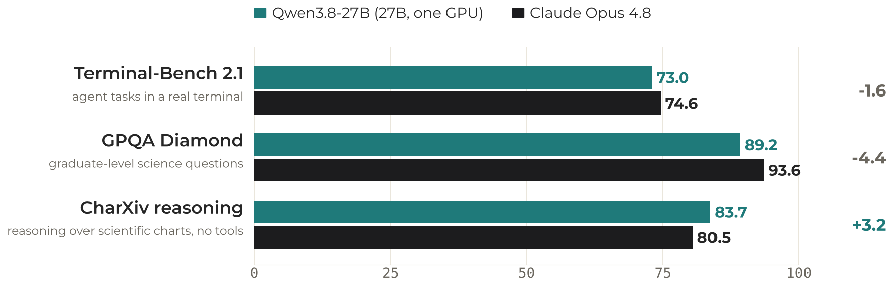

:::::::::::::::::::::::::::::::::::::: questions

- When does a RAG pipeline need a self-hosted, open-weight model instead of Bedrock?
- How do we run the embedding and generation steps of the WattBot pipeline as SageMaker Processing jobs that end on their own?
- How do we pass data in and out of a job through S3, and tag the job so its cost is traceable?

::::::::::::::::::::::::::::::::::::::::::::::::

::::::::::::::::::::::::::::::::::::: objectives

- Explain why Bedrock's catalog is not enough when you need a specific open-weight model, and why a Processing job is the default way to self-host one for batch work.
- Launch a GPU Processing job that embeds the cached WattBot chunks with a self-hosted embedding model and writes the vectors to S3.
- Launch a second Processing job that runs Qwen3-8B (an open-weight model in a size Bedrock does not carry) with `transformers` and runs the full RAG loop over the training questions.
- Read a job's inputs, outputs, arguments and runtime cap, and relate its duration to what it cost.
- Score the batch predictions with the WattBot metric and compare against the Bedrock run.

::::::::::::::::::::::::::::::::::::::::::::::::

Open the notebook from: `/ML_with_AWS_SageMaker/notebooks/12_RAG-Processing-jobs.ipynb`. Select the **`conda_pytorch`** kernel.
## When Bedrock does not have your model

The Bedrock episode is the default for RAG: per-token billing, nothing left running, two API calls. Bedrock's catalog is curated, though. It carries Amazon's models, Anthropic, Meta, Mistral, DeepSeek, and a few others, and within a family only some sizes, usually a generation behind: for Qwen, the serverless lineup is still the Qwen3 series. Hugging Face hosts well over a million open-weight checkpoints. The one you want (the newest release, a specific size, a fine-tune for scientific text, a model a paper just published) is usually not on Bedrock, and often never will be.

When that happens you host the model yourself on a GPU you rent, and the question becomes *how*. There are three ways to rent a GPU on SageMaker:

| | Bills | Stops when | Best for |
|---|---|---|---|
| GPU notebook instance | by the hour from start to stop | **you** stop it | interactive debugging, prototyping at the keyboard |
| Processing or training job | by the second while the job runs | the script ends, or `max_runtime_in_seconds` | batch work: embed a corpus, answer a list of questions, train |
| Inference endpoint | by the hour while deployed | you delete it | serving a model to an application with steady traffic |

For research RAG, almost all the work is batch: embed everything once, answer a list of questions, score them. That is a job, and a job is the one option that cannot be forgotten. This episode runs the WattBot pipeline that way. The notebook itself is a small CPU instance and never touches the model; it stages data, launches two GPU jobs, and reads the results back.

The generator is **Qwen3-8B**, an 8-billion-parameter open-weight model (Apache 2.0). Bedrock serves the 32B and 235B members of that family but not this size, which is the usual situation: the size you want is the one missing. The job runs it with `transformers`, the same library the fine-tuning episode trained with: `from_pretrained` downloads the weights onto the GPU, and `generate` writes the answer to a chat prompt, the self-hosted counterpart of what Bedrock does behind `converse`. Inference needs no gradients, so the weights are the memory cost: 8B parameters at two bytes each in bf16 is about 16 GB, which fits the 24 GB GPU of an `ml.g5.xlarge` with room for the KV cache. (The fine-tuning episode has the full memory arithmetic; the short version is that inference needs only the weights and training needs eight times more per parameter.)

Open-weight models that fit one GPU are now close to the frontier on the kinds of tasks research code runs, on data that never leaves your account. The newest of this family, Qwen3.8-27B, fits one GPU and lands within a few points of a frontier commercial model:

{alt="Paired horizontal bars comparing a 27B open-weight model on one GPU with a frontier commercial model; within a few points on agent tasks and science questions, ahead on chart reasoning"}

Qwen figures are from the Qwen3.8-27B model card and were not reproduced here; Opus 4.8 figures are from its published evaluations.

::::::::::::::::::::::::::::::::::::: callout

### What this episode costs

Rates are us-east-1 on-demand from the [Instances for ML](https://carpentries-incubator.github.io/ML_with_AWS_SageMaker/instances-for-ML.html) page.

| Job | Instance | `$`/h | Expected duration | Cost |
|---|---|---|---|---|
| Embed ~9,000 chunks | `ml.g5.xlarge` (A10G, 24 GB) | `$1.41` | ~10 min incl. startup | ~`$0.20` |
| RAG over a 53-question sample with Qwen3-8B | `ml.g5.xlarge` (A10G, 24 GB) | `$1.41` | ~20 min: 1 provisioning, ~4 downloading and loading 16 GB of weights, ~13 generating | ~`$0.40` |
| Controller notebook | `ml.t3.medium` | `$0.05` | 2 h | `$0.10` |

About `$0.70` for the episode, and the GPUs are off the moment each script ends. The RAG job answers the same stratified sample of questions as the Bedrock episode (ten per evidence type, 53 questions once the two papers the corpus lacks are dropped); all 220 is about an hour of generation, so run that at home. Both jobs carry `max_runtime_in_seconds`, so a hung job costs at most the cap. Compare the same pipeline on a GPU notebook instance (the optional GPU-notebook episode that follows): the meter runs until someone stops it, and a forgotten `ml.g5.xlarge` is `$34` a day.


The trade-off is latency. A job takes minutes to start, so this pattern is for batch questions, not a chatbot. For interactive use, Bedrock answers in seconds; for interactive use of a model Bedrock does not have, an inference endpoint does, at an hourly rate you have to remember to turn off.

::::::::::::::::::::::::::::::::::::::::::::::::

In this episode we will:

- Reuse the chunks cached in your bucket by the Bedrock episode and the inputs in the shared bucket.
- Run two short-lived GPU Processing jobs: one computes embeddings for all chunks; the second runs Qwen3-8B with `transformers` and the full RAG loop (retrieval + generation) over the same 53-question sample as the Bedrock episode.
- Score the result and compare it with the Bedrock run.


## Setup

### A code folder for each job

The four scripts the jobs need are already on this instance, in the lesson clone, but a job cannot use them from there: it runs in a container on another machine, cannot import anything from this notebook, and the only code it gets is the one directory named by `source_dir=`, uploaded whole. So each job gets a small folder holding just the files it imports, copied out of the clone, rather than `source_dir` pointing at the lesson's whole `scripts/` directory. The four files:

- `scripts/embedding_inference.py`: generic embedding script (JSONL with a `text` field in, `embeddings.npy` out).
- `scripts/hf_embedder.py`: the embedding model wrapper both jobs use, on plain `transformers` (mean pooling and normalisation, thirty lines), so neither job has to install anything for it.
- `scripts/wattbot_rag_batch.py`: the WattBot RAG loop as a batch job: loads the inputs, runs the generator, writes `wattbot_solutions.csv`.
- `scripts/wattbot_rag.py`: the shared pipeline logic (retrieval, prompts, answer parsing, `run_single_qa`, the scorer) that the Bedrock episode imported too. The batch script imports it, so it ships with the job; the notebook imports it for scoring.

The cell below copies them out of the lesson clone into the project folder, one directory per job: `code_embed/` for the embedding job and `code_rag/` for the RAG job. The split follows from how a job gets its code. `run(source_dir=...)` uploads that whole directory into the container, the same way the training estimator's `source_dir` did in the fine-tuning episode, so each directory holds exactly the files its job imports. The copies of `wattbot_rag.py` and `Score.py` next to the notebook are for the scoring step at the end, which runs in the notebook, not in a job.

```python
!mkdir -p /home/ec2-user/SageMaker/wattbot   # the same project folder the Bedrock episode used, beside the lesson clone
%cd /home/ec2-user/SageMaker/wattbot

# One source directory per job: SageMaker uploads the whole directory into the container
!mkdir -p code_embed code_rag
# The embedding job's script
!cp /home/ec2-user/SageMaker/ML_with_AWS_SageMaker/scripts/embedding_inference.py /home/ec2-user/SageMaker/ML_with_AWS_SageMaker/scripts/hf_embedder.py code_embed/
# The RAG job's script plus the shared module it imports (the container cannot see this notebook)
!cp /home/ec2-user/SageMaker/ML_with_AWS_SageMaker/scripts/wattbot_rag_batch.py /home/ec2-user/SageMaker/ML_with_AWS_SageMaker/scripts/wattbot_rag.py /home/ec2-user/SageMaker/ML_with_AWS_SageMaker/scripts/hf_embedder.py code_rag/
# The notebook's own copies, for scoring at the end: the pipeline module and the competition's metric file
!cp /home/ec2-user/SageMaker/ML_with_AWS_SageMaker/scripts/wattbot_rag.py /home/ec2-user/SageMaker/ML_with_AWS_SageMaker/scripts/Score.py .
!ls code_embed code_rag
```

Next, set up the AWS SDK, SageMaker session, and bucket names.

```python
import os
import json

import boto3
import time
import numpy as np
import pandas as pd
import os
os.environ["SAGEMAKER_SUPPRESS_V2_WARNING"] = "1"   # the SDK otherwise prints a deprecation notice on import and on every estimator
import sagemaker
import logging
logging.getLogger("sagemaker.telemetry.telemetry_logging").setLevel(logging.WARNING)   # silence the telemetry notice; the "Creating training-job" line still prints
logging.getLogger("sagemaker.image_uris").setLevel(logging.WARNING)
logging.getLogger("sagemaker.config").addFilter(lambda record: record.levelno >= logging.WARNING)   # drop the two "Not applying SDK defaults" lines; a filter holds even where the SDK resets the logger's level
from sagemaker import get_execution_role
from sagemaker.huggingface import HuggingFaceProcessor         # launches a job in the prebuilt Hugging Face container
from sagemaker.processing import ProcessingInput, ProcessingOutput   # S3 <-> container path mappings for a job

session = sagemaker.Session()
region = session.boto_region_name
role = get_execution_role()   # the IAM role the jobs run under to read and write S3

shared_bucket = "ml-marathon-shared"   # the instructor-staged, read-only bucket with the data and model weights; change only on your own account
bucket_name = "sinkorswim-doejohn"     # <-- EDIT ME: your own bucket (chunks in, outputs out)
s3_client = boto3.client("s3", region_name=region)

local_data_dir = "./data"
os.makedirs(local_data_dir, exist_ok=True)

print("Region:", region)
print("Role:", role)
print("Bucket:", bucket_name)
```


## Step 1 – Check the inputs

The jobs read three files from S3: `train_QA.csv` and `metadata.csv` from the shared bucket, and `chunks.jsonl` from your bucket, where the Bedrock episode cached it. The PDFs themselves are not needed again: chunking was done once, and the jobs work from the chunks. We download the three files to the notebook only to confirm they exist and to look at them; the jobs fetch their own copies from S3.

First the keys and the full S3 URIs. The URIs are the form a `ProcessingInput` takes, so they are built here once and reused when the jobs are launched.

```python
train_qa_key = "wattbot/train_QA.csv"
metadata_key = "wattbot/metadata.csv"
chunks_s3_key = "wattbot/chunks.jsonl"

# Full S3 URIs: this is the form a ProcessingInput takes
train_qa_s3 = f"s3://{shared_bucket}/{train_qa_key}"
metadata_s3 = f"s3://{shared_bucket}/{metadata_key}"
chunks_s3_uri = f"s3://{bucket_name}/{chunks_s3_key}"

def smart_read_csv(path: str) -> pd.DataFrame:
    """Read a CSV as utf-8, falling back to latin-1 for the odd accented author name."""
    try:
        return pd.read_csv(path)
    except UnicodeDecodeError:
        return pd.read_csv(path, encoding="latin-1")
```

Then download the three files, skipping any already on disk, and load them so we can check the counts before spending GPU time on them.

```python
train_qa_path = os.path.join(local_data_dir, "train_QA.csv")
metadata_path = os.path.join(local_data_dir, "metadata.csv")
local_chunks_path = os.path.join(local_data_dir, "chunks.jsonl")

if not os.path.exists(train_qa_path):
    s3_client.download_file(shared_bucket, train_qa_key, train_qa_path)
if not os.path.exists(metadata_path):
    s3_client.download_file(shared_bucket, metadata_key, metadata_path)
if not os.path.exists(local_chunks_path):
    s3_client.download_file(bucket_name, chunks_s3_key, local_chunks_path)   # written by the Bedrock episode

train_df = smart_read_csv(train_qa_path)
metadata_df = smart_read_csv(metadata_path)
with open(local_chunks_path, "r", encoding="utf-8") as f:
    chunked_docs = [json.loads(line) for line in f]

print("Train QAs:", len(train_df))
print("Metadata rows:", len(metadata_df))
print("Chunks:", len(chunked_docs), "from", chunks_s3_uri)
train_df.head(3)
```

If the last download fails with `NoSuchKey`, go back to the Bedrock episode and run its chunking step; this episode starts from its output.


## Step 2 – Processing Job 1: embed all chunks on a GPU

Now we launch a short-lived Hugging Face **Processing job** that:

1. Downloads `chunks.jsonl` from S3.
2. Loads `thenlper/gte-large` from Hugging Face with the container's own `transformers`.
3. Encodes each chunk into an embedding vector.
4. Saves the full matrix as `embeddings.npy` back to S3.

We use the same `embedding_inference.py` script across projects; here it expects a JSONL file with a `text` field.

### Nothing to install

Neither job installs anything. The Hugging Face container ships `transformers` and PyTorch, which is all the embedding wrapper and the generator need, so both jobs start as soon as the instance is up. A `requirements.txt` next to a script would be pip-installed before it runs; neither job here has one.

### Cost tracking: tag every job

Tags do **not** propagate in AWS. The tags you put on your notebook instance cover the notebook's hourly cost and nothing else. Each Processing job below launches its own GPU instance, which is a separate billable resource with no tags unless we pass them at launch, exactly as we did for training and tuning jobs earlier in the workshop. An untagged job shows up in Cost Explorer as anonymous SageMaker spend that nobody can attribute to a team.

Define the tags once and pass `tags=job_tags` to **every** `HuggingFaceProcessor` you create. Use a distinct `Purpose` per job so you can tell the embedding job from the batch RAG job on the bill.

```python
name = "DoeJohn"         # replace with your name
project = "SinkOrSwim"   # your challenge: WattBot2026, BadgerScribe, BadgerCode, BrainDecoding, PoisonedWell or SnapshotWI; SinkOrSwim is the workshop itself

import sys
sys.path.insert(0, "/home/ec2-user/SageMaker/ML_with_AWS_SageMaker/scripts")
import helpers   # check_launch: the account's rules, with a message that names the problem

def make_job_tags(purpose: str):   # one of: Storage, Notebook, Training, Tuning, Inference
    return helpers.check_launch([   # checked against the account's rules first, with a message that names the problem
        {"Key": "Name", "Value": name},
        {"Key": "Project", "Value": project},
        {"Key": "Purpose", "Value": purpose},   # differs per job so the bill tells them apart
    ])

print("Tags on every job this episode launches:", make_job_tags("Inference"))   # check them before launching: a job tagged DoeJohn is on the bill as DoeJohn
```

### Launch the embedding job

Open `scripts/embedding_inference.py` first; it is under fifty lines. It reads a JSONL file of chunks from the job's input directory, embeds them with whatever Hugging Face model `--model_id` names, through the thirty-line wrapper in `hf_embedder.py`, normalises the vectors so a dot product is a cosine similarity, and saves one `embeddings.npy` to the output directory. Nothing in it knows about WattBot: inputs in, outputs out, no state.

A `HuggingFaceProcessor` is the Processing-job counterpart of the estimator: the same role, tags, instance type and container versions, plus a runtime cap. Its `run` call names the script, mounts the inputs, and says where the output goes. Once it is launched, the job appears on the [Processing jobs page](https://us-east-2.console.aws.amazon.com/sagemaker/home?region=us-east-2#/processing-jobs) of the SageMaker console (under **Data preparation** in the left menu), the Processing counterpart of the Training jobs page you used earlier.

In class the instructor has run this job already and staged its output. The switch below copies that matrix into your bucket, at the key the job would have written, and the launch cell then skips the job: the second job, which you do launch, has the same shape and is where the class spends its GPU minutes. On your own, set it to `False` and run the job; it is eight minutes.

```python
def _s3_object_exists(bucket: str, key: str) -> bool:
    try:
        s3_client.head_object(Bucket=bucket, Key=key)
        return True
    except s3_client.exceptions.ClientError:
        return False

embedding_model_id = "thenlper/gte-large"
emb_output_prefix = "wattbot/embeddings"
emb_output_path = f"s3://{bucket_name}/{emb_output_prefix}/"

use_instructor_embeddings = True                       # True in class: copy the instructor's gte-large matrix and skip the job. False: run the job
shared_gte_key = "wattbot/embeddings_gte_large.npy"    # where the instructor staged it in the shared bucket

run_embedding_job = not (use_instructor_embeddings and _s3_object_exists(shared_bucket, shared_gte_key))
if not run_embedding_job:
    s3_client.copy({"Bucket": shared_bucket, "Key": shared_gte_key}, bucket_name, f"{emb_output_prefix}/embeddings.npy")
    print(f"Copied the instructor's embeddings to s3://{bucket_name}/{emb_output_prefix}/embeddings.npy; the embedding job is skipped")
```

```python

embedding_processor = HuggingFaceProcessor(
    base_job_name="WattBot-embed-gte-large",   # SageMaker appends a timestamp to make each job name unique
    role=role,
    tags=make_job_tags("Inference"),   # tags are per job; nothing is inherited from the notebook
    instance_type="ml.g5.xlarge",      # the GPU the job rents (A10G, 24 GB): plenty for a 335M-parameter embedder
    instance_count=1,
    transformers_version="4.56",       # these three pick the prebuilt container image
    pytorch_version="2.8",
    py_version="py312",
    sagemaker_session=session,
    max_runtime_in_seconds=2 * 60 * 60,   # 2 hours, in seconds (2 h x 60 min x 60 s); the estimate is ~8 minutes. SageMaker kills the job here, so a hang costs at most this
)

if run_embedding_job:   # False in class when the instructor's matrix was copied in above
    # run() uploads the code, starts the instance, streams the job's log here and returns when the script ends (wait=True is the default)
    start = time.time()
    embedding_processor.run(
        code="embedding_inference.py",     # the script the container runs...
        source_dir="code_embed/",          # ...uploaded with everything beside it (hf_embedder.py)
        inputs=[
            ProcessingInput(
                source=chunks_s3_uri,                       # S3 object (or prefix) copied in before the script starts
                destination="/opt/ml/processing/input",    # where it appears inside the container
            )
        ],
        outputs=[
            ProcessingOutput(
                output_name="embeddings",
                source="/opt/ml/processing/output",        # whatever the script writes here...
                destination=emb_output_path,               # ...is copied to this S3 prefix when the script ends
            )
        ],
        arguments=[                        # command-line flags, as the script's argparse expects them
            "--model_id", embedding_model_id,
            "--input_filename", "chunks.jsonl",
            "--text_key", "text",
            "--input_dir", "/opt/ml/processing/input",
            "--output_dir", "/opt/ml/processing/output",
        ],
    )

    print(f"Embedding job complete: {(time.time() - start) / 60:.1f} min wall-clock, including instance startup")
```

### Check on the running job in the AWS Console

To view the job running from the AWS Console, you can visit SageMaker AI, and then find the "Data Preparation" dropdown menu on the left side panel. Click that to find "Processing jobs", or open [this link](https://us-east-2.console.aws.amazon.com/sagemaker/home?region=us-east-2#/processing-jobs) in the class region (change `us-east-2` in it for another region).

It takes about 10 minutes in total for the job to complete: a couple of provisioning the instance and downloading the embedding model, eight of embedding. That startup is the cost of a job, paid once: the embedding job runs once per corpus, and the GPU bills only while it runs.


### Sanity-check the embeddings locally

We can download `embeddings.npy` back into the notebook and inspect its shape to confirm the job ran successfully.

```python
local_embeddings_path = os.path.join(local_data_dir, "embeddings.npy")
embeddings_key = f"{emb_output_prefix}/embeddings.npy"   # the ProcessingOutput destination + the filename the script wrote

s3_client.download_file(bucket_name, embeddings_key, local_embeddings_path)
chunk_embeddings = np.load(local_embeddings_path)

print("Embeddings shape:", chunk_embeddings.shape, "for", len(chunked_docs), "chunks")
```


## Step 3 – Processing Job 2: the WattBot RAG loop as a job

For the second job, we pass four inputs:

- `chunks.jsonl` – serialized chunks (your bucket)
- `embeddings.npy` – precomputed chunk embeddings (your bucket, written by Job 1)
- `train_QA.csv` – training questions (shared bucket)
- `metadata.csv` – to resolve `ref_id` → URL (shared bucket)

The `--per_type 10` argument draws the same stratified sample the Bedrock episode scored, ten questions per evidence type with the same seed, so the two runs are compared on the same questions; leave it out to answer them all. Open `scripts/wattbot_rag_batch.py` and read `main` before launching it. It is short, because the pipeline lives in `scripts/wattbot_rag.py`, the same module the Bedrock episode imported:

- `retrieve_top_k`: cosine similarity over the embedding matrix
- `run_single_qa`: retrieval, the answer call, the hybrid unanswerable rule (retrieval threshold OR the model's own `is_blank`), the explanation call
- `compute_wattbot_score`: the metric we use at the end

What the batch script adds is the two model callables: `embed_query` wraps the same `gte-large` model and pooling the embedding job used (`hf_embedder.py`) (the question has to be embedded with the same model as the chunks), and `generate_batch` wraps `transformers.generate` on the generator (Qwen3-8B here) with Qwen's thinking mode off, taking several prompts at once. The loop itself is `run_batch_qa`, the batched twin of the `run_single_qa` the Bedrock episode used: the same retrieval, prompts and unanswerable rule, with the model calls grouped four at a time because a GPU decoding one prompt is idle most of the time. The group is a trade: more prompts at once is faster, and each one adds its own cache of attention keys and values to the 16 GB the weights already hold, so a group of long prompts can run the 24 GB card out of memory. The script halves the group and retries when that happens, so a long batch costs time rather than the job. The job writes `wattbot_solutions.csv` in the WattBot submission format.

::::::::::::::::::::::::::::::::::::: callout

### Why not vLLM?

vLLM is the open-source inference engine most people serve open-weight models with: you give it a model name, it loads the weights onto the GPU and answers chat requests, batching many at once so that throughput scales. That is what you want behind an API with users. This job has about 100 prompts and no users waiting, and `transformers.generate`, already in the container, can decode several prompts at once too: `run_batch_qa` in `wattbot_rag.py` hands them to the model four at a time (`--batch_size`), which is where most of vLLM's speed on a batch like this comes from, with nothing to install. vLLM's install is several gigabytes of billed GPU time before the first answer. The GPU-notebook episode uses vLLM, where its 8-bit weights are needed to fit a larger model.

::::::::::::::::::::::::::::::::::::::::::::::::

```python
emb_output_s3 = f"s3://{bucket_name}/{emb_output_prefix}/embeddings.npy"

print("chunks:    ", chunks_s3_uri)
print("embeddings:", emb_output_s3)
print("train_QA:  ", train_qa_s3)
print("metadata:  ", metadata_s3)
```

If the launch is refused with an `AccessDeniedException` ending in `explicit deny`, the account's checks are the cause: a missing tag, an instance type outside the lesson's list, or a resource kind the lesson never creates; the first training episode's callout *If the launch is refused* says what to look at. If the launch below fails at once with `ResourceLimitExceeded` naming an instance type, nothing in the notebook is wrong: the account's quota for that type is too low, and the increase is requested in [Service Quotas](https://us-east-2.console.aws.amazon.com/servicequotas/home/services/sagemaker/quotas) (days, for GPU types). On your own account, request `ml.g5.xlarge for processing job usage` before you start.

### What launching a job means

This is the first GPU job you launch yourself in this episode (the embedding job above was staged for you in class), so this is what happens when you launch one. You describe a machine and point at a script. SageMaker rents the machine, copies the files you named from S3 onto its disk, runs your script on it, copies whatever the script wrote in its output folder back to S3, and shuts the machine down. The notebook does nothing but wait and show you the script's printed output. Nothing from this notebook's memory goes along: not `chunked_docs`, not `train_df`, not any function defined above. The script sees only the files you copied in and the arguments you gave it, which is why every input is an S3 location and every setting is a command-line flag. That is the same thing `estimator.fit` did in the fine-tuning episode, with one difference: a training job hands back a trained model, a Processing job hands back whatever files the script wrote, here a CSV of answers.

The description is two cells. The first builds a `HuggingFaceProcessor`: which machine, which container image, how long it may run, whose tags it carries. Two of its settings matter more than on the embedding job. `volume_size_in_gb=60` attaches a 60 GB volume to the instance, mounted under `/opt/ml/processing`; the container's own root disk is small, so the 16 GB of model weights must not land there. `env=` sets two environment variables in the container: `HF_HOME` points Hugging Face's download cache at that volume, which is where the weights go, and `PYTORCH_CUDA_ALLOC_CONF` tells PyTorch to reuse freed GPU memory in place rather than leave it fragmented, which matters when a batch of prompts is close to what the card holds.

```python
rag_output_prefix = "wattbot/solutions"                       # where this job's output lands in your bucket
rag_output_path = f"s3://{bucket_name}/{rag_output_prefix}/"

generation_model_id = "Qwen/Qwen3-8B"   # the Hugging Face name the job downloads; ~16 GB of bf16 weights

rag_processor = HuggingFaceProcessor(
    base_job_name="WattBot-rag-batch",   # SageMaker appends a timestamp; this is the name you look for on the Processing jobs page
    role=role,                           # the IAM role the job runs under, to read your bucket and the shared one
    tags=make_job_tags("Inference"),     # separate job, separate tags: nothing is inherited from the embedding job
    instance_type="ml.g5.xlarge",        # 1 x A10G, 24 GB: holds the bf16 8B model plus the KV cache
    instance_count=1,
    volume_size_in_gb=60,                # disk attached to the instance, mounted at /opt/ml/processing; the weights go here
    env={"HF_HOME": "/opt/ml/processing/hf_cache",                  # environment variables in the container: Hugging Face downloads to this path...
         "PYTORCH_CUDA_ALLOC_CONF": "expandable_segments:True"},   # ...and PyTorch reuses freed GPU memory instead of fragmenting it, which is what a batch of long prompts runs out of
    transformers_version="4.56",         # these three pick the prebuilt container image, the same one the embedding job used
    pytorch_version="2.8",
    py_version="py312",
    sagemaker_session=session,
    max_runtime_in_seconds=2 * 60 * 60,  # the cap: SageMaker kills the job after 2 hours; the estimate is 20 minutes
)
```

The processor is only a description; nothing runs until `run`. Its arguments are the three things a job needs: the code (`code` and `source_dir`), the data (`inputs`, each an S3 location and the container path it is copied to before the script starts), and where the results go (`outputs`, a container path copied to S3 when the script ends). The `arguments` list is the script's command line, in the form its `argparse` expects.

```python
start = time.time()
rag_processor.run(
    code="wattbot_rag_batch.py",       # the script the container runs...
    source_dir="code_rag/",            # ...uploaded with everything beside it: wattbot_rag.py and hf_embedder.py, which it imports
    inputs=[                           # each input: an S3 object, and the container path it is copied to before the script starts
        ProcessingInput(
            source=chunks_s3_uri,                              # the chunks, from your bucket
            destination="/opt/ml/processing/input/chunks",     # four inputs, each in its own subdirectory
        ),
        ProcessingInput(
            source=emb_output_s3,                              # the gte-large matrix the embedding job wrote
            destination="/opt/ml/processing/input/embeddings",
        ),
        ProcessingInput(
            source=train_qa_s3,                                # the questions, from the shared bucket
            destination="/opt/ml/processing/input/train",
        ),
        ProcessingInput(
            source=metadata_s3,                                # the paper index, to fill the ref_url column
            destination="/opt/ml/processing/input/metadata",
        ),
    ],
    outputs=[
        ProcessingOutput(
            output_name="solutions",
            source="/opt/ml/processing/output",                # whatever the script writes here...
            destination=rag_output_path,                       # ...is copied to this S3 prefix when the script ends
        )
    ],
    arguments=[                        # the script's command line: python wattbot_rag_batch.py --input_dir ... --top_k 8 ...
        "--input_dir", "/opt/ml/processing/input",             # where the inputs above were mounted
        "--output_dir", "/opt/ml/processing/output",           # where the script must write for the output copy to pick it up
        "--embedding_model_id", embedding_model_id,            # the same model that embedded the chunks, to embed each question
        "--qwen_model_id", generation_model_id,                # the generator
        "--top_k", "8",                                        # chunks handed to the model per question
        "--retrieval_threshold", "0.25",                       # best cosine below this => unanswerable
        "--per_type", "10",                                    # the same stratified sample the Bedrock episode scored (seed 0); drop it for all the questions
        "--batch_size", "4",                                   # prompts decoded together; 1 would be one at a time, several times slower. 8 ran out of GPU memory on long prompts
    ],
)

print(f"RAG batch job complete: {(time.time() - start) / 60:.1f} min wall-clock, including instance startup and the weight download")
```

While it runs, read what the container is printing. Open the [Processing jobs page](https://us-east-2.console.aws.amazon.com/sagemaker/home?region=us-east-2#/processing-jobs), click the job's name, scroll to **Monitor** and click **View logs**. That opens CloudWatch, the AWS service that stores every job's printed output, at a list with one entry named after your job; click it. The text is the container's stdout, kept after the job ends, updated while it runs (refresh). You will see, in order: `Loading model with transformers`, the weight download (16 GB in shards), a line per batch of answers and of explanations, then one line per question. The whole job is the 20 minutes in the cost callout; the generation is the second half of it.


## Step 4 – Download predictions and evaluate

Finally, we download `wattbot_solutions.csv` from S3, inspect a few rows, and compute the WattBot score against `train_QA.csv` with the same `compute_wattbot_score` the Bedrock episode used.

```python
solutions_key = f"{rag_output_prefix}/wattbot_solutions.csv"
local_solutions_path = os.path.join(local_data_dir, "wattbot_solutions.csv")

s3_client.download_file(bucket_name, solutions_key, local_solutions_path)
solutions_df = pd.read_csv(local_solutions_path)
solutions_df.head()
```

Score the predictions with the competition's own `Score.py`, through the same wrapper the Bedrock episode used, so the two runs compare directly.

```python
from wattbot_rag import compute_wattbot_score

results_df = compute_wattbot_score(
    train_qa_path=train_qa_path,
    preds_path=local_solutions_path,
    n_examples=10,
)
```

Compare the overall score with the Bedrock run. The retrieval logic, prompts and scoring are identical, so any difference is the two models: `gte-large` versus Titan for retrieval, Qwen3-8B versus DeepSeek V3 for generation. In one run on the same 53 questions, Qwen3-8B scored 0.57 against DeepSeek V3's 0.66: its citations were better (F1 0.70 against 0.57) and its answers worse (51% against 66% correct), with the cross-paper and calculation questions losing the most. An 8B model against a 671B one is not a fair fight, and the gap is the price of a model you host yourself on one small GPU.

::::::::::::::::::::::::::::::::::::: challenge

### What did the two jobs cost?

Ask SageMaker what it recorded for each job: `session.sagemaker_client.describe_processing_job(ProcessingJobName=...)` returns `CreationTime`, `ProcessingStartTime` and `ProcessingEndTime`. The job names are `embedding_processor.latest_job.job_name` and `rag_processor.latest_job.job_name`. For each job, compute the minutes between creation and start (provisioning, before the instance is billed) and between start and end (the billed window), and price the billed window at `$1.41`/h, the `ml.g5.xlarge` rate both jobs used. Then, from the RAG job's CloudWatch log timestamps, estimate how much of its billed window was setup (the weight download and model load) and how much was generation. How does the total compare with the cost callout, and with the Bedrock run?

:::::::::::::::::::::::: solution

`describe_processing_job` returns three timestamps; the gap between the first two is unbilled provisioning, between the last two the billed run.

```python
def job_cost(job_name: str, price_per_hour: float):
    d = session.sagemaker_client.describe_processing_job(ProcessingJobName=job_name)   # the record SageMaker keeps for the job
    # CreationTime -> ProcessingStartTime: provisioning the instance, not billed
    provisioning = (d["ProcessingStartTime"] - d["CreationTime"]).total_seconds() / 60
    # ProcessingStartTime -> ProcessingEndTime: the script running, billed by the second
    billed = (d["ProcessingEndTime"] - d["ProcessingStartTime"]).total_seconds() / 60
    cost = billed / 60 * price_per_hour
    print(f"{job_name}: {d['ProcessingJobStatus']}")
    print(f"  wall-clock:                {provisioning + billed:.1f} min from launch to end")
    print(f"  provisioning (not billed): {provisioning:.1f} min")
    print(f"  billed window:             {billed:.1f} min at ${price_per_hour}/h = ${cost:.2f}")
    print(f"  output:                    {d['ProcessingOutputConfig']['Outputs'][0]['S3Output']['S3Uri']}")   # where the job's files went
    return cost

total = job_cost(embedding_processor.latest_job.job_name, 1.41) if run_embedding_job else 0.0   # no job to price when the matrix was copied in
total += job_cost(rag_processor.latest_job.job_name, 1.41)
print(f"GPU total for the episode: ${total:.2f}")
```

Expect the embedding job to bill about 8 minutes (about `$0.20`) and the RAG job about 17 minutes (about `$0.40`), so about `$0.60` of GPU time, the callout's GPU figure. In the RAG job's log, the first 4 minutes of the billed window are the download and the model load; the rest is the questions, two generation calls each. Setup is a third of what you paid for, which is the argument for keeping an `HF_HOME` cache on S3 (skip the download) once a job is run routinely. The Bedrock run of the same questions cost cents, and the self-hosted route is only justified here because the model is not in the catalog.

:::::::::::::::::::::::::::::::::

::::::::::::::::::::::::::::::::::::::::::::::::

::::::::::::::::::::::::::::::::::::: challenge

### What a shorter runtime cap would have done

Both processors set `max_runtime_in_seconds=2 * 60 * 60`. Predict what would happen if the RAG job were launched with `max_runtime_in_seconds=600` instead: what does the job status become, what is in the output prefix, and what did it cost? Then compute the most a hung job can bill under each job's actual cap, and compare it with the cost of an `ml.g6e.xlarge` notebook instance left running over a weekend (64 hours).

:::::::::::::::::::::::: solution

With a 600-second cap the RAG job is killed by SageMaker ten minutes after `ProcessingStartTime`, while it is still downloading or loading the weights. The status becomes `Stopped` (the failure reason reads `MaxRuntimeExceeded`), the output prefix is empty because the script never reached the point of writing `wattbot_solutions.csv`, and the bill is the full 600 seconds: 600 / 3600 × `$1.41` ≈ `$0.24` for nothing. A cap has to leave room for the setup that precedes the work, which is why ours is six times the 20-minute estimate rather than ten percent over it.

Under the caps we set, the worst case for a job that hangs (a stuck download, a model that never finishes loading) is 2 h × `$1.41` = **`$2.82`** for either job. An `ml.g6e.xlarge` notebook instance forgotten over a weekend is 64 h × `$2.61` = **`$167`**, and nothing caps it.

:::::::::::::::::::::::::::::::::

::::::::::::::::::::::::::::::::::::::::::::::::

::::::::::::::::::::::::::::::::::::: keypoints

- Bedrock's catalog is curated and lags releases; when you need a specific open-weight model you rent a GPU and serve it yourself.
- Of the ways to rent a GPU, a Processing job is the one that cannot be forgotten: it bills while the script runs and ends on its own, with `max_runtime_in_seconds` as the backstop. Use it for batch work; use Bedrock or an endpoint when you need answers in seconds.
- Inference needs only the weights: Qwen3-8B in bf16 is ~16 GB and fits one 24 GB GPU, with the rest for the prompts' attention cache; how many prompts decode together is bounded by that remainder.
- A job's inputs and outputs are S3 prefixes mounted into the container; the notebook only stages files and reads results, so it stays a cheap CPU instance.
- The pipeline logic (`wattbot_rag.py`) ships with the job unchanged from the Bedrock episode; only the two model callables differ.
- Tags do not propagate from the notebook: every job gets its own `tags=`.

::::::::::::::::::::::::::::::::::::::::::::::::
