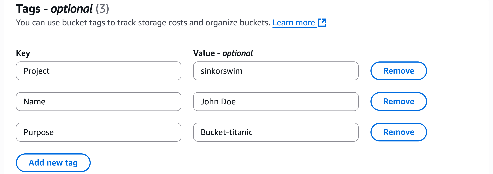

:::::::::::::::::::::::::::::::::::::: questions 

- How can I store and manage data effectively in AWS for SageMaker workflows?
- What are the best practices for using S3 versus EC2 storage for machine learning projects?

::::::::::::::::::::::::::::::::::::::::::::::::

::::::::::::::::::::::::::::::::::::: objectives

- Explain data storage options in AWS for machine learning projects.
- Describe the advantages of S3 for large datasets and multi-user workflows.
- Outline steps to set up an S3 bucket and manage data within SageMaker.

::::::::::::::::::::::::::::::::::::::::::::::::

## Storing data on AWS
Machine learning and AI projects rely on data, making efficient storage and management essential. AWS provides several options for storing data, each with different use cases and trade-offs. 

> #### Consult your institution's IT before handling sensitive data in AWS
> When using AWS for research, **ensure that no restricted or sensitive data is uploaded to S3 or any other AWS service *unless explicitly approved by your institution’s IT or cloud security team***.
> For projects involving sensitive or regulated data (e.g., HIPAA, FERPA, or proprietary research data), consult your institution's cloud security or compliance team to explore approved solutions. This may include encryption, restricted-access storage, or dedicated secure environments. If unsure about data classification, review your institution's data security policies before uploading.

## Options for storage: EC2 Instance or S3
When working with SageMaker and other AWS services, you have options for data storage, primarily **EC2 instances** or **S3**.

### What is an EC2 instance?
An Amazon EC2 (Elastic Compute Cloud) instance is a virtual server environment where you can run applications, process data, and store data temporarily. EC2 instances come in various types and sizes to meet different computing and memory needs, making them versatile for tasks ranging from light web servers to intensive machine learning workloads. For example, when you launch a new Jupyter notebook from Sagemaker, this notebook is run on an an EC2 instance configured to run Jupyter notebooks, enabling direct data processing. 

### When to store data directly on EC2
Using an EC2 instance for data storage can be useful for temporary or small datasets, especially during processing within a Jupyter notebook. But this storage is tied to the instance. On a SageMaker notebook instance, files under `/home/ec2-user/SageMaker` survive a **Stop** (they live on an attached volume that persists while the instance exists) and are lost when the instance is **Deleted**; `pip install`s and files anywhere else on the instance are lost on every Stop. So EC2 storage is fine for one-off experiments or intermediate steps, not for anything you need to keep.

::::::::::::::::::::::::::::::::::::: callout 

### Limitations of EC2 storage

- **Scalability**: EC2 storage is limited to the instance’s disk capacity, so it may not be ideal for very large datasets.
- **Cost**: EC2 storage can be more costly for long-term use compared to S3.
- **Data Persistence**: Only `/home/ec2-user/SageMaker` survives a Stop, and nothing survives a Delete. Anything you want to keep belongs in S3 (or in a git repository).

::::::::::::::::::::::::::::::::::::::::::::::::

### What is an S3 bucket?
Storing data in an **S3 bucket** is generally preferred for machine learning workflows on AWS, especially when using SageMaker. An S3 bucket is a container in Amazon S3 (Simple Storage Service) where you can store, organize, and manage data files. Buckets act as the top-level directory within S3 and can hold a virtually unlimited number of files and folders, making them ideal for storing large datasets, backups, logs, or any files needed for your project. You access objects in a bucket via a unique **S3 URI** (e.g., `s3://your-bucket-name/your-file.csv`), which you can use to reference data across various AWS services like EC2 and SageMaker.

::::::::::::::::::::::::::::::::::::: callout 

### Benefits of using S3 (recommended for SageMaker and ML workflows)
For flexibility, scalability, and cost efficiency, store data in S3 and load it into EC2 as needed. This setup allows:  

- **Separation of storage and compute**: The most essential advantage. Data in S3 remains accessible even when EC2 instances are stopped or terminated, reducing costs and improving workflow flexibility.
- **Easy data sharing**: Datasets in S3 are easier to share with team members or across projects compared to EC2 storage.  
- **Integration with AWS services**: SageMaker, Lambda, and other AWS services can read directly from and write back to S3, streamlining ML workflows.  
- **Scalability**: S3 handles large datasets efficiently, enabling storage beyond the limits of an EC2 instance's disk space.  
- **Cost efficiency**: S3 storage is generally lower cost than expanding EC2 disk volumes, and you only pay for the storage you use.  
- **Data persistence**: Unlike EC2 storage, which is lost when an instance is deleted, S3 ensures long-term data availability.  

::::::::::::::::::::::::::::::::::::::::::::::::

## Recommended approach: S3 buckets

In order to upload our titanic dataset to an S3 bucket on AWS, we'll follow the below summary procedure (details follow):

1. Log in to AWS Console and navigate to S3.
2. Create a new bucket or use an existing one.
3. Upload your dataset files.
4. Use the object URL to reference your data in future experiments.

### Detailed procedure

##### 1. Sign in to the AWS Management Console
- Log in to AWS Console using your credentials.


##### 2. Navigate to S3
- Type "S3" in the search bar
- Recommended: Select the star icon to save S3 as a bookmark in your AWS toolbar 
- Select **S3 - Scalable Storage in the Cloud**

##### 3. Create a new bucket
- **AWS Region**: the region your instructor named (the same one your SageMaker notebook will use; in the workshop account it is US East (Ohio), `us-east-2`). SageMaker jobs can only read buckets in their own region, so a bucket created in another region shows up later as "access denied" or "no such bucket" errors from your jobs.
- Click **Create Bucket** and enter a unique name. Use the naming convention `challenge-lastnamefirstname`, all lowercase, e.g. `sinkorswim-doejohn`: the challenge you are working on (`wattbot2026`, `badgerscribe`, `badgercode`, ...), a hyphen, then your last and first name run together. S3 requires bucket names to be lowercase letters, digits and hyphens only (3 to 63 characters, starting and ending with a letter or digit, no underscores, no spaces), and the same lowercase string is what we will use for your notebook instance and your `Project` tag, so one name works everywhere. **This is the only bucket you will create in the workshop.** Every later episode writes its outputs (trained models, embeddings, predictions) into this same bucket under its own prefix, such as `xgboost/`, `wattbot/` or `badger-scribe/`.
- **Access Control (ACLs)**: Disable ACLs (recommended).  
	- **What are ACLs?** Access Control Lists (ACLs) define fine-grained permissions at the object level, allowing you to grant specific users or AWS accounts access to individual files in your bucket.  
	- **Why disable them?** AWS now recommends managing access through bucket policies and IAM roles, which offer better security and are easier to manage at scale. Unless you have a specific need for ACLs, disabling them is the best practice.
- **Public Access**: Turn on "Block all public access" (recommended). This setting prevents unauthorized access and accidental data exposure. If you need external access, use IAM policies or signed URLs instead.
- **Versioning**: Disable unless you need multiple versions of objects (unnecessary for ML Marathon). Enable only if needed, as versioning increases storage costs. Useful when tracking changes to datasets over time but unnecessary for static datasets.  
- **Tags (NOT OPTIONAL)**: Tags are key/value labels that let the bill be broken down by project, person, or purpose, which is how costs get traced back to you in a shared account. Tags only show up in cost reports if the tag *key* has been activated as a cost-allocation tag at the account level; on UW–Madison's AWS accounts that is done centrally for a fixed list of approved keys ([KB 72454](https://kb.wisc.edu/72454)), and `Name`, `Project` and `Purpose` are on that list. Any other spelling (`project`, `Team`, `Owner`) is silently ignored by the bill, so type the keys exactly as shown; capitalization matters. You will put the same three keys on every resource you create in this workshop, starting with this bucket:

	| Key | Value |
	|---|---|
	| `Project` | your challenge name, e.g. `sinkorswim` |
	| `Name` | your name, e.g. `John Doe` |
	| `Purpose` | `Workshop-storage` |

  Tag values are case-sensitive on the bill: `SinkOrSwim` and `sinkorswim` would be two separate rows in Cost Explorer. Use the same lowercase challenge name you put in the bucket name.

{alt="Screenshot showing required tags for an S3 bucket"}

- Click **Create Bucket** at the bottom once everything above has been configured


##### 4. Edit bucket policy
Once the bucket is created, you'll be brought to a page that shows all of your current buckets (and those on our shared account). We'll have to edit our bucket's policy to allow ourselves proper access to any files stored there (e.g., read from bucket, write to bucket). To set these permissions...

1. Click on the name of your bucket to bring up additional options and settings.
2. Click the Permissions tab
3. Scroll down to Bucket policy and click Edit. Paste the following policy, **editing the bucket name "sinkorswim-doejohn"** to reflect your bucket's name and replacing `<account-id>` with the 12-digit AWS account ID shown at the top right of the console (your instructor will also give it to you)

```json
{
	"Version": "2012-10-17",
	"Statement": [
		{
			"Effect": "Allow",
			"Principal": {
			    "AWS": [
			        "arn:aws:iam::<account-id>:role/ml-sagemaker-use",
			        "arn:aws:iam::<account-id>:role/ml-sagemaker-bedrock-use"
		        ]
			},
			"Action": [
				"s3:GetObject",
				"s3:PutObject",
				"s3:DeleteObject",
				"s3:ListMultipartUploadParts"
			],
			"Resource": [
				"arn:aws:s3:::sinkorswim-doejohn",
				"arn:aws:s3:::sinkorswim-doejohn/*"
			]
		}
	]
}
```

For workshop attendees, this policy grants the `ml-sagemaker-use` IAM role access to specific S3 bucket actions, ensuring they can use the bucket for reading, writing, deleting, and listing parts during multipart uploads. Attendees should apply this policy to their buckets to enable SageMaker to operate on stored data.

Two buckets appear in this workshop, and this is the only one you create. Your bucket holds the data *you* bring (the Titanic files, uploaded below) and everything the later episodes produce. The larger datasets for the RAG and fine-tuning episodes (a corpus of PDFs, hundreds of scanned letters) live in a **shared, read-only bucket** that the instructors stage before class: one copy for everyone, instead of fifty copies of the same files. You read from it and never upload to it; your instructor will give you its name.

::::::::::::::::::::::::::::::::::::: callout 

#### General guidance for setting up permissions outside of this workshop
When setting up a bucket outside of this workshop, it's essential to create a similar IAM role (such as `ml-sagemaker-use`) with policies that provide controlled access to S3 resources, ensuring only the necessary actions are permitted for security and cost-efficiency.
 
a. **Create an IAM role**: Set up an IAM role for SageMaker to assume, with necessary S3 access permissions, such as `s3:GetObject`, `s3:PutObject`, `s3:DeleteObject`, and `s3:ListMultipartUploadParts`, as shown in the policy above.
 
b. **Attach permissions to S3 buckets**: Attach bucket policies that specify this role as the principal, as in our bucket policy above
 
c. **More information**: For a detailed guide on setting up roles and policies for SageMaker, refer to the [AWS SageMaker documentation on IAM roles and policies](https://docs.aws.amazon.com/sagemaker/latest/dg/sagemaker-roles.html). This resource explains role creation, permission setups, and policy best practices tailored for SageMaker’s operations with S3 and other AWS services.
 
This setup ensures that your SageMaker operations will have the access needed without exposing the bucket to unnecessary permissions or external accounts.

::::::::::::::::::::::::::::::::::::::::::::::::

##### 5. Upload files to the bucket
- If you haven't downloaded these files yet (part of workshop setup), download the data for this workshop: [data.zip](https://raw.githubusercontent.com/carpentries-incubator/ML_with_AWS_SageMaker/main/data/data.zip)
	- Extract the zip folder contents (Right-click -> Extract all on Windows; Double-click on mac)
	- Save the two data files (train and test) to a location where they can easily be accessed. E.g., ... 
		- `~/Downloads/data/titanic/titanic_train.csv`
		- `~/Downloads/data/titanic/titanic_test.csv`
- Navigate to the Objects tab of your bucket, then **Upload**.
- **Add Files** (`titanic_train.csv`, `titanic_test.csv`) and click **Upload** to complete.

##### 6. Take note of S3 URI for your data
- After uploading a file to S3, click on the file to locate its **Object URI** (e.g., `s3://sinkorswim-doejohn/titanic_train.csv`). The Uniform Resource Identifier (URI) is a unique address that specifies the location of the file within S3. This URI is essential for referencing data in AWS services like SageMaker, where it will be used to load data for processing and model training.

## S3 bucket costs

S3 bucket storage incurs costs based on data storage, data transfer, and request counts.

### Storage costs
- Storage is charged per GB per month. Typical: Storing 10 GB costs approximately $0.23/month in S3 Standard ($0.023/GB-month in us-east-1).
- Pricing Tiers: S3 offers multiple storage classes (Standard, Intelligent-Tiering, Glacier, etc.), with different costs based on access frequency and retrieval times. Standard S3 fits most purposes. 

### Data transfer costs
- **Uploading** data to S3 is free.
- **Downloading** data (out of S3) incurs charges (~$0.09/GB). Be sure to take note of this fee, as it can add up fast for large datasets.
- **In-region transfer** (e.g., S3 to a SageMaker notebook or job in the same region) is free, while cross-region data transfer is charged (~$0.02/GB). This is one reason your bucket and your SageMaker resources must be in the same region.
- **Deleting** objects is free.

### Request costs
- GET requests are $0.0004 per 1,000 requests. In the context of Amazon S3, "GET" requests refer to the action of retrieving or downloading data from an S3 bucket. Each time a file or object is accessed in S3, it incurs a small cost per request. This means that if you have code that reads data from S3 frequently, such as loading datasets repeatedly, each read operation counts as a GET request.

***To calculate specific costs based on your needs, storage class, and region, refer to AWS's [S3 Pricing Information](https://aws.amazon.com/s3/pricing/).***

::::::::::::::::::::::::::::::::::::: challenge 

### Challenge: Estimating Storage Costs

**1. Estimate the total cost of keeping 1 GB in S3 for one month assuming:**

- Storage duration: 1 month
- Storage region: us-east-1 (same region as your SageMaker notebook and jobs)
- Storage class: S3 Standard
- The data is read 100 times by SageMaker training and tuning jobs in the same region (100 `GET` requests)
- At the end of the project you download one copy to your laptop, then delete the data

**Hints**

- S3 storage cost: $0.023 per GB per month (us-east-1)
- Reads by SageMaker in the same region: no data-transfer charge (in-region transfer is free); only the per-request cost applies
- `GET` requests cost: $0.0004 per 1,000 requests (each read counts as one `GET` request)
- Data transfer out to the internet (the download to your laptop): $0.09 per GB
- Deleting objects: free (no request or transfer charge)
- Check the [AWS S3 Pricing](https://aws.amazon.com/s3/pricing/) page for more details.
 
**2. Repeat the above calculation using the following dataset sizes: 10 GB, 100 GB, 1 TB (1024 GB)**

:::::::::::::::::::::::::::::::::::: solution

### Solution

Using the S3 Standard rate in us-east-1. The 100 SageMaker reads cost only the requests (100 × $0.0004 / 1,000 = $0.00004), because in-region transfer is free; the delete is free; the one download to a laptop is the only transfer charge.

1. **1 GB**:  
   - **Storage**: 1 GB × $0.023 = $0.023
   - **100 in-region reads (requests only)**: $0.00004
   - **One download to a laptop**: 1 GB × $0.09 = $0.09  
   - **Delete**: $0
   - **Total Cost**: **≈ $0.11**

2. **10 GB**:  
   - **Storage**: 10 GB × $0.023 = $0.23
   - **100 in-region reads**: $0.00004
   - **One download**: 10 GB × $0.09 = $0.90  
   - **Total Cost**: **≈ $1.13**

3. **100 GB**:  
   - **Storage**: 100 GB × $0.023 = $2.30
   - **100 in-region reads**: $0.00004
   - **One download**: 100 GB × $0.09 = $9.00  
   - **Total Cost**: **≈ $11.30**

4. **1 TB (1024 GB)**:  
   - **Storage**: 1024 GB × $0.023 = $23.55
   - **100 in-region reads**: $0.00004
   - **One download**: 1024 GB × $0.09 = $92.16  
   - **Total Cost**: **≈ $115.71**

Two things to notice. The reads by SageMaker are essentially free no matter how many times a job loads the data, which is why the lesson keeps data in S3 and reads it from jobs in the same region. And the single download to a laptop costs four times the month of storage: egress is the line item to watch, so pull results out of AWS once, not repeatedly, and leave large datasets in the bucket (or delete them) rather than downloading them "just in case".

::::::::::::::::::::::::::::::::::::::::::::::::

::::::::::::::::::::::::::::::::::::::::::::::::

## Removing unused data (complete *after* the workshop)

After you are done using your data, it's important to practice good resource stewardship and remove the unneeded files/buckets.

**Option 1: Delete data only (if you plan to reuse bucket for other datasets)**

- Go to S3, navigate to the bucket.
- Select files to delete, then **Actions > Delete**.

**Option 2: Delete the S3 bucket entirely (you no longer need the bucket or data)**

- Select the bucket, click **Actions > Delete**.
- Type the bucket name to confirm deletion.

***Please complete option 2 following this workshop***. Deleting the bucket stops all costs associated with storage, requests, and data transfer.

::::::::::::::::::::::::::::::::::::: keypoints 

- Use S3 for scalable, cost-effective, and flexible storage.
- Instance storage is fairly uncommon for data, but may be suitable for small, temporary files; only `/home/ec2-user/SageMaker` survives a Stop, and nothing survives a Delete.
- Create the bucket in the same region as your SageMaker notebook, and tag it with the same three keys (`Name`, `Project`, `Purpose`) you will put on every other resource.
- Track your S3 storage costs, data transfer, and requests to manage expenses.
- Regularly delete unused data or buckets to avoid ongoing costs.

::::::::::::::::::::::::::::::::::::::::::::::::
